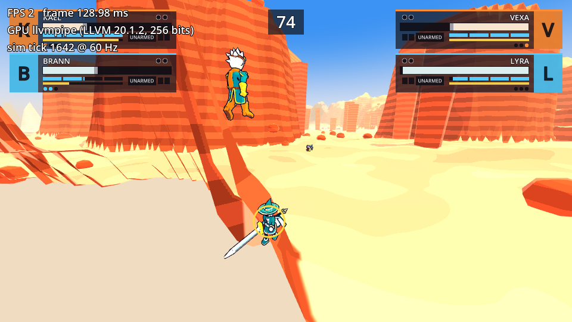
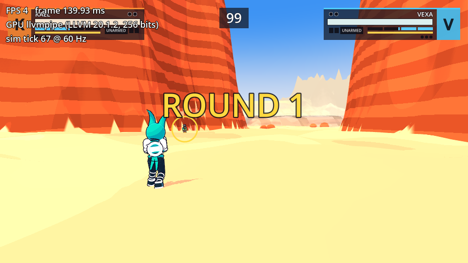
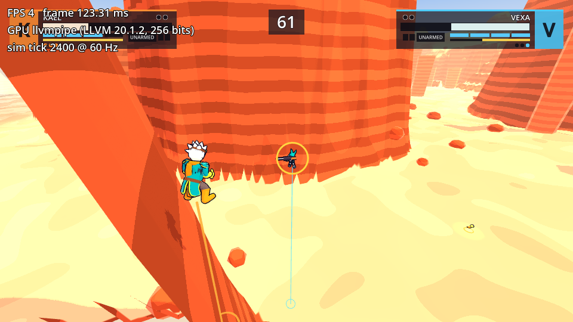
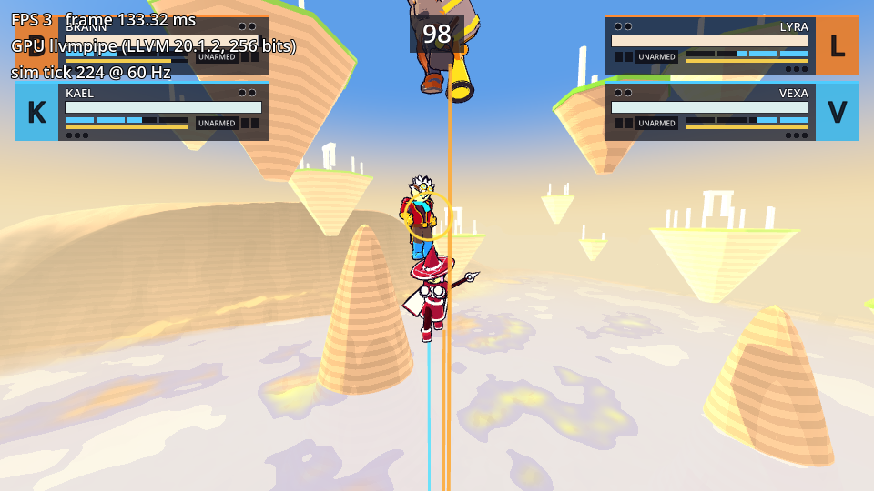
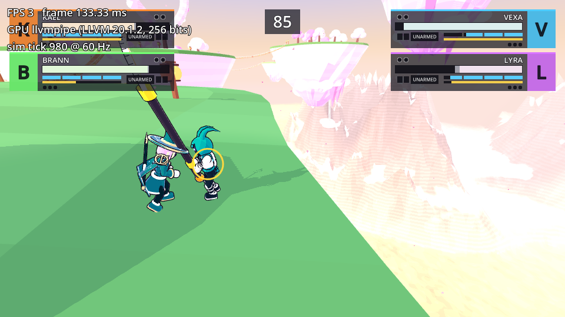
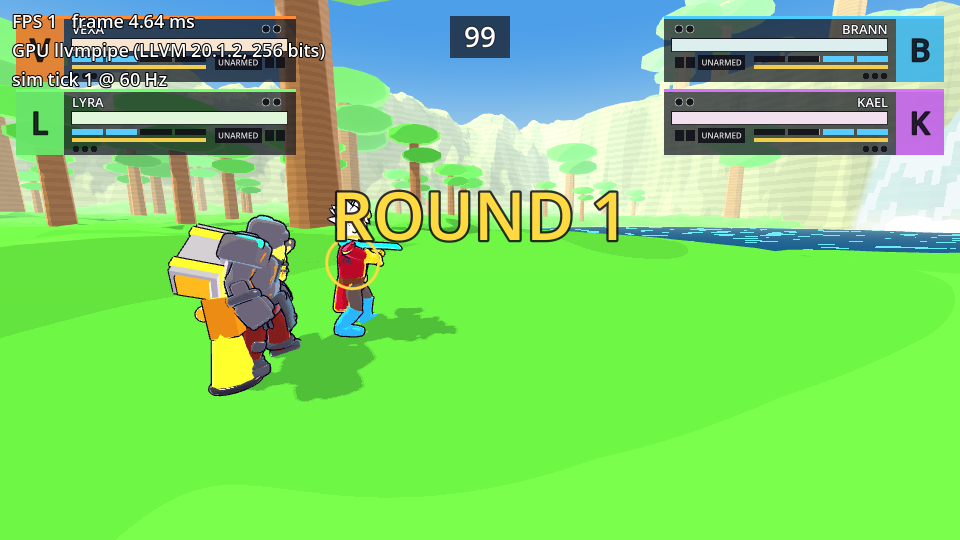
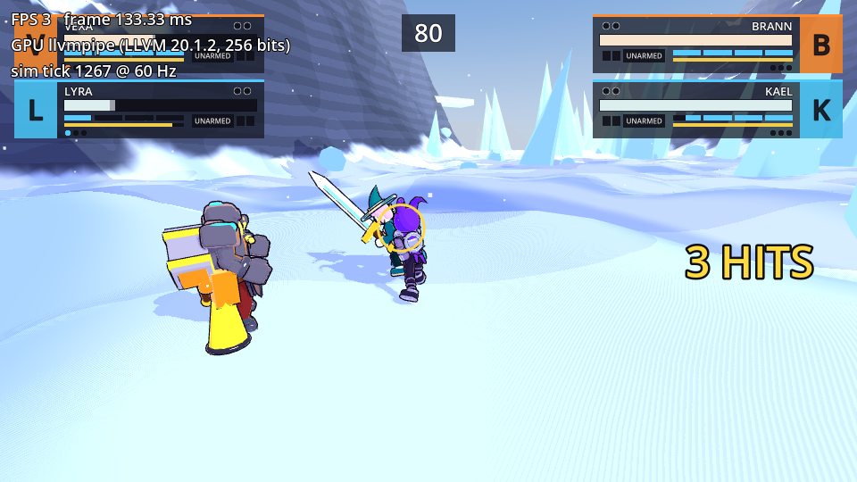
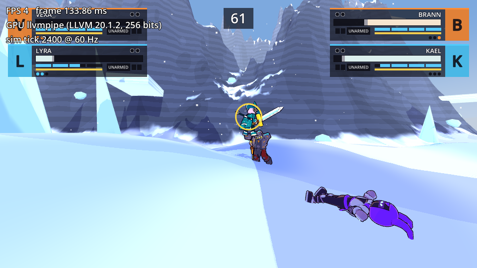
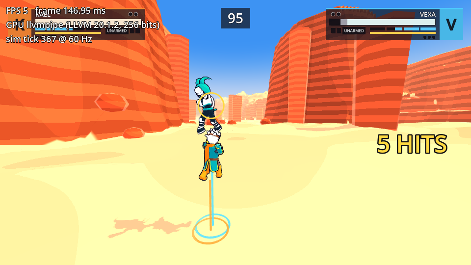
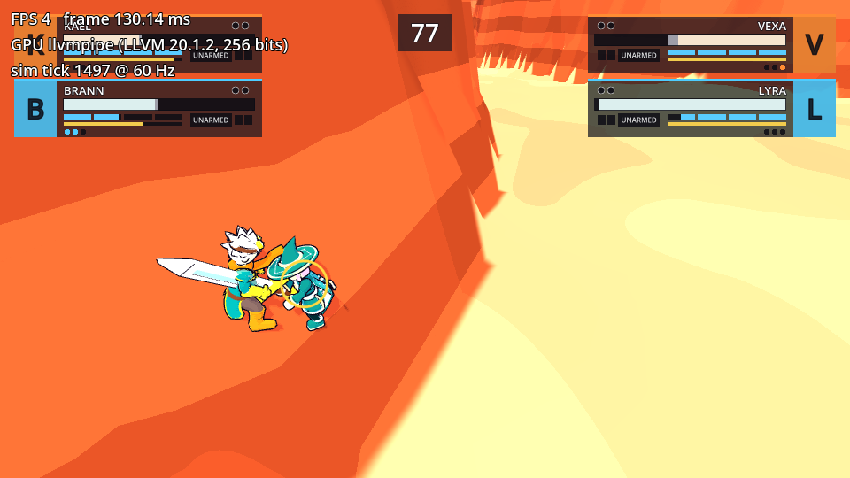

# Gameplay QA report: 06d3c55 (quick)

Matches: 21, ticks: 50400, total wall 369 s. Thresholds are documented in `AGENTS.md` (QA).

| Section | Result |
|---|---|
| Invariant soak (sim) | **FAIL** |
| Invariant soak (view) | **FAIL** |
| Scenario library | **FAIL** |
| Golden replays | **PASS** |
| Visual goldens | **NOT RUN** |
| Feel metrics trend | **FAIL** |

## Invariant soak: sim

| Check | Matches hit | Frames | Note |
|---|---|---|---|
| fighter_overlap | 9 / 21 | 123 |  |
| arena_bounds | 2 / 21 | 2 |  |

## Invariant soak: view

| Check | Matches hit | Frames | Note |
|---|---|---|---|
| pop | 21 / 21 | 3034 |  |
| pop_budget | 21 / 21 | 21 |  |
| foot_ground | 18 / 21 | 2973 |  |

## Top 10 violations

1. **foot_ground**, fighter 0, legend kael, weapon unarmed, zone shattered_mesa, 2v2, seed 114, worst at tick 1642 (first 88, 82 frames): lowest sole -168.8 cm off the visible ground (MOVING, clip walk)  
   `tools/qa/run_qa.sh --repro '114:shattered_mesa:2v2:kael,vexa,brann,lyra:3355' --tick 1642 --fighter 0`

    [2 s clip](2026-11-19-06d3c55-quick/captures/114_shattered_mesa_2v2_kael-vexa-brann-lyra_3355_t1642/clip.mp4)

2. **pop**, fighter 1, legend vexa, weapon unarmed, zone shattered_mesa, 1v1, seed 100, worst at tick 67 (first 67, 171 frames): RightHand turned 2.79 rad in one frame (IDLE, move , clip fight_idle)  
   `tools/qa/run_qa.sh --repro '100:shattered_mesa:1v1:kael,vexa:54' --tick 67 --fighter 1`

    [2 s clip](2026-11-19-06d3c55-quick/captures/100_shattered_mesa_1v1_kael-vexa_54_t67/clip.mp4)

3. **pop_budget**, match, legend -, weapon unarmed, zone shattered_mesa, 1v1, seed 100, worst at tick 2400 (first 2400, 1 frames): 187 pops in 1.3 fighter-minutes (budget 2.0/min)  
   `tools/qa/run_qa.sh --repro '100:shattered_mesa:1v1:kael,vexa:54' --tick 2400 --fighter 0`

    [2 s clip](2026-11-19-06d3c55-quick/captures/100_shattered_mesa_1v1_kael-vexa_54_t2400/clip.mp4)

4. **fighter_overlap**, fighter 1, legend lyra, weapon unarmed, zone skyhold_ruins, 2v2, seed 108, worst at tick 224 (first 219, 30 frames): fighters 1 and 2 overlap 0.16 m (ATTACKING vs BLOCKSTUN)  
   `tools/qa/run_qa.sh --repro '108:skyhold_ruins:2v2:brann,lyra,kael,vexa:5343' --tick 224 --fighter 1`

    [2 s clip](2026-11-19-06d3c55-quick/captures/108_skyhold_ruins_2v2_brann-lyra-kael-vexa_5343_t224/clip.mp4)

5. **arena_bounds**, fighter 3, legend lyra, weapon unarmed, zone heartbloom_gardens, ffa4, seed 113, worst at tick 980 (first 980, 1 frames): outside the arena at (124.95, 273.59, -137.37) (stand 273.69, GRABBED)  
   `tools/qa/run_qa.sh --repro '113:heartbloom_gardens:ffa4:kael,vexa,brann,lyra:2553' --tick 980 --fighter 3`

    [2 s clip](2026-11-19-06d3c55-quick/captures/113_heartbloom_gardens_ffa4_kael-vexa-brann-lyra_2553_t980/clip.mp4)

6. **foot_ground**, fighter 1, legend brann, weapon unarmed, zone verdant_falls, ffa4, seed 104, worst at tick 1 (first 1, 233 frames): lowest sole -20.4 cm off the visible ground (IDLE, clip fight_idle)  
   `tools/qa/run_qa.sh --repro '104:verdant_falls:ffa4:vexa,brann,lyra,kael:2243' --tick 1 --fighter 1`

    [2 s clip](2026-11-19-06d3c55-quick/captures/104_verdant_falls_ffa4_vexa-brann-lyra-kael_2243_t1/clip.mp4)

7. **pop**, fighter 1, legend brann, weapon unarmed, zone frozen_peaks, 2v2, seed 117, worst at tick 1267 (first 90, 135 frames): RightLowerArm turned 3.14 rad in one frame (MOVING, move , clip fight_idle)  
   `tools/qa/run_qa.sh --repro '117:frozen_peaks:2v2:vexa,brann,lyra,kael:2343' --tick 1267 --fighter 1`

    [2 s clip](2026-11-19-06d3c55-quick/captures/117_frozen_peaks_2v2_vexa-brann-lyra-kael_2343_t1267/clip.mp4)

8. **pop_budget**, match, legend -, weapon unarmed, zone frozen_peaks, 2v2, seed 117, worst at tick 2400 (first 2400, 1 frames): 338 pops in 2.7 fighter-minutes (budget 2.0/min)  
   `tools/qa/run_qa.sh --repro '117:frozen_peaks:2v2:vexa,brann,lyra,kael:2343' --tick 2400 --fighter 0`

    [2 s clip](2026-11-19-06d3c55-quick/captures/117_frozen_peaks_2v2_vexa-brann-lyra-kael_2343_t2400/clip.mp4)

9. **fighter_overlap**, fighter 0, legend kael, weapon unarmed, zone shattered_mesa, 1v1, seed 100, worst at tick 367 (first 362, 21 frames): fighters 0 and 1 overlap 0.17 m (ATTACKING vs ATTACKING)  
   `tools/qa/run_qa.sh --repro '100:shattered_mesa:1v1:kael,vexa:54' --tick 367 --fighter 0`

    [2 s clip](2026-11-19-06d3c55-quick/captures/100_shattered_mesa_1v1_kael-vexa_54_t367/clip.mp4)

10. **arena_bounds**, fighter 0, legend kael, weapon unarmed, zone shattered_mesa, 2v2, seed 114, worst at tick 1497 (first 1497, 1 frames): outside the arena at (484.36, 21.36, 521.88) (stand 21.59, GRABBED)  
   `tools/qa/run_qa.sh --repro '114:shattered_mesa:2v2:kael,vexa,brann,lyra:3355' --tick 1497 --fighter 0`

    [2 s clip](2026-11-19-06d3c55-quick/captures/114_shattered_mesa_2v2_kael-vexa-brann-lyra_3355_t1497/clip.mp4)

## Scenario library

38 tests: 36 passing, 2 failing, 0 pending (strict mode: known issues fail).

- FAIL `test_brann_lands_lights_launcher_air_light_and_spike_as_one_combo`: [5] expected to be >= than [6]:  one unbroken combo, launcher to spike
- FAIL `test_a_knockout_on_a_raised_island_rests_on_the_island_top`: [1.00000000000000000000] expected to equal [7.0] +/- [0.05]:  lies on the island, not inside it

## Golden replays

9 tests, 0 failing.

## Visual goldens

Not run: numpy/Pillow missing.

## Feel metrics

Compared with reports/qa/2026-11-19-bc9aa29-quick/metrics.json; regression = worse by more than 15%.

| Metric | Now | Before | Change |
|---|---|---|---|
| hitstop_consistency | 0.6431 | 0.6261 | +3% |
| pops_per_fighter_minute | 63.58 | 29.26 | +117% **REGRESSION** |
| finger_pops_per_fighter_minute | 42.95 | 28.96 | +48% **REGRESSION** |
| foot_slide_cm_per_frame | 1.07 | 0.6964 | +54% **REGRESSION** |
| foot_error_p95_cm | 8.131 | 9.464 | -14% |
| camera_jerk_p95 | 0.01163 | 0.01345 | -14% |
| locked_on_screen_share | 0.9918 | 0.9799 | +1% |
| sim_ms_per_tick | 0.9171 | 1.776 | -48% |
| view_ms_per_frame | 0.6844 | 1.597 | -57% |

Press to first active frame (ticks at 60 Hz):

| Legend | grab@air | grab@ground | heavy@air | heavy@ground | light@air | light@ground |
|---|---|---|---|---|---|---|
| brann | 10 | 10 | 19 | 19 | 9 | 9 |
| kael | 8 | 8 | 15 | 15 | 7 | 7 |
| lyra | 9 | 9 | 16 | 16 | 7 | 7 |
| vexa | 7 | 7 | 12 | 12 | 5 | 5 |

