# Gameplay QA report: 2c0894e (quick)

Matches: 21, ticks: 50400, total wall 462 s. Thresholds are documented in `AGENTS.md` (QA).

| Section | Result |
|---|---|
| Invariant soak (sim) | **FAIL** |
| Invariant soak (view) | **FAIL** |
| Scenario library | **FAIL** |
| Golden replays | **PASS** |
| Visual goldens | **FAIL** |
| Feel metrics trend | **FAIL** |

## Invariant soak: sim

| Check | Matches hit | Frames | Note |
|---|---|---|---|
| fighter_overlap | 7 / 21 | 186 |  |
| arena_bounds | 3 / 21 | 4 |  |

## Invariant soak: view

| Check | Matches hit | Frames | Note |
|---|---|---|---|
| pop | 21 / 21 | 2942 |  |
| pop_budget | 21 / 21 | 21 |  |
| foot_ground | 18 / 21 | 3418 |  |
| bow_string_head | 2 / 21 | 3 |  |
| camera_cover | 2 / 21 | 6 |  |

## Top 10 violations

1. **foot_ground**, fighter 0, legend brann, weapon unarmed, zone verdant_falls, 1v1, seed 118, worst at tick 1553 (first 1, 268 frames): lowest sole -20.9 cm off the visible ground (IDLE, clip fight_idle)  
   `tools/qa/run_qa.sh --repro '118:verdant_falls:1v1:brann,lyra:24' --tick 1553 --fighter 0`

   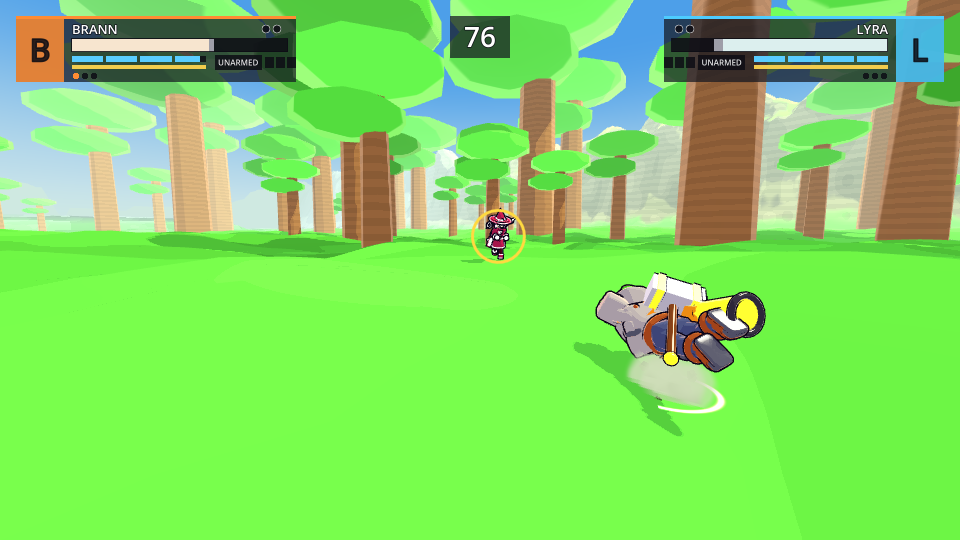 [2 s clip](2026-11-19-2c0894e-quick/captures/118_verdant_falls_1v1_brann-lyra_24_t1553/clip.mp4)

2. **pop**, fighter 0, legend lyra, weapon unarmed, zone verdant_falls, 2v2, seed 111, worst at tick 85 (first 85, 250 frames): RightHand turned 2.78 rad in one frame (IDLE, move , clip fight_idle)  
   `tools/qa/run_qa.sh --repro '111:verdant_falls:2v2:lyra,kael,vexa,brann:4432' --tick 85 --fighter 0`

   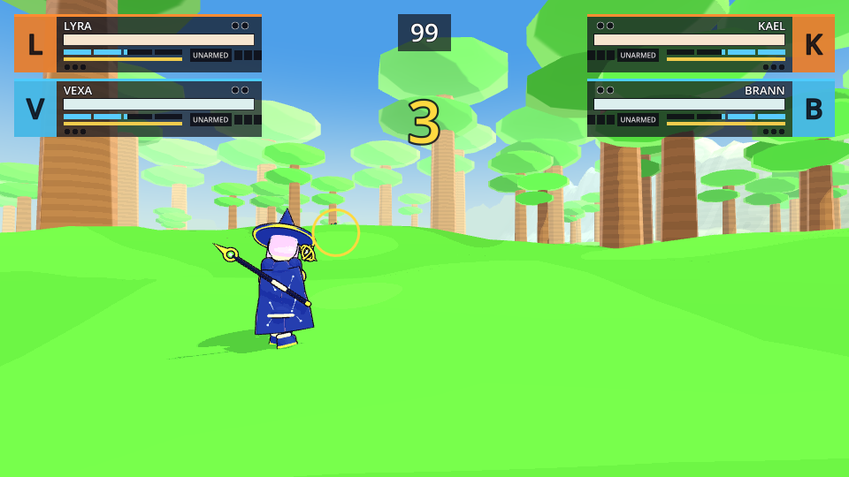 [2 s clip](2026-11-19-2c0894e-quick/captures/111_verdant_falls_2v2_lyra-kael-vexa-brann_4432_t85/clip.mp4)

3. **fighter_overlap**, fighter 1, legend lyra, weapon unarmed, zone skyhold_ruins, 2v2, seed 108, worst at tick 254 (first 249, 75 frames): fighters 1 and 2 overlap 0.16 m (ATTACKING vs BLOCKSTUN)  
   `tools/qa/run_qa.sh --repro '108:skyhold_ruins:2v2:brann,lyra,kael,vexa:5343' --tick 254 --fighter 1`

   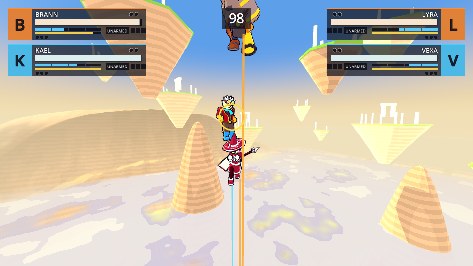 [2 s clip](2026-11-19-2c0894e-quick/captures/108_skyhold_ruins_2v2_brann-lyra-kael-vexa_5343_t254/clip.mp4)

4. **pop_budget**, match, legend -, weapon unarmed, zone verdant_falls, 2v2, seed 111, worst at tick 2400 (first 2400, 1 frames): 412 pops in 2.7 fighter-minutes (budget 2.0/min)  
   `tools/qa/run_qa.sh --repro '111:verdant_falls:2v2:lyra,kael,vexa,brann:4432' --tick 2400 --fighter 0`

   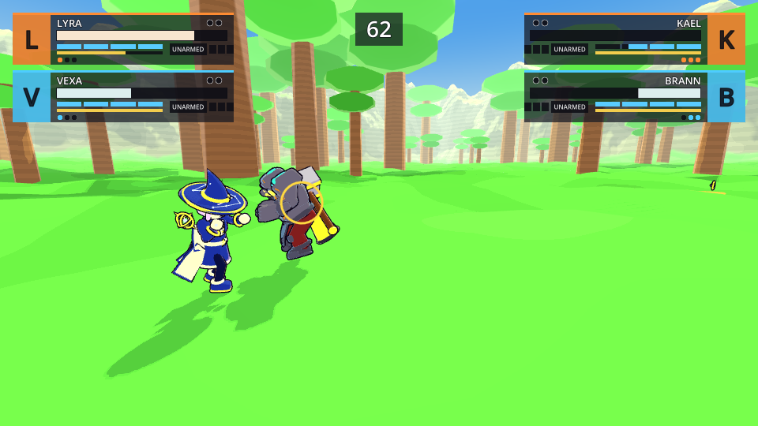 [2 s clip](2026-11-19-2c0894e-quick/captures/111_verdant_falls_2v2_lyra-kael-vexa-brann_4432_t2400/clip.mp4)

5. **camera_cover**, fighter 1, legend brann, weapon unarmed, zone stormfall_city, ffa4, seed 116, worst at tick 2169 (first 2167, 3 frames): fighter 1 covers 100% of the screen  
   `tools/qa/run_qa.sh --repro '116:stormfall_city:ffa4:vexa,brann,lyra,kael:5333' --tick 2169 --fighter 1`

   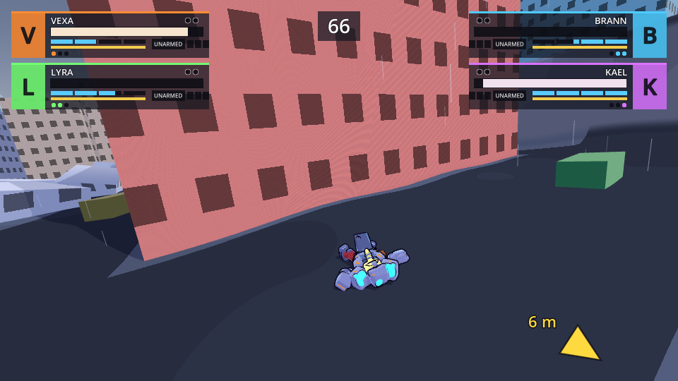 [2 s clip](2026-11-19-2c0894e-quick/captures/116_stormfall_city_ffa4_vexa-brann-lyra-kael_5333_t2169/clip.mp4)

6. **arena_bounds**, fighter 1, legend kael, weapon unarmed, zone verdant_falls, 2v2, seed 111, worst at tick 1621 (first 1547, 2 frames): outside the arena at (-651.96, 5.85, 609.33) (stand 5.91, GRABBED)  
   `tools/qa/run_qa.sh --repro '111:verdant_falls:2v2:lyra,kael,vexa,brann:4432' --tick 1621 --fighter 1`

   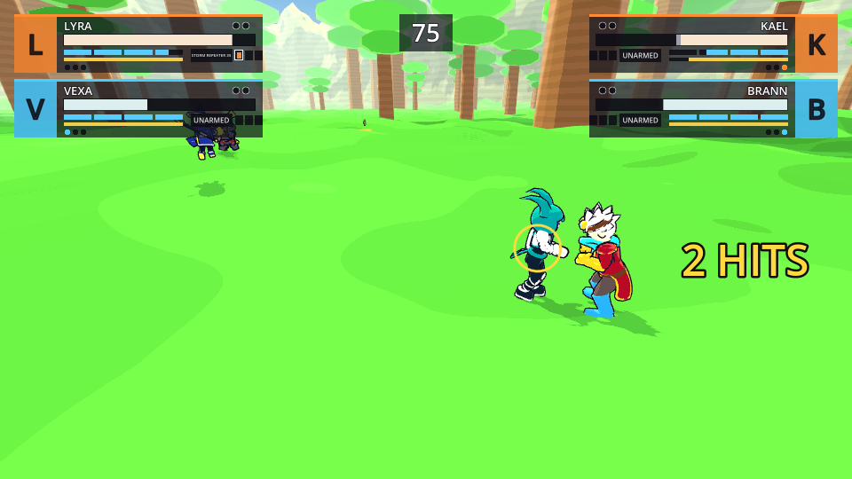 [2 s clip](2026-11-19-2c0894e-quick/captures/111_verdant_falls_2v2_lyra-kael-vexa-brann_4432_t1621/clip.mp4)

7. **bow_string_head**, fighter 2, legend lyra, weapon bow, zone verdant_falls, ffa4, seed 104, worst at tick 2055 (first 2055, 2 frames): bow string 7.2 cm from the head centre (draw 0, FLYING)  
   `tools/qa/run_qa.sh --repro '104:verdant_falls:ffa4:vexa,brann,lyra,kael:2243' --tick 2055 --fighter 2`

   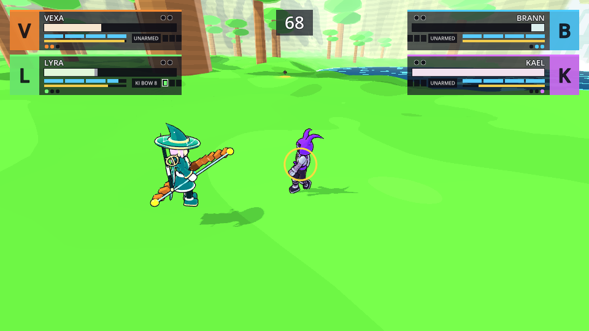 [2 s clip](2026-11-19-2c0894e-quick/captures/104_verdant_falls_ffa4_vexa-brann-lyra-kael_2243_t2055/clip.mp4)

8. **foot_ground**, fighter 2, legend brann, weapon unarmed, zone shattered_mesa, 2v2, seed 114, worst at tick 1066 (first 1, 292 frames): lowest sole -16.8 cm off the visible ground (IDLE, clip fight_idle)  
   `tools/qa/run_qa.sh --repro '114:shattered_mesa:2v2:kael,vexa,brann,lyra:3355' --tick 1066 --fighter 2`

   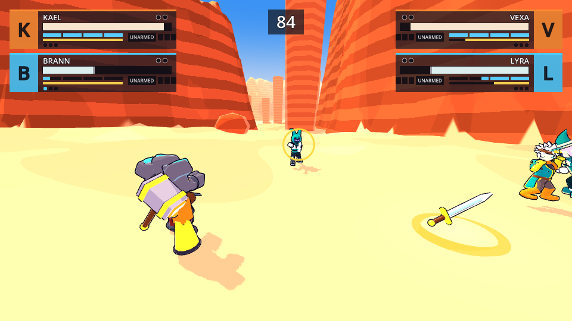 [2 s clip](2026-11-19-2c0894e-quick/captures/114_shattered_mesa_2v2_kael-vexa-brann-lyra_3355_t1066/clip.mp4)

9. **pop**, fighter 0, legend kael, weapon unarmed, zone shattered_mesa, 1v1, seed 100, worst at tick 76 (first 76, 131 frames): RightHand turned 2.78 rad in one frame (IDLE, move , clip fight_idle)  
   `tools/qa/run_qa.sh --repro '100:shattered_mesa:1v1:kael,vexa:54' --tick 76 --fighter 0`

   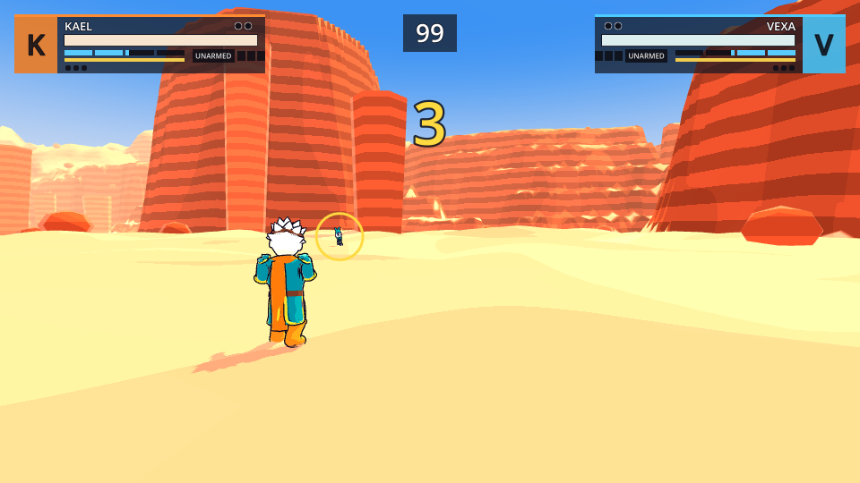 [2 s clip](2026-11-19-2c0894e-quick/captures/100_shattered_mesa_1v1_kael-vexa_54_t76/clip.mp4)

10. **fighter_overlap**, fighter 1, legend vexa, weapon unarmed, zone skyhold_ruins, ffa4, seed 101, worst at tick 1760 (first 252, 35 frames): fighters 1 and 3 overlap 0.15 m (FLYING vs ATTACKING)  
   `tools/qa/run_qa.sh --repro '101:skyhold_ruins:ffa4:kael,vexa,brann,lyra:4235' --tick 1760 --fighter 1`

   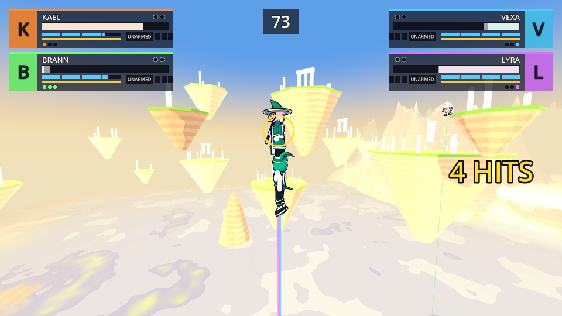 [2 s clip](2026-11-19-2c0894e-quick/captures/101_skyhold_ruins_ffa4_kael-vexa-brann-lyra_4235_t1760/clip.mp4)

## Scenario library

38 tests: 36 passing, 2 failing, 0 pending (strict mode: known issues fail).

- FAIL `test_brann_lands_lights_launcher_air_light_and_spike_as_one_combo`: [5] expected to be >= than [6]:  one unbroken combo, launcher to spike
- FAIL `test_a_knockout_on_a_raised_island_rests_on_the_island_top`: [1.00000000000000000000] expected to equal [7.0] +/- [0.05]:  lies on the island, not inside it

## Golden replays

9 tests, 0 failing.

## Visual goldens

SSIM floor 0.90, tile 32px changes above 12/255, fail above 5% of tiles.

| Shot | Result | SSIM | Changed tiles |
|---|---|---|---|
| heartbloom_brann_idle.png | PASS | 0.997 | 1.7% |
| heartbloom_brann_light.png | PASS | 0.996 | 1.0% |
| heartbloom_kael_idle.png | PASS | 0.997 | 0.2% |
| heartbloom_kael_light.png | PASS | 0.998 | 0.2% |
| heartbloom_lyra_idle.png | PASS | 0.998 | 0.2% |
| heartbloom_lyra_light.png | PASS | 0.997 | 0.6% |
| heartbloom_vexa_idle.png | PASS | 0.998 | 0.4% |
| heartbloom_vexa_light.png | PASS | 0.998 | 0.4% |
| zone_ember_rift.png | FAIL | 0.886 | 34.6% |

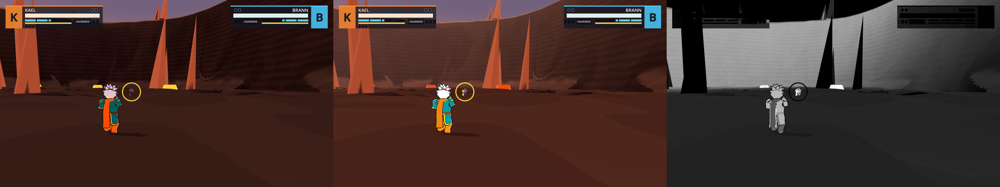

| zone_frozen_peaks.png | FAIL | 0.945 | 80.2% |

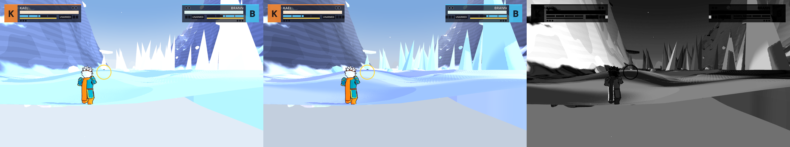

| zone_shattered_mesa.png | FAIL | 0.981 | 17.9% |

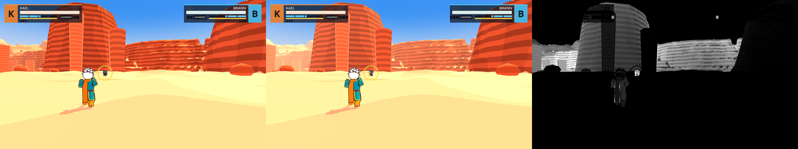

| zone_skyhold_ruins.png | FAIL | 0.843 | 44.6% |

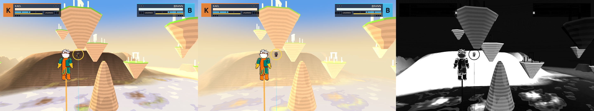

| zone_stormfall_city.png | FAIL | 0.984 | 6.5% |

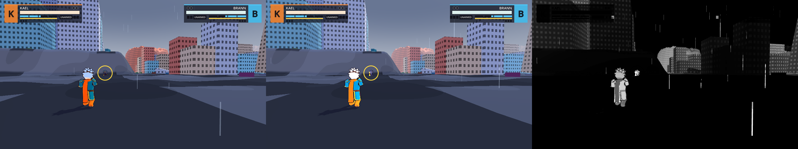

| zone_verdant_falls.png | FAIL | 0.949 | 20.0% |

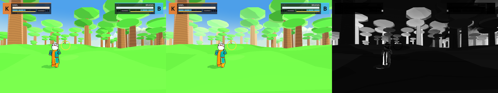

## Feel metrics

Compared with reports/qa/2026-11-19-06d3c55-quick/metrics.json; regression = worse by more than 15%.

| Metric | Now | Before | Change |
|---|---|---|---|
| hitstop_consistency | 0.669 | 0.6431 | +4% |
| pops_per_fighter_minute | 61.53 | 63.58 | -3% |
| finger_pops_per_fighter_minute | 39.12 | 42.95 | -9% |
| foot_slide_cm_per_frame | 1.112 | 1.07 | +4% |
| foot_error_p95_cm | 7.748 | 8.131 | -5% |
| camera_jerk_p95 | 0.01173 | 0.01163 | +1% |
| locked_on_screen_share | 0.9936 | 0.9918 | +0% |
| sim_ms_per_tick | 1.563 | 0.9171 | +70% **REGRESSION** |
| view_ms_per_frame | 1.116 | 0.6844 | +63% **REGRESSION** |

Press to first active frame (ticks at 60 Hz):

| Legend | grab@air | grab@ground | heavy@air | heavy@ground | light@air | light@ground |
|---|---|---|---|---|---|---|
| brann | 10 | 10 | 19 | 19 | 9 | 9 |
| kael | 8 | 8 | 15 | 15 | 7 | 7 |
| lyra | 9 | 9 | 16 | 16 | 7 | 7 |
| vexa | 7 | 7 | 12 | 12 | 5 | 5 |

