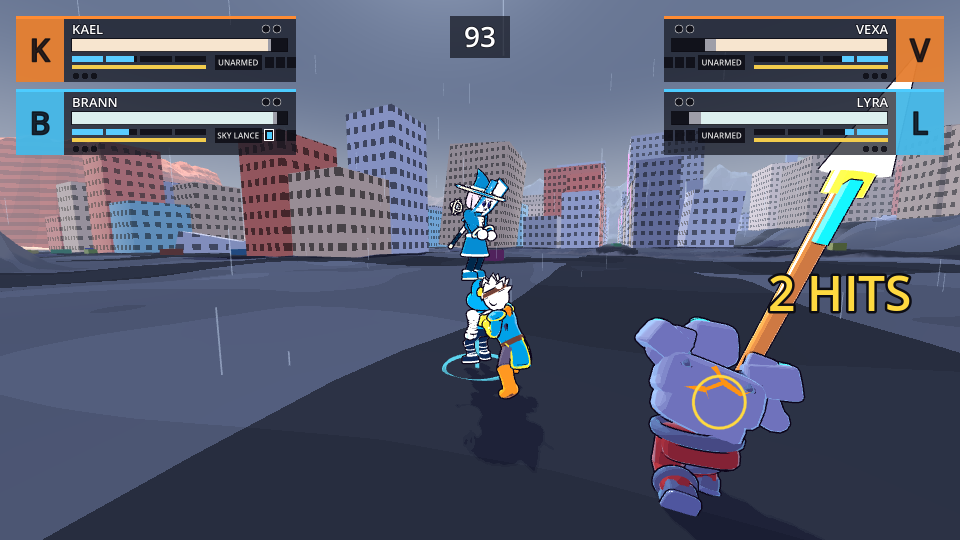
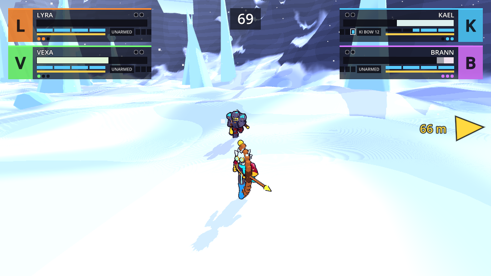
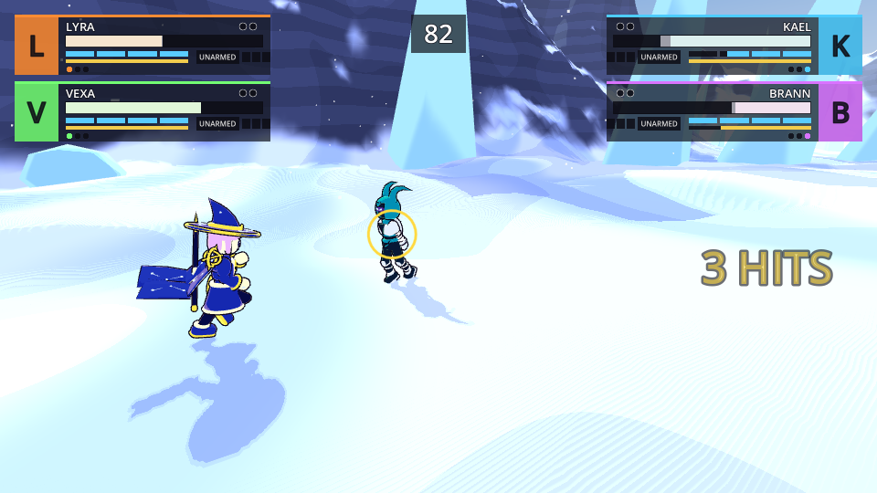
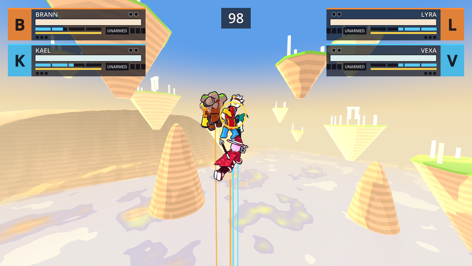
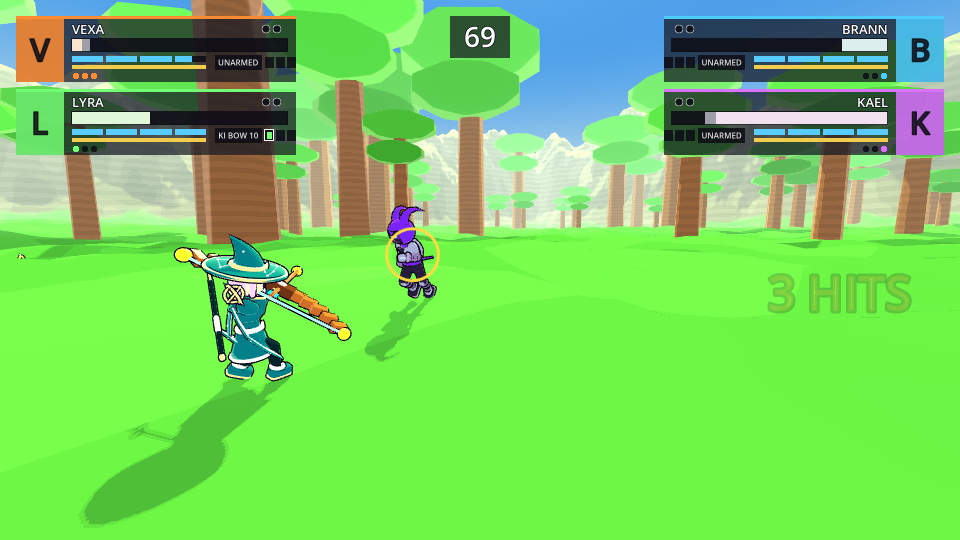
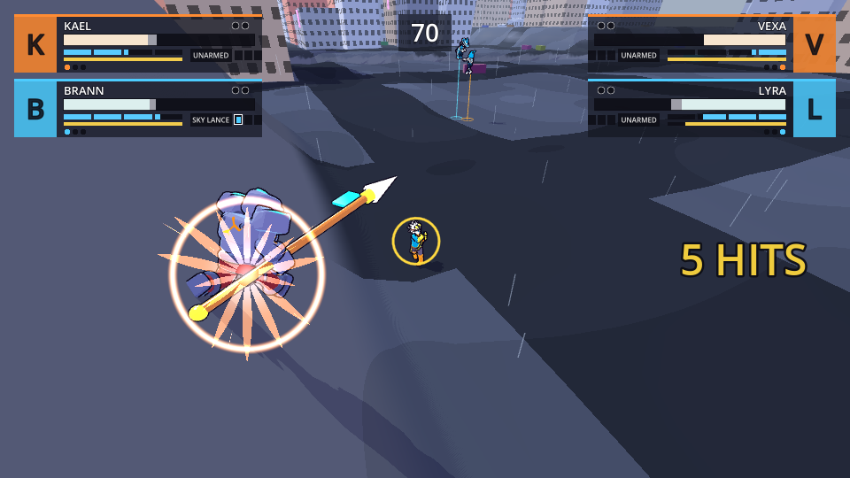
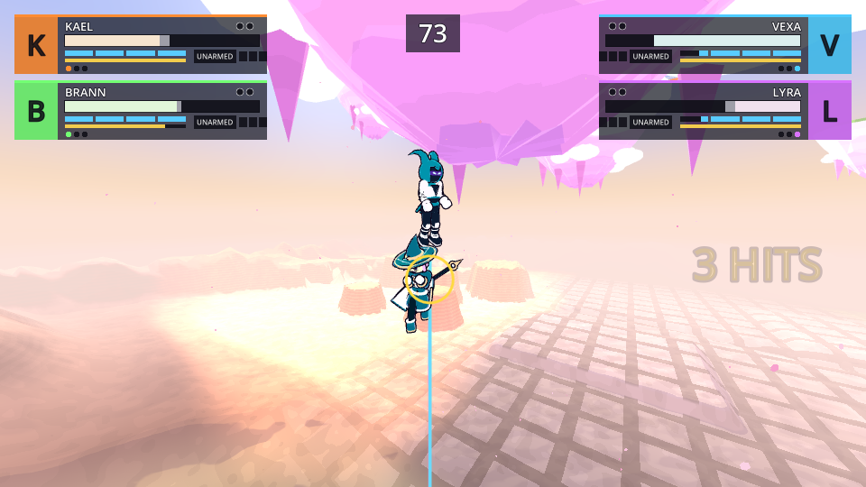
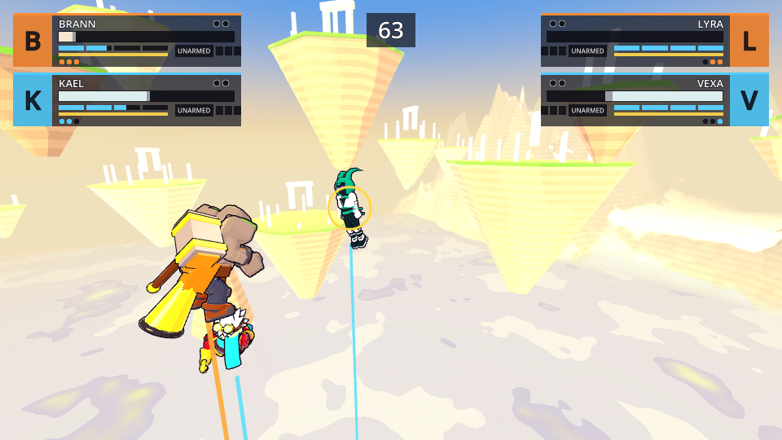
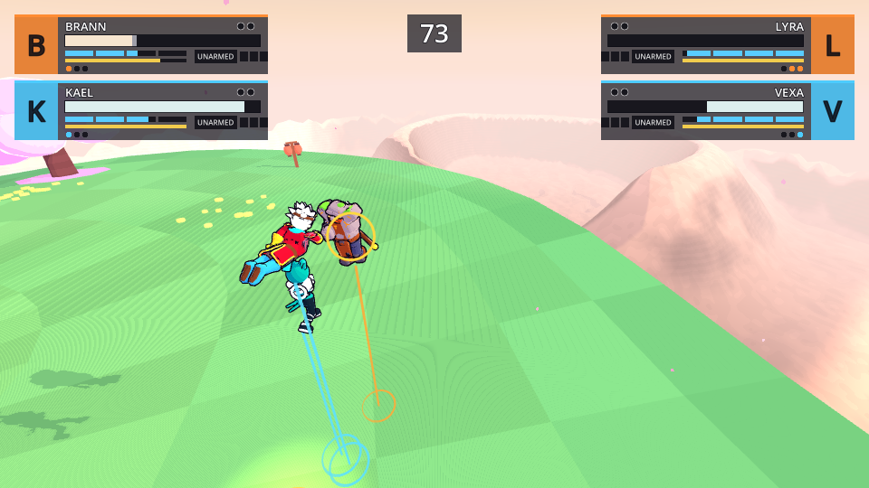
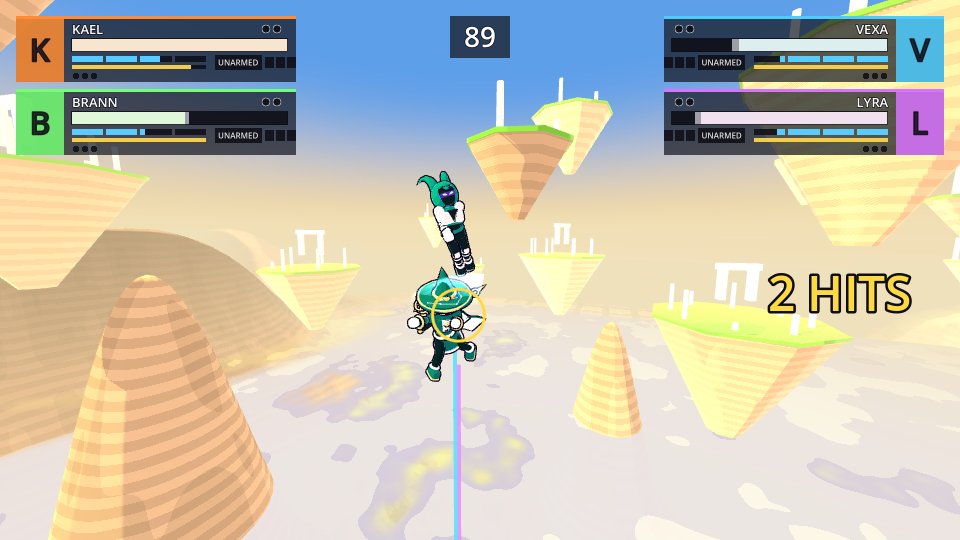

# Gameplay QA report: 93ca66b (quick)

Matches: 21, ticks: 50400, total wall 364 s. Thresholds are documented in `AGENTS.md` (QA).

| Section | Result |
|---|---|
| Invariant soak (sim) | **FAIL** |
| Invariant soak (view) | **FAIL** |
| Scenario library | **PASS** |
| Golden replays | **PASS** |
| Visual goldens | **PASS** |
| Feel metrics trend | **PASS** |

## Invariant soak: sim

| Check | Matches hit | Frames | Note |
|---|---|---|---|
| fighter_overlap | 5 / 21 | 128 |  |

## Invariant soak: view

| Check | Matches hit | Frames | Note |
|---|---|---|---|
| foot_ground | 2 / 21 | 3 |  |
| bow_string_head | 2 / 21 | 21 |  |

## Top 10 violations

1. **fighter_overlap**, fighter 1, legend vexa, weapon unarmed, zone stormfall_city, 2v2, seed 102, worst at tick 546 (first 480, 70 frames): fighters 1 and 3 overlap 0.15 m (HITSTUN vs BLOCKING)  
   `tools/qa/run_qa.sh --repro '102:stormfall_city:2v2:kael,vexa,brann,lyra:4455' --tick 546 --fighter 1`

    [2 s clip](2026-11-19-93ca66b-quick/captures/102_stormfall_city_2v2_kael-vexa-brann-lyra_4455_t546/clip.mp4)

2. **bow_string_head**, fighter 1, legend kael, weapon bow, zone frozen_peaks, ffa4, seed 110, worst at tick 1982 (first 1900, 19 frames): bow string 8.7 cm from the head centre (draw 0, MOVING)  
   `tools/qa/run_qa.sh --repro '110:frozen_peaks:ffa4:lyra,kael,vexa,brann:3523' --tick 1982 --fighter 1`

    [2 s clip](2026-11-19-93ca66b-quick/captures/110_frozen_peaks_ffa4_lyra-kael-vexa-brann_3523_t1982/clip.mp4)

3. **foot_ground**, fighter 0, legend lyra, weapon unarmed, zone frozen_peaks, ffa4, seed 110, worst at tick 1181 (first 1178, 2 frames): lowest sole +6.6 cm off the visible ground (BLOCKING, clip guard)  
   `tools/qa/run_qa.sh --repro '110:frozen_peaks:ffa4:lyra,kael,vexa,brann:3523' --tick 1181 --fighter 0`

    [2 s clip](2026-11-19-93ca66b-quick/captures/110_frozen_peaks_ffa4_lyra-kael-vexa-brann_3523_t1181/clip.mp4)

4. **fighter_overlap**, fighter 1, legend lyra, weapon unarmed, zone skyhold_ruins, 2v2, seed 108, worst at tick 229 (first 225, 17 frames): fighters 1 and 2 overlap 0.17 m (FLYING vs ATTACKING)  
   `tools/qa/run_qa.sh --repro '108:skyhold_ruins:2v2:brann,lyra,kael,vexa:5343' --tick 229 --fighter 1`

    [2 s clip](2026-11-19-93ca66b-quick/captures/108_skyhold_ruins_2v2_brann-lyra-kael-vexa_5343_t229/clip.mp4)

5. **bow_string_head**, fighter 2, legend lyra, weapon bow, zone verdant_falls, ffa4, seed 104, worst at tick 2004 (first 2003, 2 frames): bow string 7.7 cm from the head centre (draw 0, ATTACKING)  
   `tools/qa/run_qa.sh --repro '104:verdant_falls:ffa4:vexa,brann,lyra,kael:2243' --tick 2004 --fighter 2`

    [2 s clip](2026-11-19-93ca66b-quick/captures/104_verdant_falls_ffa4_vexa-brann-lyra-kael_2243_t2004/clip.mp4)

6. **foot_ground**, fighter 2, legend brann, weapon lance, zone stormfall_city, 2v2, seed 102, worst at tick 1902 (first 1902, 1 frames): lowest sole +10.2 cm off the visible ground (IDLE, clip fight_idle)  
   `tools/qa/run_qa.sh --repro '102:stormfall_city:2v2:kael,vexa,brann,lyra:4455' --tick 1902 --fighter 2`

    [2 s clip](2026-11-19-93ca66b-quick/captures/102_stormfall_city_2v2_kael-vexa-brann-lyra_4455_t1902/clip.mp4)

7. **fighter_overlap**, fighter 1, legend vexa, weapon unarmed, zone heartbloom_gardens, ffa4, seed 113, worst at tick 1764 (first 1538, 12 frames): fighters 1 and 3 overlap 0.15 m (FLYING vs ATTACKING)  
   `tools/qa/run_qa.sh --repro '113:heartbloom_gardens:ffa4:kael,vexa,brann,lyra:2553' --tick 1764 --fighter 1`

    [2 s clip](2026-11-19-93ca66b-quick/captures/113_heartbloom_gardens_ffa4_kael-vexa-brann-lyra_2553_t1764/clip.mp4)

8. **fighter_overlap**, fighter 0, legend brann, weapon unarmed, zone skyhold_ruins, 2v2, seed 108, worst at tick 2349 (first 199, 10 frames): fighters 0 and 2 overlap 0.12 m (FLYING vs FLYING)  
   `tools/qa/run_qa.sh --repro '108:skyhold_ruins:2v2:brann,lyra,kael,vexa:5343' --tick 2349 --fighter 0`

    [2 s clip](2026-11-19-93ca66b-quick/captures/108_skyhold_ruins_2v2_brann-lyra-kael-vexa_5343_t2349/clip.mp4)

9. **fighter_overlap**, fighter 2, legend kael, weapon unarmed, zone heartbloom_gardens, 2v2, seed 120, worst at tick 1754 (first 1751, 7 frames): fighters 2 and 3 overlap 0.15 m (FLYING vs ATTACKING)  
   `tools/qa/run_qa.sh --repro '120:heartbloom_gardens:2v2:brann,lyra,kael,vexa:5245' --tick 1754 --fighter 2`

    [2 s clip](2026-11-19-93ca66b-quick/captures/120_heartbloom_gardens_2v2_brann-lyra-kael-vexa_5245_t1754/clip.mp4)

10. **fighter_overlap**, fighter 1, legend vexa, weapon unarmed, zone skyhold_ruins, ffa4, seed 101, worst at tick 754 (first 252, 5 frames): fighters 1 and 3 overlap 0.14 m (FLYING vs ATTACKING)  
   `tools/qa/run_qa.sh --repro '101:skyhold_ruins:ffa4:kael,vexa,brann,lyra:4235' --tick 754 --fighter 1`

    [2 s clip](2026-11-19-93ca66b-quick/captures/101_skyhold_ruins_ffa4_kael-vexa-brann-lyra_4235_t754/clip.mp4)

## Scenario library

38 tests: 38 passing, 0 failing, 0 pending (strict mode: known issues fail).

## Golden replays

9 tests, 0 failing.

## Visual goldens

SSIM floor 0.90, tile 32px changes above 12/255, fail above 5% of tiles.

| Shot | Result | SSIM | Changed tiles |
|---|---|---|---|
| heartbloom_brann_idle.png | PASS | 0.980 | 4.2% |
| heartbloom_brann_light.png | PASS | 0.970 | 4.0% |
| heartbloom_kael_idle.png | PASS | 0.989 | 1.9% |
| heartbloom_kael_light.png | PASS | 0.980 | 2.3% |
| heartbloom_lyra_idle.png | PASS | 0.993 | 1.5% |
| heartbloom_lyra_light.png | PASS | 0.971 | 3.1% |
| heartbloom_vexa_idle.png | PASS | 0.988 | 1.9% |
| heartbloom_vexa_light.png | PASS | 0.975 | 2.5% |
| zone_ember_rift.png | PASS | 1.000 | 0.0% |
| zone_frozen_peaks.png | PASS | 1.000 | 0.0% |
| zone_shattered_mesa.png | PASS | 1.000 | 0.0% |
| zone_skyhold_ruins.png | PASS | 0.984 | 0.0% |
| zone_stormfall_city.png | PASS | 0.994 | 0.0% |
| zone_verdant_falls.png | PASS | 1.000 | 0.0% |

## Feel metrics

Compared with reports/qa/2026-11-19-fafc61e-quick/metrics.json; regression = worse by more than 15%.

| Metric | Now | Before | Change |
|---|---|---|---|
| hitstop_consistency | 0.6214 | 0.6955 | -11% |
| pops_per_fighter_minute | 0 | 0 | - |
| finger_pops_per_fighter_minute | 0 | 0 | - |
| foot_slide_cm_per_frame | 0.03253 | 0.0078 | re-baselined (v2) |
| foot_error_p95_cm | 0.855 | 4.627 | -82% |
| camera_jerk_p95 | 0.01163 | 0.01233 | -6% |
| locked_on_screen_share | 0.9948 | 0.9943 | +0% |
| sim_ms_per_tick | 0.8673 | 1.464 | -41% |
| view_ms_per_frame | 0.6524 | 1.1 | -41% |

Press to first active frame (ticks at 60 Hz):

| Legend | grab@air | grab@ground | heavy@air | heavy@ground | light@air | light@ground |
|---|---|---|---|---|---|---|
| brann | 10 | 10 | 19 | 19 | 9 | 9 |
| kael | 8 | 8 | 15 | 15 | 7 | 7 |
| lyra | 9 | 9 | 16 | 16 | 7 | 7 |
| vexa | 7 | 7 | 12 | 12 | 5 | 5 |

