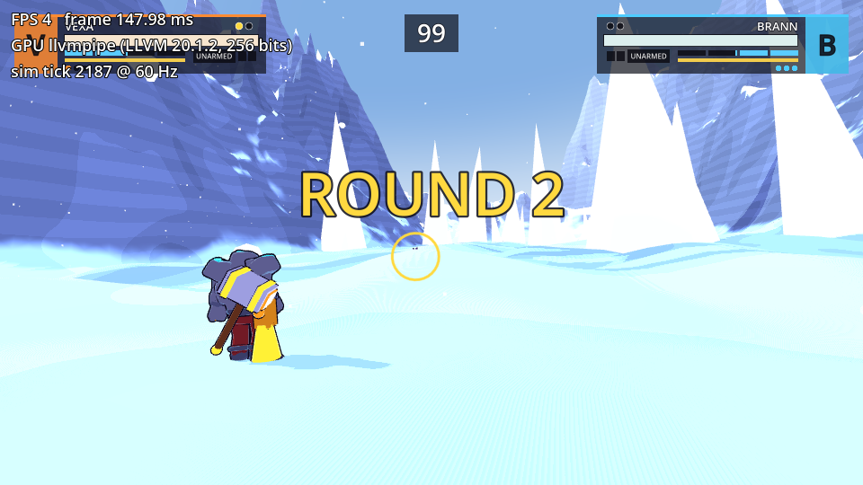
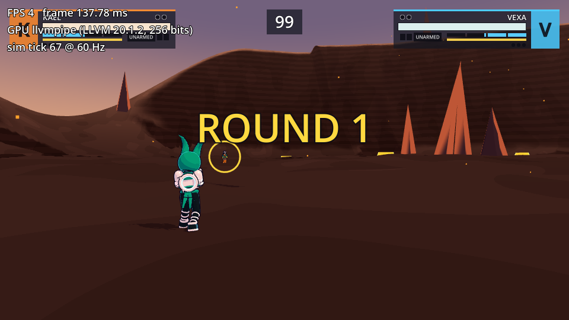
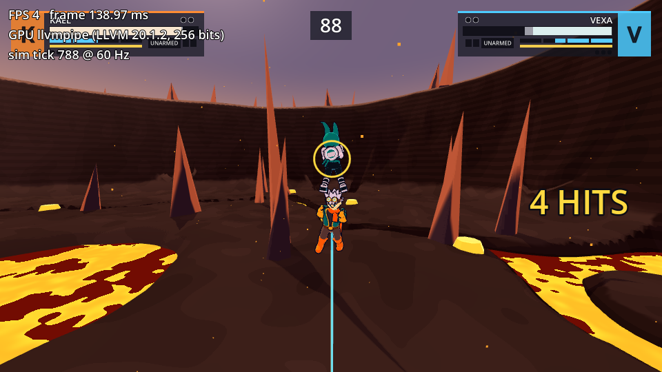
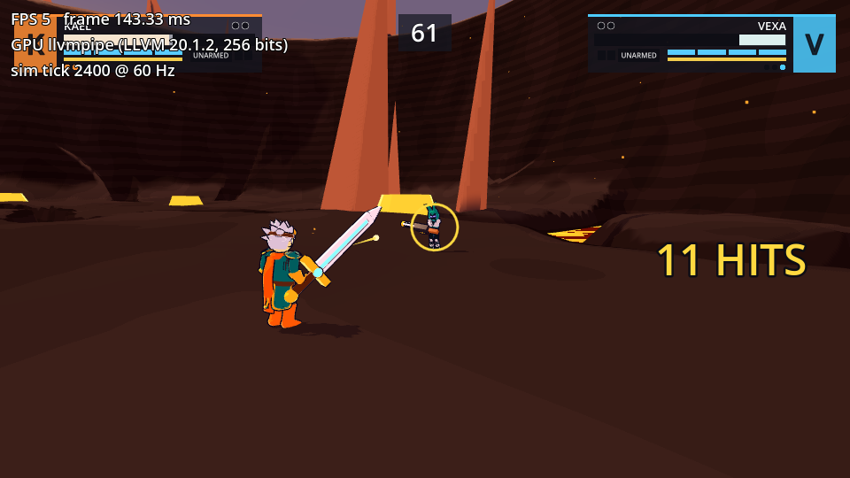
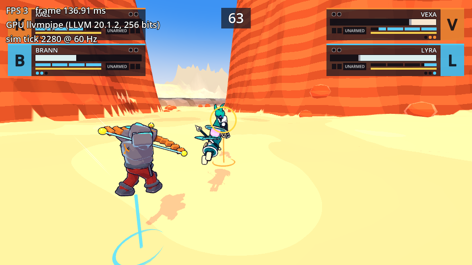
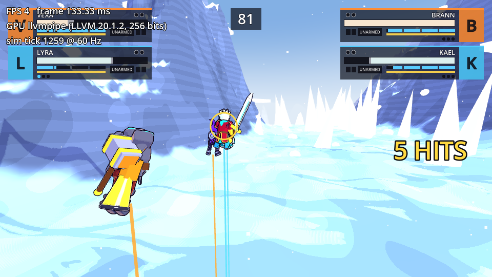
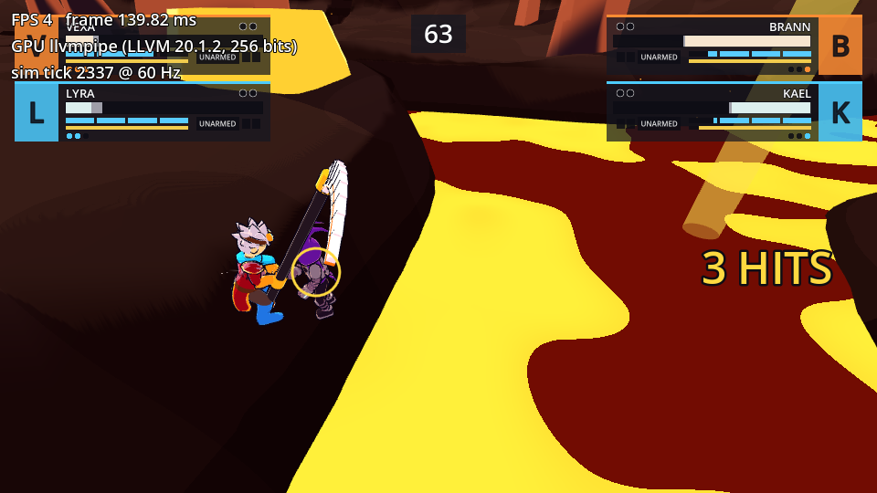
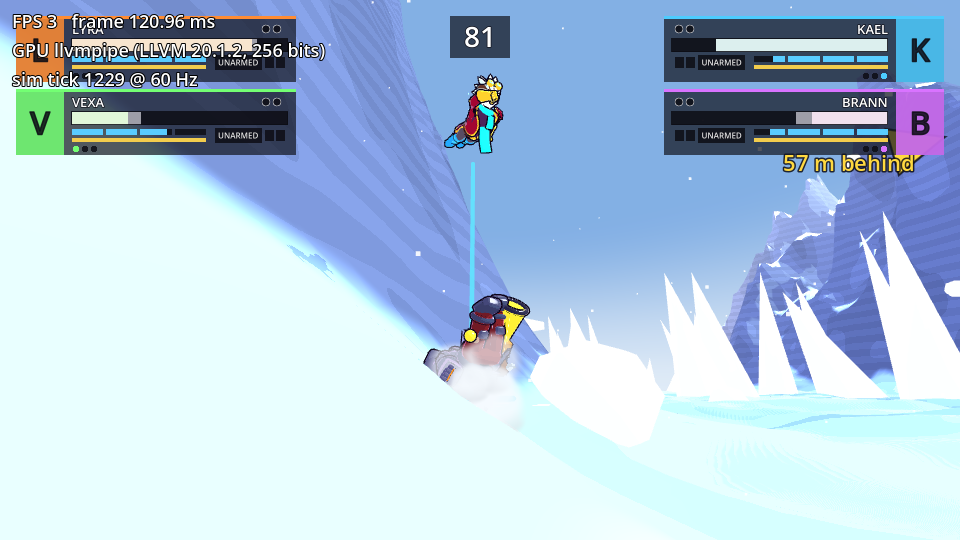
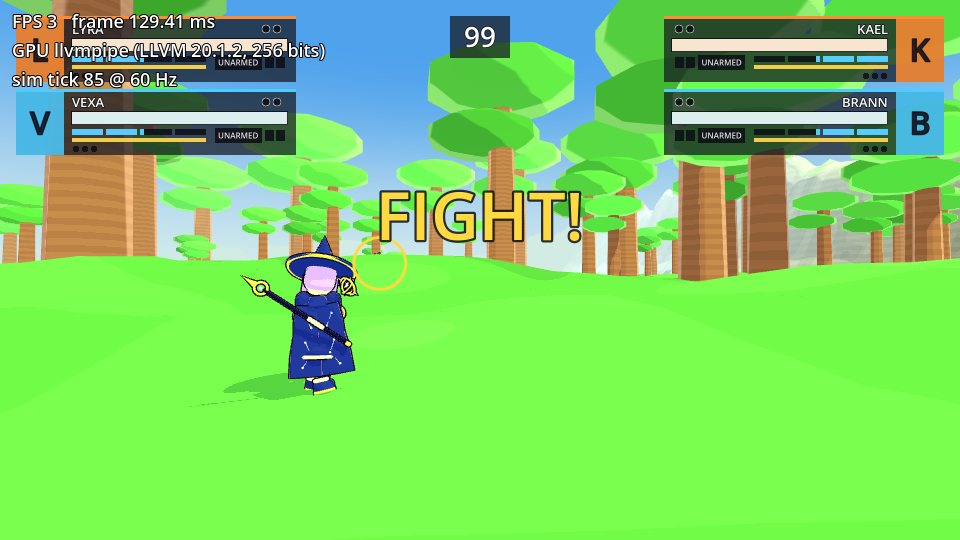
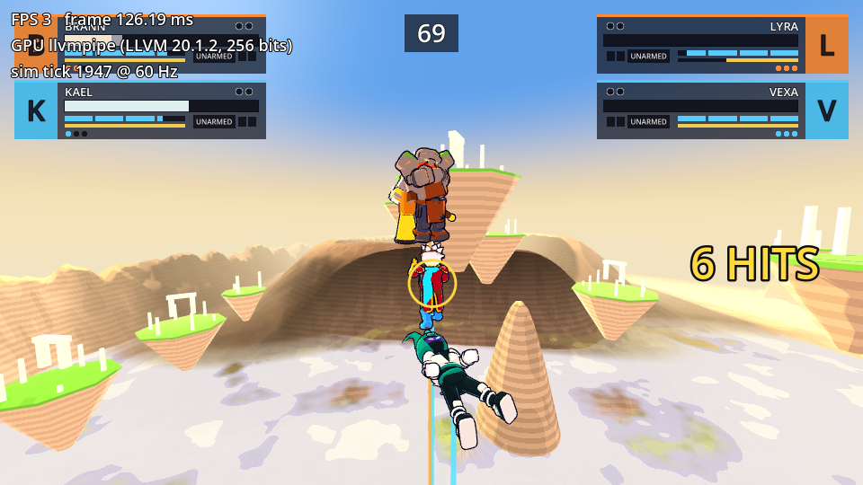

# Gameplay QA report: b09ceec (quick)

Matches: 21, ticks: 50400, total wall 503 s. Thresholds are documented in `AGENTS.md` (QA).

| Section | Result |
|---|---|
| Invariant soak (sim) | **FAIL** |
| Invariant soak (view) | **FAIL** |
| Scenario library | **FAIL** |
| Golden replays | **PASS** |
| Visual goldens | **PASS** |
| Feel metrics trend | **FAIL** |

## Invariant soak: sim

| Check | Matches hit | Frames | Note |
|---|---|---|---|
| fighter_overlap | 19 / 21 | 1556 |  |
| arena_bounds | 1 / 21 | 1 |  |

## Invariant soak: view

| Check | Matches hit | Frames | Note |
|---|---|---|---|
| pop | 21 / 21 | 2162 |  |
| pop_budget | 21 / 21 | 21 |  |
| foot_ground | 18 / 21 | 2229 |  |
| bow_string_head | 1 / 21 | 2 |  |
| camera_cover | 1 / 21 | 1 |  |

## Top 10 violations

1. **foot_ground**, fighter 1, legend brann, weapon unarmed, zone frozen_peaks, 1v1, seed 103, worst at tick 2187 (first 1, 277 frames): lowest sole -9.5 cm off the visible ground (IDLE, clip turn_step)  
   `tools/qa/run_qa.sh --repro '103:frozen_peaks:1v1:vexa,brann:44' --tick 2187 --fighter 1`

    [2 s clip](2026-11-19-b09ceec-quick/captures/103_frozen_peaks_1v1_vexa-brann_44_t2187/clip.mp4)

2. **pop**, fighter 1, legend vexa, weapon unarmed, zone ember_rift, 1v1, seed 112, worst at tick 67 (first 67, 265 frames): RightHand turned 2.79 rad in one frame (IDLE, move , clip fight_idle)  
   `tools/qa/run_qa.sh --repro '112:ember_rift:1v1:kael,vexa:45' --tick 67 --fighter 1`

    [2 s clip](2026-11-19-b09ceec-quick/captures/112_ember_rift_1v1_kael-vexa_45_t67/clip.mp4)

3. **fighter_overlap**, fighter 0, legend kael, weapon unarmed, zone ember_rift, 1v1, seed 112, worst at tick 788 (first 379, 200 frames): fighters 0 and 1 overlap 0.17 m (ATTACKING vs ATTACKING)  
   `tools/qa/run_qa.sh --repro '112:ember_rift:1v1:kael,vexa:45' --tick 788 --fighter 0`

    [2 s clip](2026-11-19-b09ceec-quick/captures/112_ember_rift_1v1_kael-vexa_45_t788/clip.mp4)

4. **pop_budget**, match, legend -, weapon unarmed, zone ember_rift, 1v1, seed 112, worst at tick 2400 (first 2400, 1 frames): 286 pops in 1.3 fighter-minutes (budget 2.0/min)  
   `tools/qa/run_qa.sh --repro '112:ember_rift:1v1:kael,vexa:45' --tick 2400 --fighter 0`

    [2 s clip](2026-11-19-b09ceec-quick/captures/112_ember_rift_1v1_kael-vexa_45_t2400/clip.mp4)

5. **bow_string_head**, fighter 2, legend brann, weapon bow, zone shattered_mesa, 2v2, seed 114, worst at tick 2280 (first 2280, 2 frames): bow string 8.9 cm from the head centre (draw 1, ATTACKING)  
   `tools/qa/run_qa.sh --repro '114:shattered_mesa:2v2:kael,vexa,brann,lyra:3355' --tick 2280 --fighter 2`

    [2 s clip](2026-11-19-b09ceec-quick/captures/114_shattered_mesa_2v2_kael-vexa-brann-lyra_3355_t2280/clip.mp4)

6. **camera_cover**, fighter 1, legend brann, weapon unarmed, zone frozen_peaks, 2v2, seed 117, worst at tick 1259 (first 1259, 1 frames): fighter 1 covers 100% of the screen  
   `tools/qa/run_qa.sh --repro '117:frozen_peaks:2v2:vexa,brann,lyra,kael:2343' --tick 1259 --fighter 1`

    [2 s clip](2026-11-19-b09ceec-quick/captures/117_frozen_peaks_2v2_vexa-brann-lyra-kael_2343_t1259/clip.mp4)

7. **arena_bounds**, fighter 3, legend kael, weapon scythe, zone ember_rift, 2v2, seed 105, worst at tick 2337 (first 2337, 1 frames): outside the arena at (701.55, 34.41, -404.5) (stand 34.70, GRABBED)  
   `tools/qa/run_qa.sh --repro '105:ember_rift:2v2:vexa,brann,lyra,kael:3224' --tick 2337 --fighter 3`

    [2 s clip](2026-11-19-b09ceec-quick/captures/105_ember_rift_2v2_vexa-brann-lyra-kael_3224_t2337/clip.mp4)

8. **foot_ground**, fighter 3, legend brann, weapon unarmed, zone frozen_peaks, ffa4, seed 110, worst at tick 1229 (first 1, 122 frames): lowest sole -32.3 cm off the visible ground (IDLE, clip fight_idle)  
   `tools/qa/run_qa.sh --repro '110:frozen_peaks:ffa4:lyra,kael,vexa,brann:3523' --tick 1229 --fighter 3`

    [2 s clip](2026-11-19-b09ceec-quick/captures/110_frozen_peaks_ffa4_lyra-kael-vexa-brann_3523_t1229/clip.mp4)

9. **pop**, fighter 0, legend lyra, weapon unarmed, zone verdant_falls, 2v2, seed 111, worst at tick 85 (first 85, 161 frames): RightHand turned 2.78 rad in one frame (IDLE, move , clip fight_idle)  
   `tools/qa/run_qa.sh --repro '111:verdant_falls:2v2:lyra,kael,vexa,brann:4432' --tick 85 --fighter 0`

    [2 s clip](2026-11-19-b09ceec-quick/captures/111_verdant_falls_2v2_lyra-kael-vexa-brann_4432_t85/clip.mp4)

10. **fighter_overlap**, fighter 0, legend brann, weapon unarmed, zone skyhold_ruins, 2v2, seed 108, worst at tick 1947 (first 793, 212 frames): fighters 0 and 2 overlap 0.15 m (BLOCKING vs ATTACKING)  
   `tools/qa/run_qa.sh --repro '108:skyhold_ruins:2v2:brann,lyra,kael,vexa:5343' --tick 1947 --fighter 0`

    [2 s clip](2026-11-19-b09ceec-quick/captures/108_skyhold_ruins_2v2_brann-lyra-kael-vexa_5343_t1947/clip.mp4)

## Scenario library

38 tests: 36 passing, 2 failing, 0 pending (strict mode: known issues fail).

- FAIL `test_brann_lands_lights_launcher_air_light_and_spike_as_one_combo`: [5] expected to be >= than [6]:  one unbroken combo, launcher to spike
- FAIL `test_a_knockout_on_a_raised_island_rests_on_the_island_top`: [1.00000000000000000000] expected to equal [7.0] +/- [0.05]:  lies on the island, not inside it

## Golden replays

9 tests, 0 failing.

## Visual goldens

SSIM floor 0.90, tile 32px changes above 12/255, fail above 5% of tiles.

| Shot | Result | SSIM | Changed tiles |
|---|---|---|---|
| heartbloom_brann_idle.png | PASS | 0.999 | 0.0% |
| heartbloom_brann_light.png | PASS | 0.999 | 0.0% |
| heartbloom_kael_idle.png | PASS | 0.998 | 0.2% |
| heartbloom_kael_light.png | PASS | 0.999 | 0.0% |
| heartbloom_lyra_idle.png | PASS | 1.000 | 0.0% |
| heartbloom_lyra_light.png | PASS | 0.997 | 0.0% |
| heartbloom_vexa_idle.png | PASS | 1.000 | 0.0% |
| heartbloom_vexa_light.png | PASS | 1.000 | 0.0% |
| zone_ember_rift.png | PASS | 0.998 | 0.2% |
| zone_frozen_peaks.png | PASS | 0.997 | 0.4% |
| zone_shattered_mesa.png | PASS | 0.999 | 0.4% |
| zone_skyhold_ruins.png | PASS | 0.969 | 1.2% |
| zone_stormfall_city.png | PASS | 0.992 | 0.0% |
| zone_verdant_falls.png | PASS | 0.999 | 0.4% |

## Feel metrics

Compared with reports/qa/2026-11-19-bc9aa29-quick/metrics.json; regression = worse by more than 15%.

| Metric | Now | Before | Change |
|---|---|---|---|
| hitstop_consistency | 0.6555 | 0.6261 | +5% |
| pops_per_fighter_minute | 50.15 | 29.26 | +71% **REGRESSION** |
| finger_pops_per_fighter_minute | 25.53 | 28.96 | -12% |
| foot_slide_cm_per_frame | 1.124 | 0.6964 | +61% **REGRESSION** |
| foot_error_p95_cm | 8.002 | 9.464 | -15% |
| camera_jerk_p95 | 0.01076 | 0.01345 | -20% |
| locked_on_screen_share | 0.9845 | 0.9799 | +0% |
| sim_ms_per_tick | 1.655 | 1.776 | -7% |
| view_ms_per_frame | 1.272 | 1.597 | -20% |

Press to first active frame (ticks at 60 Hz):

| Legend | grab@air | grab@ground | heavy@air | heavy@ground | light@air | light@ground |
|---|---|---|---|---|---|---|
| brann | 10 | 10 | 19 | 19 | 9 | 9 |
| kael | 8 | 8 | 15 | 15 | 7 | 7 |
| lyra | 9 | 9 | 16 | 16 | 7 | 7 |
| vexa | 7 | 7 | 12 | 12 | 5 | 5 |

