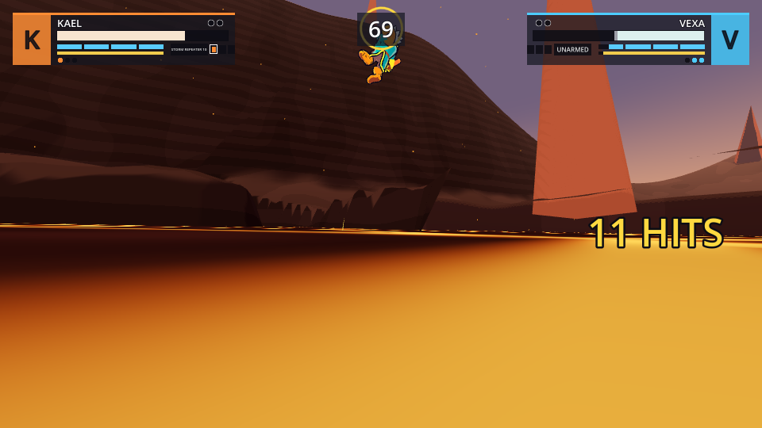
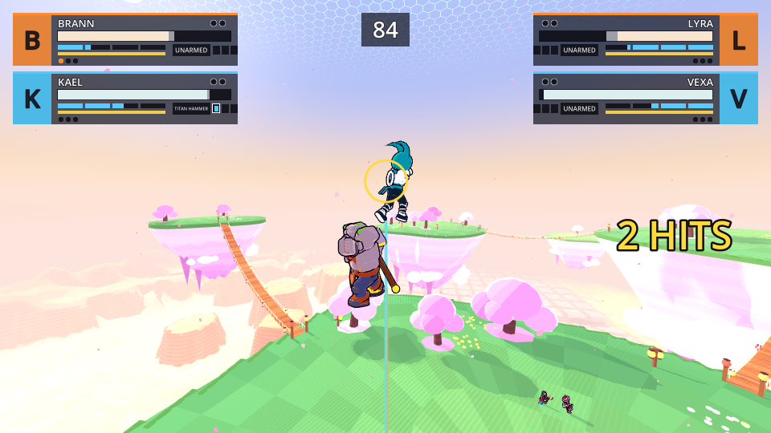
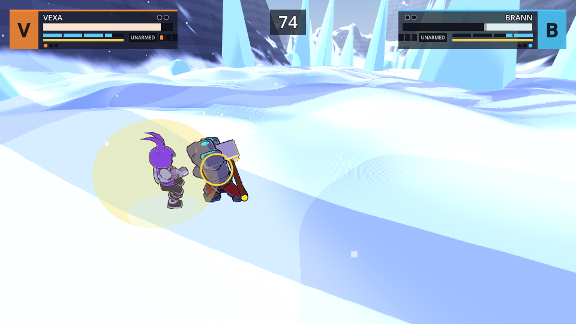
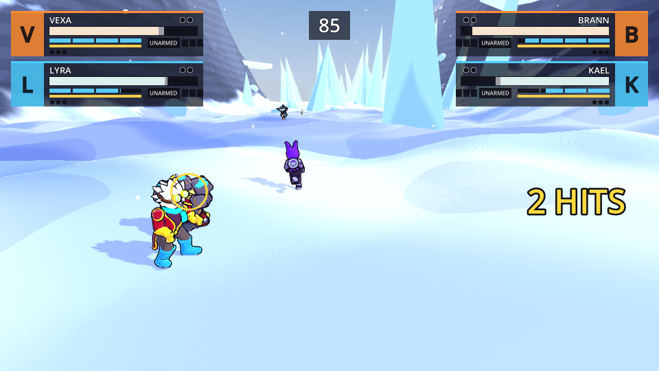
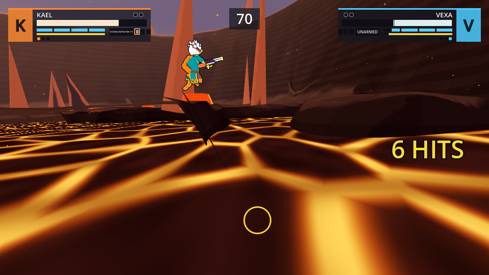
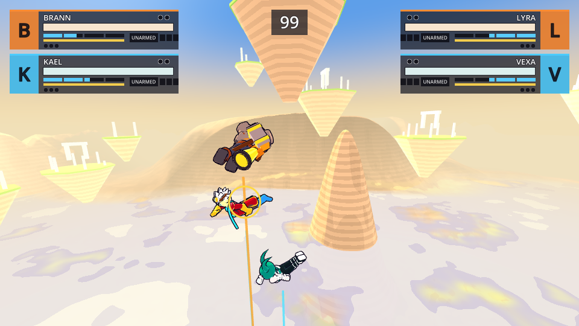
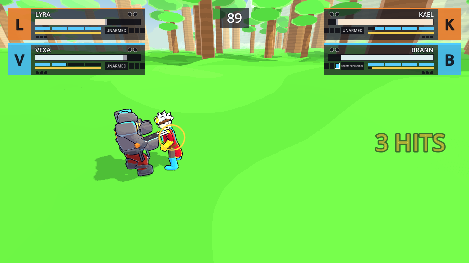
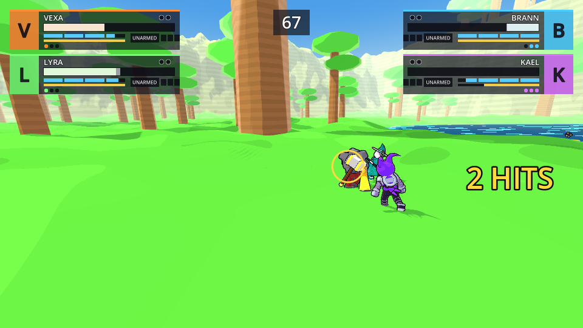
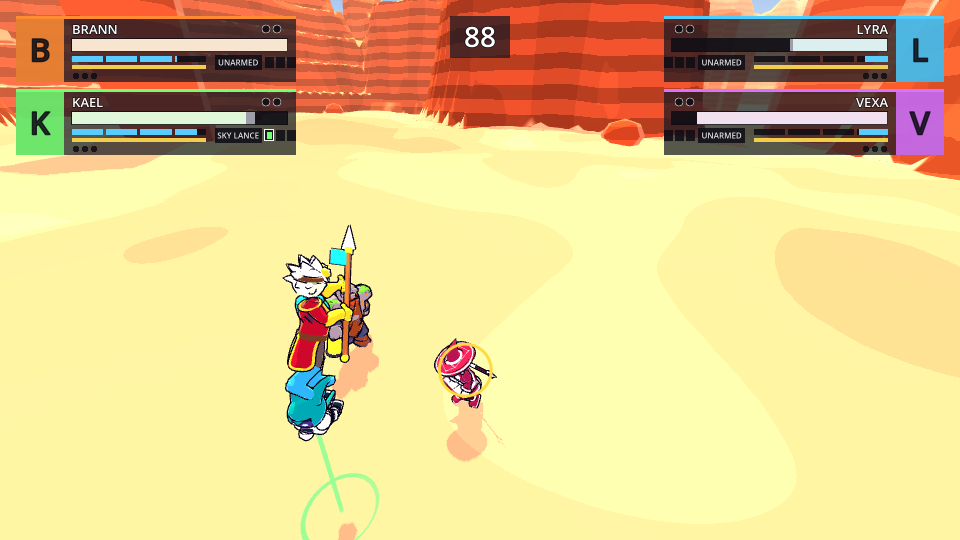
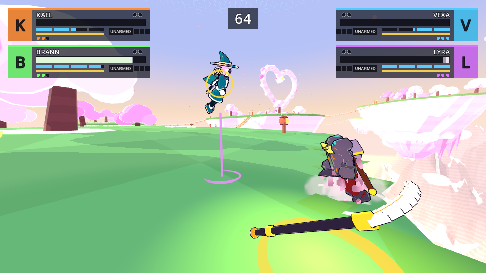

# Gameplay QA report: b181a53 (quick)

Matches: 21, ticks: 50400, total wall 481 s. Thresholds are documented in `AGENTS.md` (QA).

| Section | Result |
|---|---|
| Invariant soak (sim) | **FAIL** |
| Invariant soak (view) | **FAIL** |
| Scenario library | **FAIL** |
| Golden replays | **PASS** |
| Visual goldens | **NOT RUN** |
| Feel metrics trend | **FAIL** |

## Invariant soak: sim

| Check | Matches hit | Frames | Note |
|---|---|---|---|
| fighter_overlap | 7 / 21 | 188 |  |
| arena_bounds | 2 / 21 | 2 |  |

## Invariant soak: view

| Check | Matches hit | Frames | Note |
|---|---|---|---|
| foot_ground | 18 / 21 | 1044 |  |
| camera_cover | 1 / 21 | 1 |  |

## Top 10 violations

1. **foot_ground**, fighter 1, legend vexa, weapon unarmed, zone ember_rift, 1v1, seed 112, worst at tick 1986 (first 126, 26 frames): lowest sole -79.4 cm off the visible ground (BLOCKING, clip guard)  
   `tools/qa/run_qa.sh --repro '112:ember_rift:1v1:kael,vexa:45' --tick 1986 --fighter 1`

    [2 s clip](2026-11-19-b181a53-quick/captures/112_ember_rift_1v1_kael-vexa_45_t1986/clip.mp4)

2. **fighter_overlap**, fighter 0, legend brann, weapon unarmed, zone heartbloom_gardens, 2v2, seed 120, worst at tick 1102 (first 1066, 115 frames): fighters 0 and 3 overlap 0.28 m (ATTACKING vs ATTACKING)  
   `tools/qa/run_qa.sh --repro '120:heartbloom_gardens:2v2:brann,lyra,kael,vexa:5245' --tick 1102 --fighter 0`

    [2 s clip](2026-11-19-b181a53-quick/captures/120_heartbloom_gardens_2v2_brann-lyra-kael-vexa_5245_t1102/clip.mp4)

3. **arena_bounds**, fighter 0, legend vexa, weapon unarmed, zone frozen_peaks, 1v1, seed 103, worst at tick 1687 (first 1687, 1 frames): outside the arena at (-631.15, 73.24, -523.03) (stand 73.34, GRABBED)  
   `tools/qa/run_qa.sh --repro '103:frozen_peaks:1v1:vexa,brann:44' --tick 1687 --fighter 0`

    [2 s clip](2026-11-19-b181a53-quick/captures/103_frozen_peaks_1v1_vexa-brann_44_t1687/clip.mp4)

4. **camera_cover**, fighter 3, legend kael, weapon unarmed, zone frozen_peaks, 2v2, seed 117, worst at tick 1023 (first 1023, 1 frames): fighter 3 covers 91% of the screen  
   `tools/qa/run_qa.sh --repro '117:frozen_peaks:2v2:vexa,brann,lyra,kael:2343' --tick 1023 --fighter 3`

    [2 s clip](2026-11-19-b181a53-quick/captures/117_frozen_peaks_2v2_vexa-brann-lyra-kael_2343_t1023/clip.mp4)

5. **foot_ground**, fighter 0, legend kael, weapon repeater, zone ember_rift, 1v1, seed 112, worst at tick 1935 (first 20, 19 frames): lowest sole +84.7 cm off the visible ground (IDLE, clip fight_idle)  
   `tools/qa/run_qa.sh --repro '112:ember_rift:1v1:kael,vexa:45' --tick 1935 --fighter 0`

    [2 s clip](2026-11-19-b181a53-quick/captures/112_ember_rift_1v1_kael-vexa_45_t1935/clip.mp4)

6. **fighter_overlap**, fighter 0, legend brann, weapon unarmed, zone skyhold_ruins, 2v2, seed 108, worst at tick 202 (first 199, 24 frames): fighters 0 and 2 overlap 0.25 m (ATTACKING vs ATTACKING)  
   `tools/qa/run_qa.sh --repro '108:skyhold_ruins:2v2:brann,lyra,kael,vexa:5343' --tick 202 --fighter 0`

    [2 s clip](2026-11-19-b181a53-quick/captures/108_skyhold_ruins_2v2_brann-lyra-kael-vexa_5343_t202/clip.mp4)

7. **arena_bounds**, fighter 3, legend brann, weapon repeater, zone verdant_falls, 2v2, seed 111, worst at tick 803 (first 803, 1 frames): outside the arena at (-666.95, 5.43, 632.82) (stand 5.58, GRABBED)  
   `tools/qa/run_qa.sh --repro '111:verdant_falls:2v2:lyra,kael,vexa,brann:4432' --tick 803 --fighter 3`

    [2 s clip](2026-11-19-b181a53-quick/captures/111_verdant_falls_2v2_lyra-kael-vexa-brann_4432_t803/clip.mp4)

8. **foot_ground**, fighter 0, legend vexa, weapon unarmed, zone verdant_falls, ffa4, seed 104, worst at tick 2121 (first 343, 43 frames): lowest sole -16.0 cm off the visible ground (MOVING, clip walk_back)  
   `tools/qa/run_qa.sh --repro '104:verdant_falls:ffa4:vexa,brann,lyra,kael:2243' --tick 2121 --fighter 0`

    [2 s clip](2026-11-19-b181a53-quick/captures/104_verdant_falls_ffa4_vexa-brann-lyra-kael_2243_t2121/clip.mp4)

9. **fighter_overlap**, fighter 2, legend kael, weapon lance, zone shattered_mesa, ffa4, seed 107, worst at tick 812 (first 811, 13 frames): fighters 2 and 3 overlap 0.20 m (ATTACKING vs FLYING)  
   `tools/qa/run_qa.sh --repro '107:shattered_mesa:ffa4:brann,lyra,kael,vexa:2445' --tick 812 --fighter 2`

    [2 s clip](2026-11-19-b181a53-quick/captures/107_shattered_mesa_ffa4_brann-lyra-kael-vexa_2445_t812/clip.mp4)

10. **foot_ground**, fighter 2, legend brann, weapon unarmed, zone heartbloom_gardens, ffa4, seed 113, worst at tick 2281 (first 156, 46 frames): lowest sole +19.1 cm off the visible ground (IDLE, clip heavy_land)  
   `tools/qa/run_qa.sh --repro '113:heartbloom_gardens:ffa4:kael,vexa,brann,lyra:2553' --tick 2281 --fighter 2`

    [2 s clip](2026-11-19-b181a53-quick/captures/113_heartbloom_gardens_ffa4_kael-vexa-brann-lyra_2553_t2281/clip.mp4)

## Scenario library

38 tests: 36 passing, 2 failing, 0 pending (strict mode: known issues fail).

- FAIL `test_brann_lands_lights_launcher_air_light_and_spike_as_one_combo`: [3] expected to be >= than [6]:  one unbroken combo, launcher to spike
- FAIL `test_a_knockout_on_a_raised_island_rests_on_the_island_top`: [1.00000000000000000000] expected to equal [7.0] +/- [0.05]:  lies on the island, not inside it

## Golden replays

9 tests, 0 failing.

## Visual goldens

Not run: numpy/Pillow missing.

## Feel metrics

Compared with reports/qa/2026-11-19-fafc61e-quick/metrics.json; regression = worse by more than 15%.

| Metric | Now | Before | Change |
|---|---|---|---|
| hitstop_consistency | 0.6792 | 0.6955 | -2% |
| pops_per_fighter_minute | 0 | 0 | - |
| finger_pops_per_fighter_minute | 0 | 0 | - |
| foot_slide_cm_per_frame | 0.1458 | 0.0078 | +1769% **REGRESSION** |
| foot_error_p95_cm | 8.804 | 4.627 | +90% **REGRESSION** |
| camera_jerk_p95 | 0.01163 | 0.01233 | -6% |
| locked_on_screen_share | 0.9929 | 0.9943 | -0% |
| sim_ms_per_tick | 1.335 | 1.464 | -9% |
| view_ms_per_frame | 1.01 | 1.1 | -8% |

Press to first active frame (ticks at 60 Hz):

| Legend | grab@air | grab@ground | heavy@air | heavy@ground | light@air | light@ground |
|---|---|---|---|---|---|---|
| brann | 10 | 10 | 19 | 19 | 9 | 9 |
| kael | 8 | 8 | 15 | 15 | 7 | 7 |
| lyra | 9 | 9 | 16 | 16 | 7 | 7 |
| vexa | 7 | 7 | 12 | 12 | 5 | 5 |

