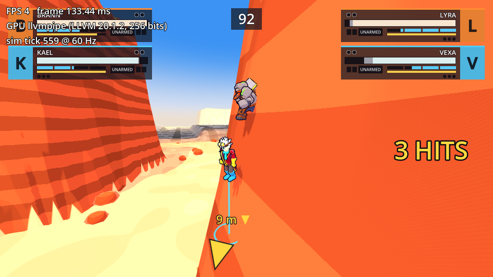
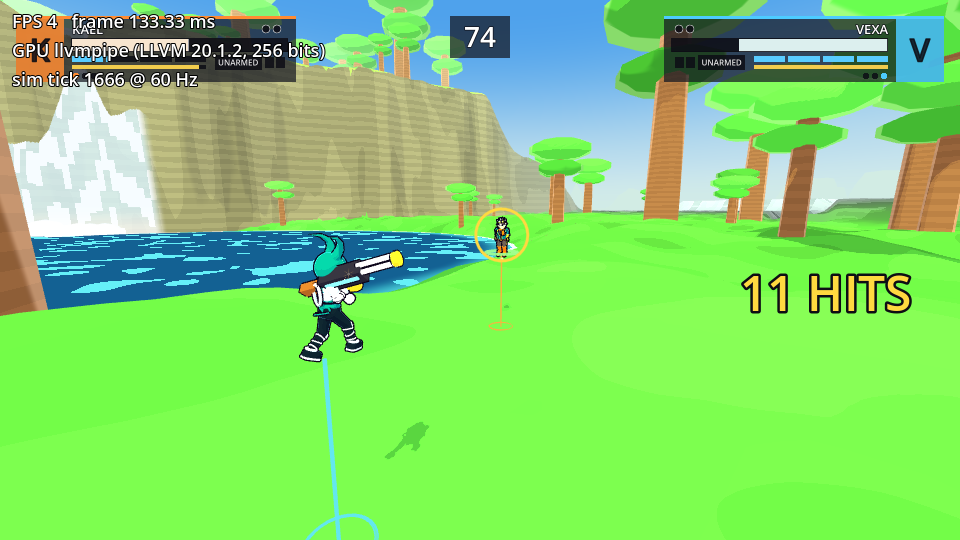
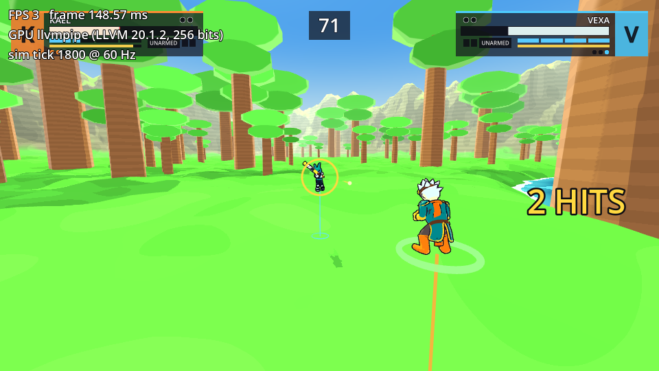
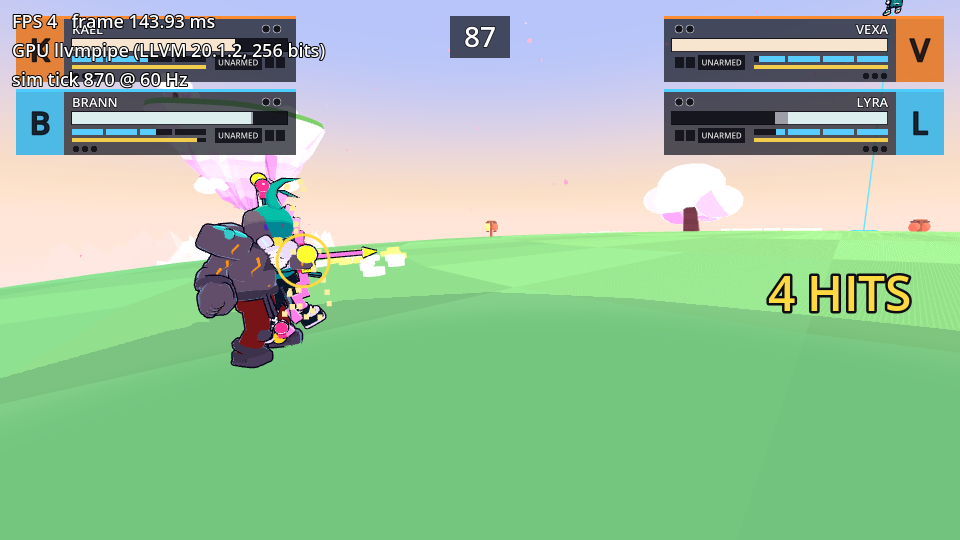
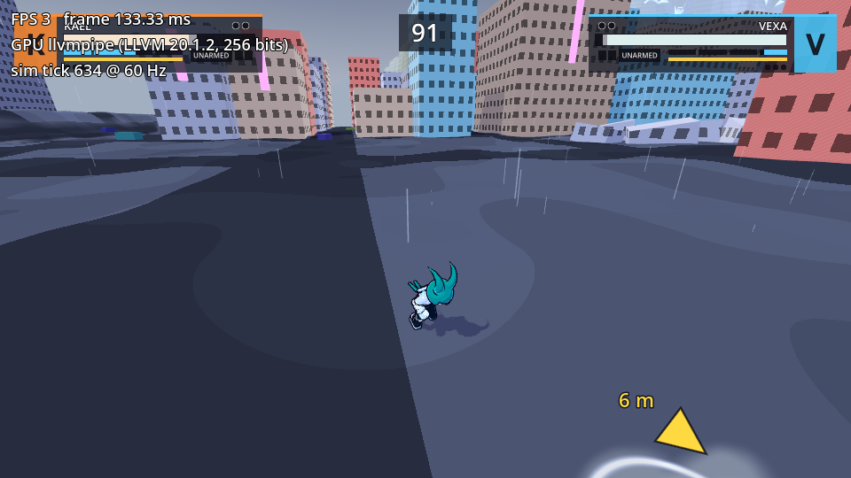
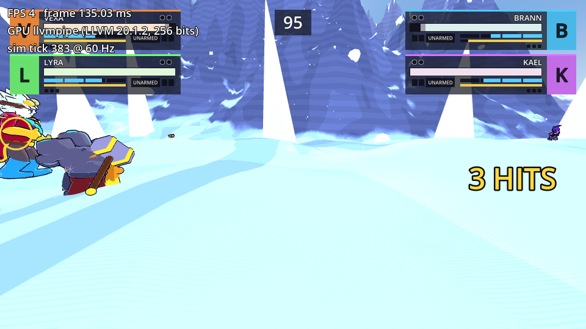
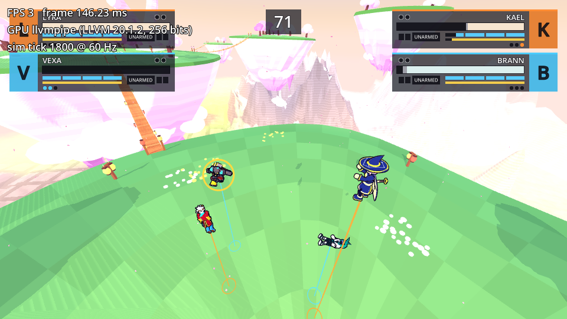
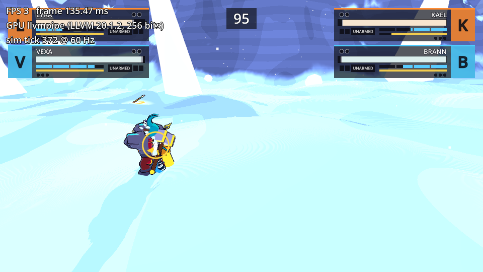
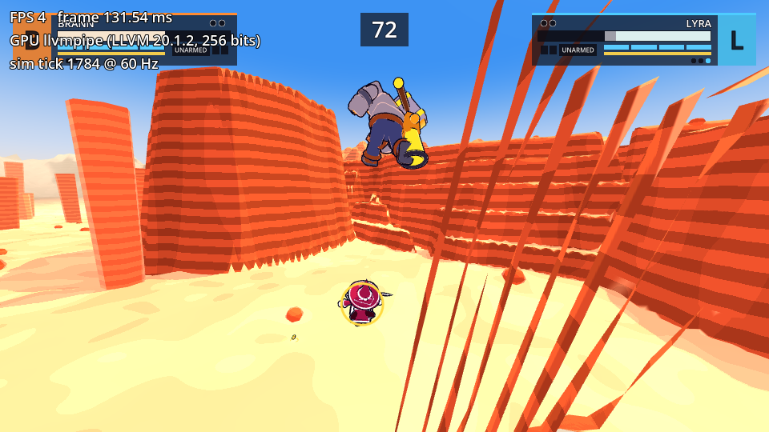
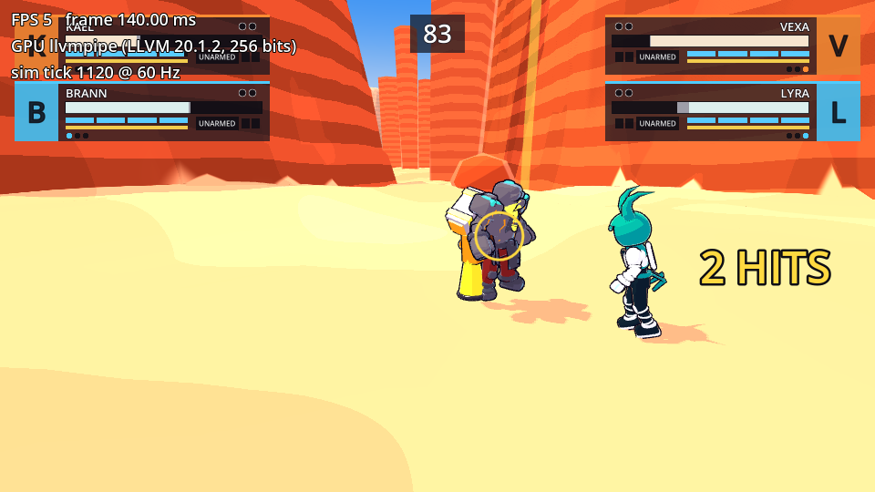

# Gameplay QA report: bc9aa29 (full)

Matches: 252, ticks: 453600, total wall 8201 s. Thresholds are documented in `AGENTS.md` (QA).

| Section | Result |
|---|---|
| Invariant soak (sim) | **FAIL** |
| Invariant soak (view) | **FAIL** |
| Scenario library | **FAIL** |
| Golden replays | **PASS** |
| Visual goldens | **PASS** |
| Feel metrics trend | **BASELINE** |

## Invariant soak: sim

| Check | Matches hit | Frames | Note |
|---|---|---|---|
| fighter_overlap | 252 / 252 | 277725 | pending T-D29 (pushboxes) |
| arena_bounds | 27 / 252 | 32 |  |

## Invariant soak: view

| Check | Matches hit | Frames | Note |
|---|---|---|---|
| pop | 251 / 252 | 10189 |  |
| pop_budget | 249 / 252 | 249 |  |
| foot_ground | 210 / 252 | 40364 |  |
| camera_on_screen | 16 / 252 | 16 |  |
| camera_cover | 10 / 252 | 20 |  |
| bow_string_head | 7 / 252 | 112 |  |

## Top 10 violations

1. **foot_ground**, fighter 0, legend brann, weapon unarmed, zone shattered_mesa, 2v2, seed 1022, worst at tick 559 (first 1, 210 frames): lowest sole -295.5 cm off the visible ground (MOVING)  
   `tools/qa/run_qa.sh --repro '1022:shattered_mesa:2v2:brann,lyra,kael,vexa:4424' --tick 559 --fighter 0`

    [2 s clip](2026-11-19-bc9aa29-full/captures/1022_shattered_mesa_2v2_brann-lyra-kael-vexa_4424_t559/clip.mp4)

2. **pop**, fighter 1, legend vexa, weapon repeater, zone verdant_falls, 1v1, seed 2400, worst at tick 1666 (first 124, 197 frames): SashLower turned 2.58 rad in one frame (ATTACKING, move repeater/shot)  
   `tools/qa/run_qa.sh --repro '2400:verdant_falls:1v1:kael,vexa:45' --tick 1666 --fighter 1`

    [2 s clip](2026-11-19-bc9aa29-full/captures/2400_verdant_falls_1v1_kael-vexa_45_t1666/clip.mp4)

3. **pop_budget**, match, legend -, weapon unarmed, zone verdant_falls, 1v1, seed 2400, worst at tick 1800 (first 1800, 1 frames): 207 pops in 1.0 fighter-minutes (budget 2.0/min)  
   `tools/qa/run_qa.sh --repro '2400:verdant_falls:1v1:kael,vexa:45' --tick 1800 --fighter 0`

    [2 s clip](2026-11-19-bc9aa29-full/captures/2400_verdant_falls_1v1_kael-vexa_45_t1800/clip.mp4)

4. **bow_string_head**, fighter 2, legend brann, weapon heartstring, zone heartbloom_gardens, 2v2, seed 3620, worst at tick 870 (first 769, 57 frames): bow string 5.0 cm from the head centre (draw 0, BLOCKSTUN)  
   `tools/qa/run_qa.sh --repro '3620:heartbloom_gardens:2v2:kael,vexa,brann,lyra:4253' --tick 870 --fighter 2`

    [2 s clip](2026-11-19-bc9aa29-full/captures/3620_heartbloom_gardens_2v2_kael-vexa-brann-lyra_4253_t870/clip.mp4)

5. **camera_cover**, fighter 1, legend vexa, weapon unarmed, zone stormfall_city, 1v1, seed 1200, worst at tick 634 (first 633, 3 frames): fighter 1 covers 100% of the screen  
   `tools/qa/run_qa.sh --repro '1200:stormfall_city:1v1:kael,vexa:55' --tick 634 --fighter 1`

    [2 s clip](2026-11-19-bc9aa29-full/captures/1200_stormfall_city_1v1_kael-vexa_55_t634/clip.mp4)

6. **arena_bounds**, fighter 1, legend brann, weapon unarmed, zone frozen_peaks, ffa4, seed 1311, worst at tick 383 (first 228, 2 frames): outside the arena at (-625.89, 72.59, -531.75) (stand 72.92, GRABBED)  
   `tools/qa/run_qa.sh --repro '1311:frozen_peaks:ffa4:vexa,brann,lyra,kael:2244' --tick 383 --fighter 1`

    [2 s clip](2026-11-19-bc9aa29-full/captures/1311_frozen_peaks_ffa4_vexa-brann-lyra-kael_2244_t383/clip.mp4)

7. **camera_on_screen**, fighter 0, legend lyra, weapon unarmed, zone heartbloom_gardens, 2v2, seed 2623, worst at tick 1800 (first 1800, 1 frames): both locked fighters on screen in 90.4% of 1518 locked frames  
   `tools/qa/run_qa.sh --repro '2623:heartbloom_gardens:2v2:lyra,kael,vexa,brann:2422' --tick 1800 --fighter 0`

    [2 s clip](2026-11-19-bc9aa29-full/captures/2623_heartbloom_gardens_2v2_lyra-kael-vexa-brann_2422_t1800/clip.mp4)

8. **fighter_overlap** (pending), fighter 1, legend kael, weapon unarmed, zone frozen_peaks, 2v2, seed 3323, worst at tick 372 (first 247, 1323 frames): fighters 1 and 3 overlap 1.08 m (FLYING vs ATTACKING)  
   `tools/qa/run_qa.sh --repro '3323:frozen_peaks:2v2:lyra,kael,vexa,brann:5422' --tick 372 --fighter 1`

    [2 s clip](2026-11-19-bc9aa29-full/captures/3323_frozen_peaks_2v2_lyra-kael-vexa-brann_5422_t372/clip.mp4)

9. **foot_ground**, fighter 0, legend brann, weapon unarmed, zone shattered_mesa, 1v1, seed 1002, worst at tick 1784 (first 1, 200 frames): lowest sole -259.5 cm off the visible ground (MOVING)  
   `tools/qa/run_qa.sh --repro '1002:shattered_mesa:1v1:brann,lyra:22' --tick 1784 --fighter 0`

    [2 s clip](2026-11-19-bc9aa29-full/captures/1002_shattered_mesa_1v1_brann-lyra_22_t1784/clip.mp4)

10. **pop**, fighter 1, legend vexa, weapon unarmed, zone shattered_mesa, 2v2, seed 1020, worst at tick 1120 (first 124, 111 frames): RightFoot turned 2.09 rad in one frame (MOVING, move )  
   `tools/qa/run_qa.sh --repro '1020:shattered_mesa:2v2:kael,vexa,brann,lyra:3323' --tick 1120 --fighter 1`

    [2 s clip](2026-11-19-bc9aa29-full/captures/1020_shattered_mesa_2v2_kael-vexa-brann-lyra_3323_t1120/clip.mp4)

## Scenario library

38 tests: 34 passing, 4 failing, 0 pending (strict mode: known issues fail).

- FAIL `test_lyra_lands_lights_launcher_air_light_and_spike_as_one_combo`: Expected [ARRAY([&"light_1", &"light_2", &"launcher", &"light_1", &"light_2"])] to contain value:  [STRING_NAME(spike)]:  the spike lands
- FAIL `test_a_dash_into_an_opponent_stops_at_contact_without_passing_through`: the dash never ends up on the far side
- FAIL `test_a_knockout_on_a_raised_island_rests_on_the_island_top`: [1.00000000000000000000] expected to equal [7.0] +/- [0.05]:  lies on the island, not inside it

## Golden replays

9 tests, 0 failing.

## Visual goldens

SSIM floor 0.90, tile 32px changes above 12/255, fail above 5% of tiles.

| Shot | Result | SSIM | Changed tiles |
|---|---|---|---|
| heartbloom_brann_idle.png | PASS | 1.000 | 0.0% |
| heartbloom_brann_light.png | PASS | 1.000 | 0.0% |
| heartbloom_kael_idle.png | PASS | 0.999 | 0.0% |
| heartbloom_kael_light.png | PASS | 0.999 | 0.0% |
| heartbloom_lyra_idle.png | PASS | 1.000 | 0.0% |
| heartbloom_lyra_light.png | PASS | 1.000 | 0.0% |
| heartbloom_vexa_idle.png | PASS | 1.000 | 0.0% |
| heartbloom_vexa_light.png | PASS | 1.000 | 0.0% |
| zone_ember_rift.png | PASS | 1.000 | 0.0% |
| zone_frozen_peaks.png | PASS | 0.997 | 0.4% |
| zone_shattered_mesa.png | PASS | 0.999 | 0.0% |
| zone_skyhold_ruins.png | PASS | 0.962 | 1.5% |
| zone_stormfall_city.png | PASS | 0.991 | 0.0% |
| zone_verdant_falls.png | PASS | 0.997 | 0.4% |

## Feel metrics

Compared with nothing (first report: this is the baseline); regression = worse by more than 15%.

| Metric | Now | Before | Change |
|---|---|---|---|
| hitstop_consistency | 0.5341 | - | - |
| pops_per_fighter_minute | 24.26 | - | - |
| finger_pops_per_fighter_minute | 27.79 | - | - |
| foot_slide_cm_per_frame | 0.8564 | - | - |
| foot_error_p95_cm | 10.76 | - | - |
| camera_jerk_p95 | 0.01378 | - | - |
| locked_on_screen_share | 0.9793 | - | - |
| sim_ms_per_tick | 3.528 | - | - |
| view_ms_per_frame | 3.246 | - | - |

Press to first active frame (ticks at 60 Hz):

| Legend | grab@air | grab@ground | heavy@air | heavy@ground | light@air | light@ground |
|---|---|---|---|---|---|---|
| brann | 10 | 10 | 19 | 19 | 9 | 9 |
| kael | 8 | 8 | 15 | 15 | 7 | 7 |
| lyra | 9 | 9 | 16 | 16 | 7 | 7 |
| vexa | 7 | 7 | 12 | 12 | 5 | 5 |

