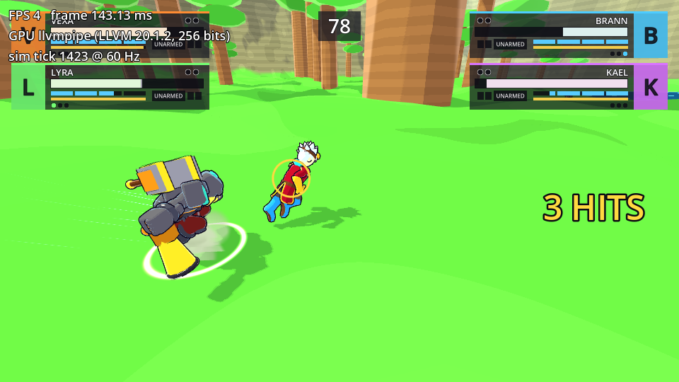
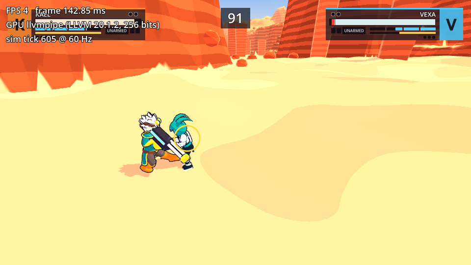
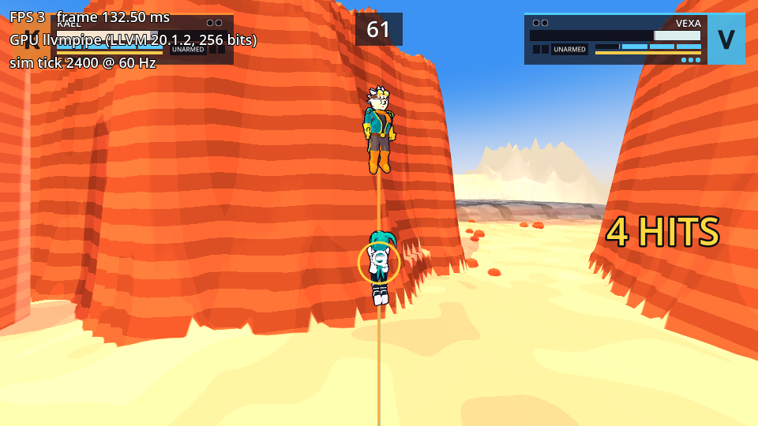
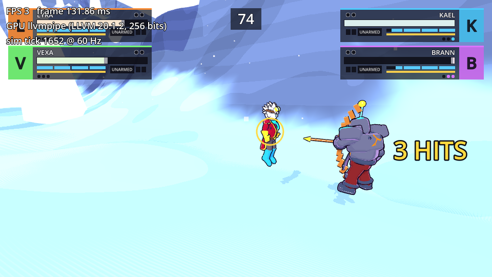
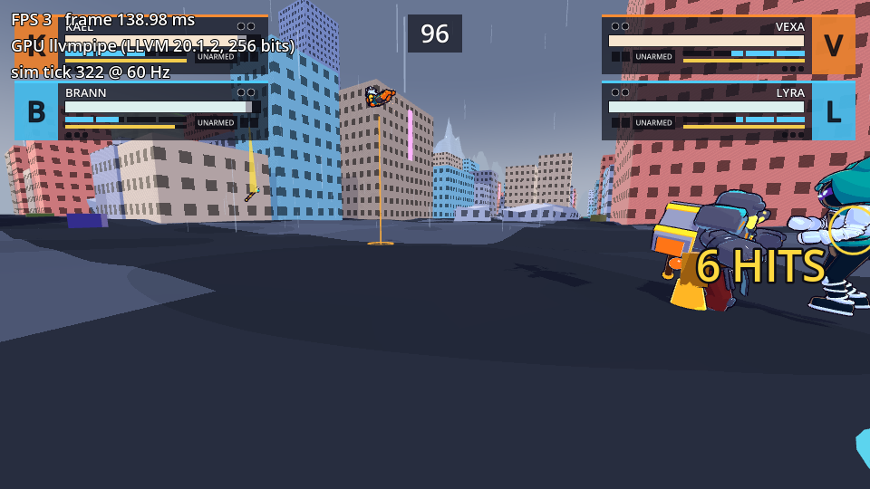
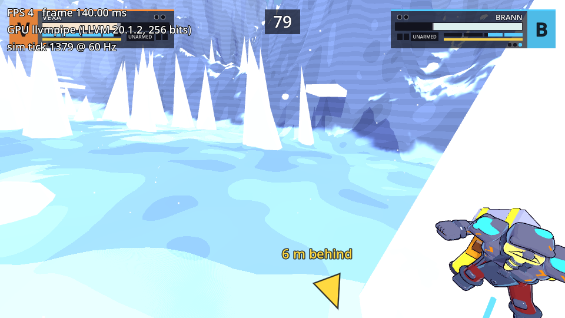
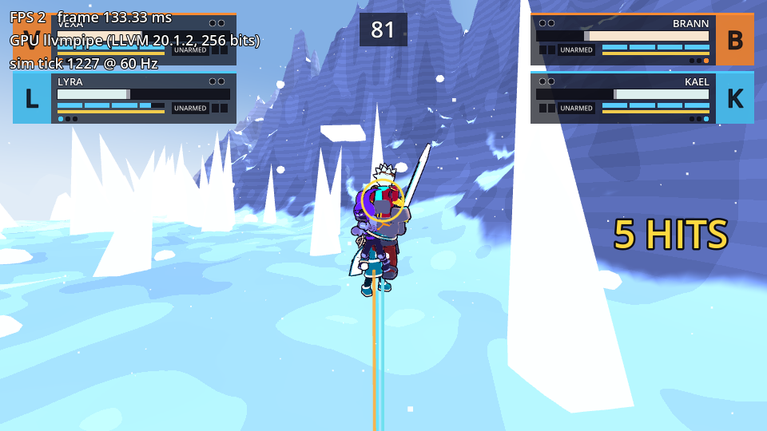
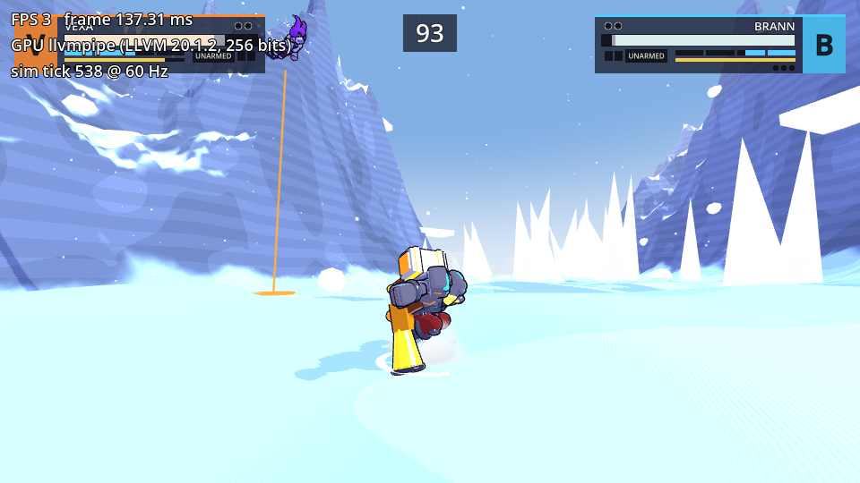
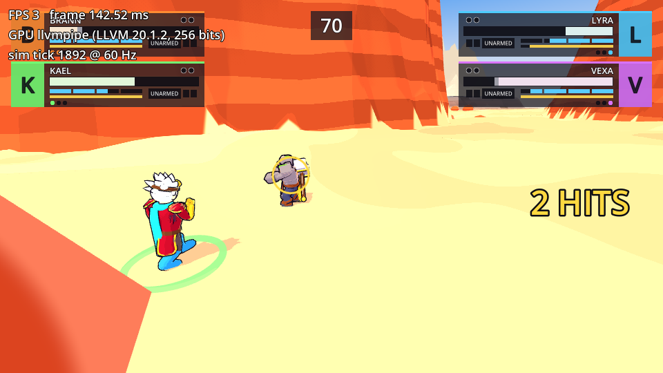
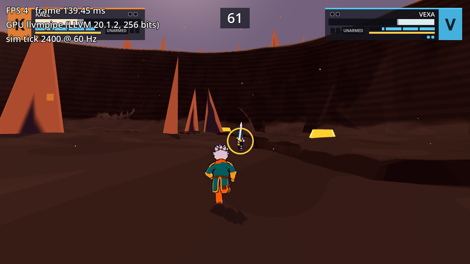

# Gameplay QA report: bc9aa29 (quick)

Matches: 21, ticks: 50400, total wall 592 s. Thresholds are documented in `AGENTS.md` (QA).

| Section | Result |
|---|---|
| Invariant soak (sim) | **FAIL** |
| Invariant soak (view) | **FAIL** |
| Scenario library | **FAIL** |
| Golden replays | **PASS** |
| Visual goldens | **PASS** |
| Feel metrics trend | **BASELINE** |

## Invariant soak: sim

| Check | Matches hit | Frames | Note |
|---|---|---|---|
| fighter_overlap | 21 / 21 | 29515 | pending T-D29 (pushboxes) |
| arena_bounds | 1 / 21 | 1 |  |

## Invariant soak: view

| Check | Matches hit | Frames | Note |
|---|---|---|---|
| pop | 21 / 21 | 1269 |  |
| pop_budget | 21 / 21 | 21 |  |
| foot_ground | 18 / 21 | 3190 |  |
| camera_cover | 1 / 21 | 1 |  |
| bow_string_head | 1 / 21 | 10 |  |

## Top 10 violations

1. **foot_ground**, fighter 1, legend brann, weapon unarmed, zone verdant_falls, ffa4, seed 104, worst at tick 1423 (first 1, 172 frames): lowest sole +45.5 cm off the visible ground (IDLE)  
   `tools/qa/run_qa.sh --repro '104:verdant_falls:ffa4:vexa,brann,lyra,kael:2243' --tick 1423 --fighter 1`

    [2 s clip](2026-11-19-bc9aa29-quick/captures/104_verdant_falls_ffa4_vexa-brann-lyra-kael_2243_t1423/clip.mp4)

2. **pop**, fighter 0, legend kael, weapon repeater, zone shattered_mesa, 1v1, seed 100, worst at tick 605 (first 124, 210 frames): LeftUpperArm turned 2.06 rad in one frame (ATTACKING, move repeater/bash)  
   `tools/qa/run_qa.sh --repro '100:shattered_mesa:1v1:kael,vexa:54' --tick 605 --fighter 0`

    [2 s clip](2026-11-19-bc9aa29-quick/captures/100_shattered_mesa_1v1_kael-vexa_54_t605/clip.mp4)

3. **pop_budget**, match, legend -, weapon unarmed, zone shattered_mesa, 1v1, seed 100, worst at tick 2400 (first 2400, 1 frames): 219 pops in 1.3 fighter-minutes (budget 2.0/min)  
   `tools/qa/run_qa.sh --repro '100:shattered_mesa:1v1:kael,vexa:54' --tick 2400 --fighter 0`

    [2 s clip](2026-11-19-bc9aa29-quick/captures/100_shattered_mesa_1v1_kael-vexa_54_t2400/clip.mp4)

4. **bow_string_head**, fighter 3, legend brann, weapon bow, zone frozen_peaks, ffa4, seed 110, worst at tick 1652 (first 1535, 10 frames): bow string 6.1 cm from the head centre (draw 0, BLOCKING)  
   `tools/qa/run_qa.sh --repro '110:frozen_peaks:ffa4:lyra,kael,vexa,brann:3523' --tick 1652 --fighter 3`

    [2 s clip](2026-11-19-bc9aa29-quick/captures/110_frozen_peaks_ffa4_lyra-kael-vexa-brann_3523_t1652/clip.mp4)

5. **arena_bounds**, fighter 2, legend brann, weapon unarmed, zone stormfall_city, 2v2, seed 102, worst at tick 322 (first 322, 1 frames): outside the arena at (-29.05, 12.88, 404.4) (stand 13.06, GRABBED)  
   `tools/qa/run_qa.sh --repro '102:stormfall_city:2v2:kael,vexa,brann,lyra:4455' --tick 322 --fighter 2`

    [2 s clip](2026-11-19-bc9aa29-quick/captures/102_stormfall_city_2v2_kael-vexa-brann-lyra_4455_t322/clip.mp4)

6. **camera_cover**, fighter 1, legend brann, weapon unarmed, zone frozen_peaks, 1v1, seed 103, worst at tick 1379 (first 1379, 1 frames): fighter 1 covers 65% of the screen  
   `tools/qa/run_qa.sh --repro '103:frozen_peaks:1v1:vexa,brann:44' --tick 1379 --fighter 1`

    [2 s clip](2026-11-19-bc9aa29-quick/captures/103_frozen_peaks_1v1_vexa-brann_44_t1379/clip.mp4)

7. **fighter_overlap** (pending), fighter 1, legend brann, weapon blade, zone frozen_peaks, 2v2, seed 117, worst at tick 1227 (first 287, 1644 frames): fighters 1 and 3 overlap 1.10 m (ATTACKING vs FLYING)  
   `tools/qa/run_qa.sh --repro '117:frozen_peaks:2v2:vexa,brann,lyra,kael:2343' --tick 1227 --fighter 1`

    [2 s clip](2026-11-19-bc9aa29-quick/captures/117_frozen_peaks_2v2_vexa-brann-lyra-kael_2343_t1227/clip.mp4)

8. **foot_ground**, fighter 1, legend brann, weapon unarmed, zone frozen_peaks, 1v1, seed 103, worst at tick 538 (first 1, 171 frames): lowest sole +44.9 cm off the visible ground (IDLE)  
   `tools/qa/run_qa.sh --repro '103:frozen_peaks:1v1:vexa,brann:44' --tick 538 --fighter 1`

    [2 s clip](2026-11-19-bc9aa29-quick/captures/103_frozen_peaks_1v1_vexa-brann_44_t538/clip.mp4)

9. **pop**, fighter 2, legend kael, weapon unarmed, zone shattered_mesa, ffa4, seed 107, worst at tick 1892 (first 175, 41 frames): LeftLowerArm turned 3.12 rad in one frame (MOVING, move )  
   `tools/qa/run_qa.sh --repro '107:shattered_mesa:ffa4:brann,lyra,kael,vexa:2445' --tick 1892 --fighter 2`

    [2 s clip](2026-11-19-bc9aa29-quick/captures/107_shattered_mesa_ffa4_brann-lyra-kael-vexa_2445_t1892/clip.mp4)

10. **pop_budget**, match, legend -, weapon unarmed, zone ember_rift, 1v1, seed 112, worst at tick 2400 (first 2400, 1 frames): 56 pops in 1.3 fighter-minutes (budget 2.0/min)  
   `tools/qa/run_qa.sh --repro '112:ember_rift:1v1:kael,vexa:45' --tick 2400 --fighter 0`

    [2 s clip](2026-11-19-bc9aa29-quick/captures/112_ember_rift_1v1_kael-vexa_45_t2400/clip.mp4)

## Scenario library

38 tests: 34 passing, 4 failing, 0 pending (strict mode: known issues fail).

- FAIL `test_lyra_lands_lights_launcher_air_light_and_spike_as_one_combo`: Expected [ARRAY([&"light_1", &"light_2", &"launcher", &"light_1", &"light_2"])] to contain value:  [STRING_NAME(spike)]:  the spike lands
- FAIL `test_a_dash_into_an_opponent_stops_at_contact_without_passing_through`: the dash never ends up on the far side
- FAIL `test_a_knockout_on_a_raised_island_rests_on_the_island_top`: [1.00000000000000000000] expected to equal [7.0] +/- [0.05]:  lies on the island, not inside it

## Golden replays

9 tests, 0 failing.

## Visual goldens

SSIM floor 0.90, tile 32px changes above 12/255, fail above 5% of tiles.

| Shot | Result | SSIM | Changed tiles |
|---|---|---|---|
| heartbloom_brann_idle.png | PASS | 1.000 | 0.0% |
| heartbloom_brann_light.png | PASS | 1.000 | 0.0% |
| heartbloom_kael_idle.png | PASS | 0.998 | 0.2% |
| heartbloom_kael_light.png | PASS | 0.999 | 0.0% |
| heartbloom_lyra_idle.png | PASS | 1.000 | 0.0% |
| heartbloom_lyra_light.png | PASS | 1.000 | 0.0% |
| heartbloom_vexa_idle.png | PASS | 1.000 | 0.0% |
| heartbloom_vexa_light.png | PASS | 0.999 | 0.0% |
| zone_ember_rift.png | PASS | 0.999 | 0.0% |
| zone_frozen_peaks.png | PASS | 0.997 | 0.4% |
| zone_shattered_mesa.png | PASS | 0.999 | 0.2% |
| zone_skyhold_ruins.png | PASS | 0.961 | 1.9% |
| zone_stormfall_city.png | PASS | 0.992 | 0.0% |
| zone_verdant_falls.png | PASS | 0.997 | 0.4% |

## Feel metrics

Compared with nothing (first report: this is the baseline); regression = worse by more than 15%.

| Metric | Now | Before | Change |
|---|---|---|---|
| hitstop_consistency | 0.6261 | - | - |
| pops_per_fighter_minute | 29.26 | - | - |
| finger_pops_per_fighter_minute | 28.96 | - | - |
| foot_slide_cm_per_frame | 0.6964 | - | - |
| foot_error_p95_cm | 9.464 | - | - |
| camera_jerk_p95 | 0.01345 | - | - |
| locked_on_screen_share | 0.9799 | - | - |
| sim_ms_per_tick | 1.776 | - | - |
| view_ms_per_frame | 1.597 | - | - |

Press to first active frame (ticks at 60 Hz):

| Legend | grab@air | grab@ground | heavy@air | heavy@ground | light@air | light@ground |
|---|---|---|---|---|---|---|
| brann | 10 | 10 | 19 | 19 | 9 | 9 |
| kael | 8 | 8 | 15 | 15 | 7 | 7 |
| lyra | 9 | 9 | 16 | 16 | 7 | 7 |
| vexa | 7 | 7 | 12 | 12 | 5 | 5 |

