# Gameplay QA report: e3b95c9 (quick)

Matches: 21, ticks: 50400, total wall 371 s. Thresholds are documented in `AGENTS.md` (QA).

| Section | Result |
|---|---|
| Invariant soak (sim) | **FAIL** |
| Invariant soak (view) | **FAIL** |
| Scenario library | **FAIL** |
| Golden replays | **PASS** |
| Visual goldens | **FAIL** |
| Feel metrics trend | **PASS** |

## Invariant soak: sim

| Check | Matches hit | Frames | Note |
|---|---|---|---|
| fighter_overlap | 7 / 21 | 186 |  |
| arena_bounds | 3 / 21 | 4 |  |

## Invariant soak: view

| Check | Matches hit | Frames | Note |
|---|---|---|---|
| foot_ground | 18 / 21 | 465 |  |
| camera_cover | 2 / 21 | 6 |  |

## Top 10 violations

1. **foot_ground**, fighter 3, legend lyra, weapon unarmed, zone shattered_mesa, 2v2, seed 114, worst at tick 368 (first 368, 30 frames): lowest sole +76.4 cm off the visible ground (IDLE, clip heavy_land)  
   `tools/qa/run_qa.sh --repro '114:shattered_mesa:2v2:kael,vexa,brann,lyra:3355' --tick 368 --fighter 3`

   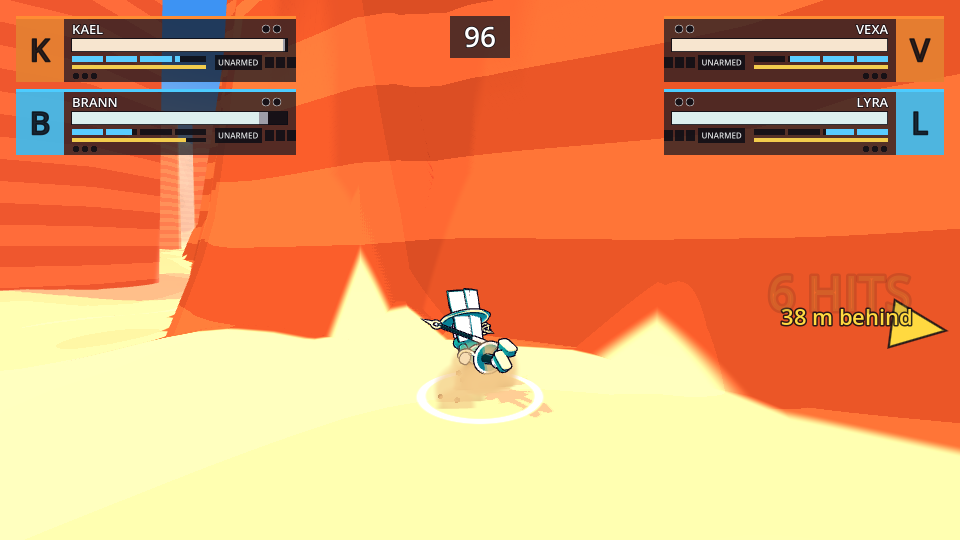 [2 s clip](2026-11-19-e3b95c9-quick/captures/114_shattered_mesa_2v2_kael-vexa-brann-lyra_3355_t368/clip.mp4)

2. **fighter_overlap**, fighter 1, legend lyra, weapon unarmed, zone skyhold_ruins, 2v2, seed 108, worst at tick 254 (first 249, 75 frames): fighters 1 and 2 overlap 0.16 m (ATTACKING vs BLOCKSTUN)  
   `tools/qa/run_qa.sh --repro '108:skyhold_ruins:2v2:brann,lyra,kael,vexa:5343' --tick 254 --fighter 1`

   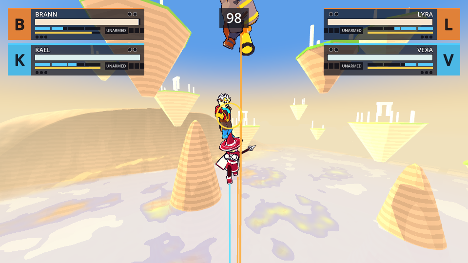 [2 s clip](2026-11-19-e3b95c9-quick/captures/108_skyhold_ruins_2v2_brann-lyra-kael-vexa_5343_t254/clip.mp4)

3. **camera_cover**, fighter 1, legend brann, weapon unarmed, zone stormfall_city, ffa4, seed 116, worst at tick 2169 (first 2167, 3 frames): fighter 1 covers 100% of the screen  
   `tools/qa/run_qa.sh --repro '116:stormfall_city:ffa4:vexa,brann,lyra,kael:5333' --tick 2169 --fighter 1`

   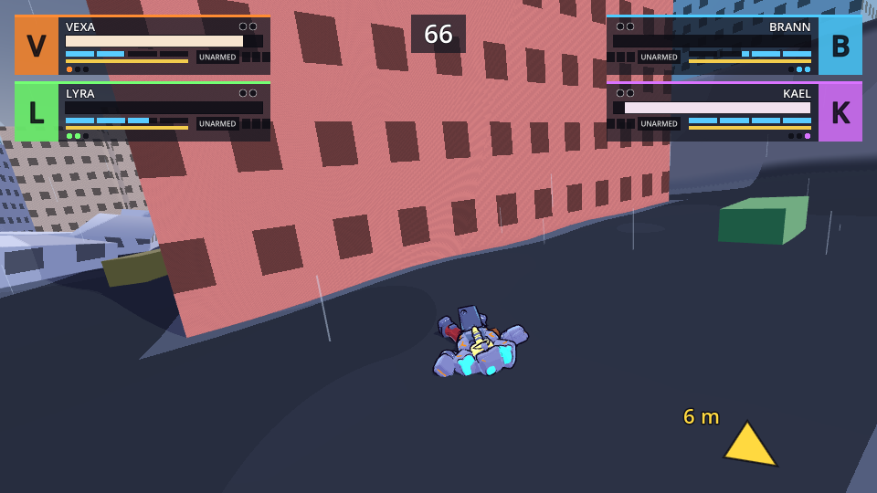 [2 s clip](2026-11-19-e3b95c9-quick/captures/116_stormfall_city_ffa4_vexa-brann-lyra-kael_5333_t2169/clip.mp4)

4. **arena_bounds**, fighter 1, legend kael, weapon unarmed, zone verdant_falls, 2v2, seed 111, worst at tick 1621 (first 1547, 2 frames): outside the arena at (-651.96, 5.85, 609.33) (stand 5.91, GRABBED)  
   `tools/qa/run_qa.sh --repro '111:verdant_falls:2v2:lyra,kael,vexa,brann:4432' --tick 1621 --fighter 1`

   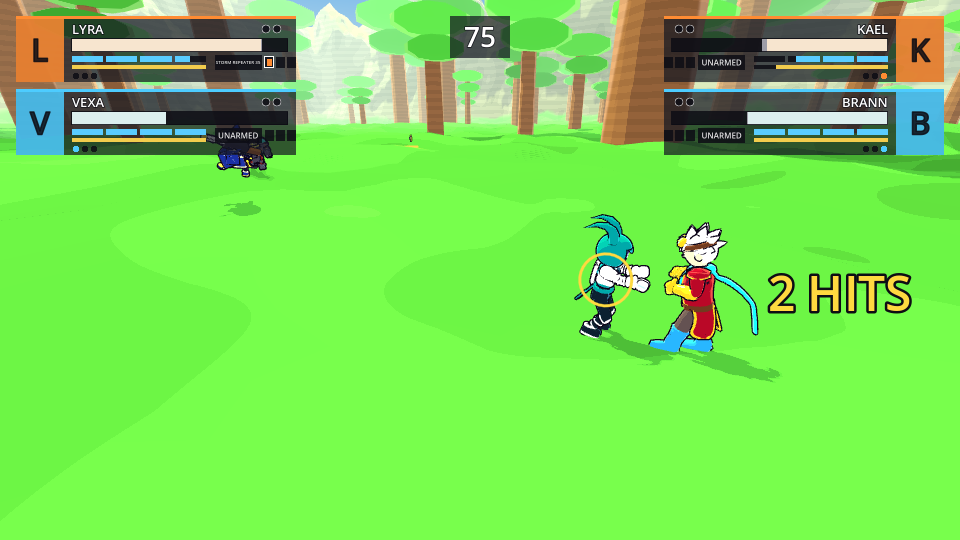 [2 s clip](2026-11-19-e3b95c9-quick/captures/111_verdant_falls_2v2_lyra-kael-vexa-brann_4432_t1621/clip.mp4)

5. **foot_ground**, fighter 1, legend lyra, weapon unarmed, zone ember_rift, ffa4, seed 119, worst at tick 1585 (first 836, 26 frames): lowest sole +62.7 cm off the visible ground (IDLE, clip fight_idle)  
   `tools/qa/run_qa.sh --repro '119:ember_rift:ffa4:brann,lyra,kael,vexa:4433' --tick 1585 --fighter 1`

   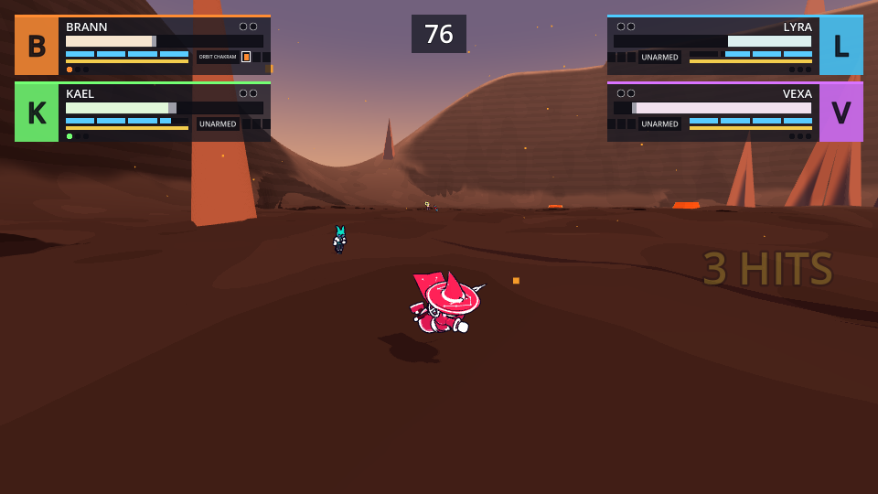 [2 s clip](2026-11-19-e3b95c9-quick/captures/119_ember_rift_ffa4_brann-lyra-kael-vexa_4433_t1585/clip.mp4)

6. **fighter_overlap**, fighter 1, legend vexa, weapon unarmed, zone skyhold_ruins, ffa4, seed 101, worst at tick 1760 (first 252, 35 frames): fighters 1 and 3 overlap 0.15 m (FLYING vs ATTACKING)  
   `tools/qa/run_qa.sh --repro '101:skyhold_ruins:ffa4:kael,vexa,brann,lyra:4235' --tick 1760 --fighter 1`

   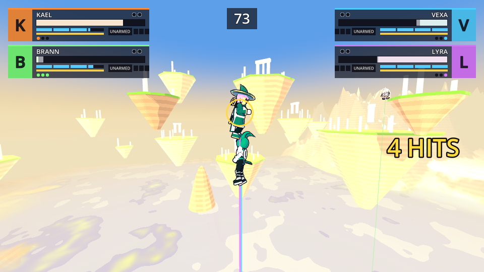 [2 s clip](2026-11-19-e3b95c9-quick/captures/101_skyhold_ruins_ffa4_kael-vexa-brann-lyra_4235_t1760/clip.mp4)

7. **camera_cover**, fighter 1, legend brann, weapon unarmed, zone frozen_peaks, 2v2, seed 117, worst at tick 1795 (first 1794, 3 frames): fighter 1 covers 100% of the screen  
   `tools/qa/run_qa.sh --repro '117:frozen_peaks:2v2:vexa,brann,lyra,kael:2343' --tick 1795 --fighter 1`

   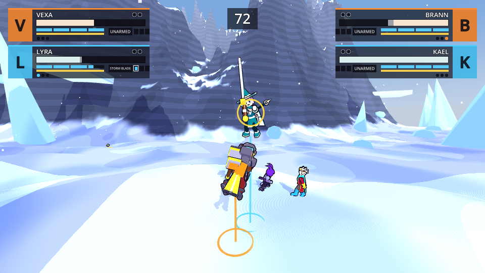 [2 s clip](2026-11-19-e3b95c9-quick/captures/117_frozen_peaks_2v2_vexa-brann-lyra-kael_2343_t1795/clip.mp4)

8. **arena_bounds**, fighter 3, legend kael, weapon unarmed, zone ember_rift, 2v2, seed 105, worst at tick 1191 (first 1191, 1 frames): outside the arena at (665.09, 36.51, -424.34) (stand 36.57, GRABBED)  
   `tools/qa/run_qa.sh --repro '105:ember_rift:2v2:vexa,brann,lyra,kael:3224' --tick 1191 --fighter 3`

   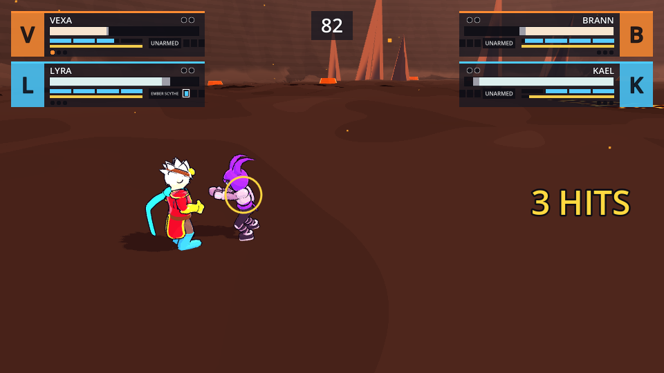 [2 s clip](2026-11-19-e3b95c9-quick/captures/105_ember_rift_2v2_vexa-brann-lyra-kael_3224_t1191/clip.mp4)

9. **foot_ground**, fighter 0, legend kael, weapon unarmed, zone shattered_mesa, 2v2, seed 114, worst at tick 1353 (first 245, 15 frames): lowest sole +62.5 cm off the visible ground (IDLE, clip fight_idle)  
   `tools/qa/run_qa.sh --repro '114:shattered_mesa:2v2:kael,vexa,brann,lyra:3355' --tick 1353 --fighter 0`

   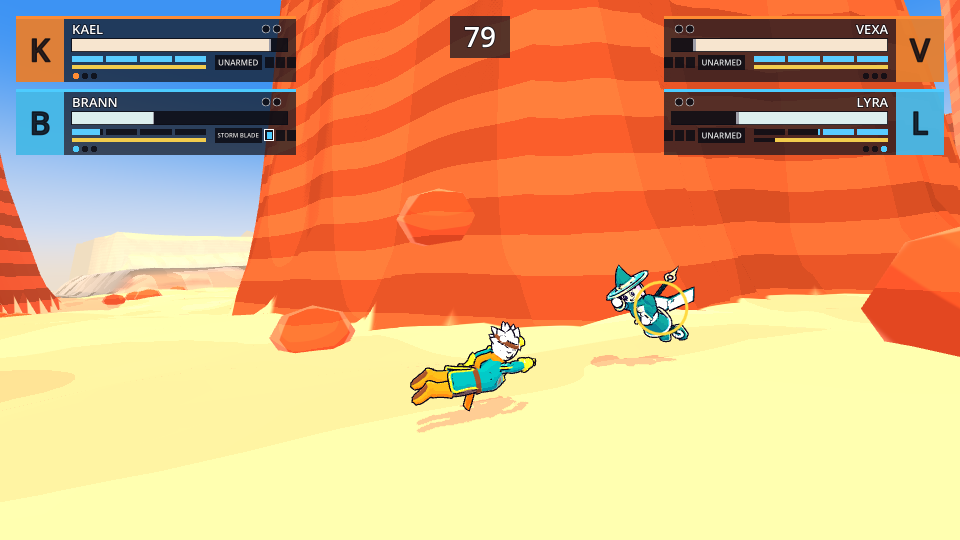 [2 s clip](2026-11-19-e3b95c9-quick/captures/114_shattered_mesa_2v2_kael-vexa-brann-lyra_3355_t1353/clip.mp4)

10. **fighter_overlap**, fighter 0, legend brann, weapon unarmed, zone skyhold_ruins, 2v2, seed 108, worst at tick 206 (first 199, 23 frames): fighters 0 and 2 overlap 0.15 m (ATTACKING vs ATTACKING)  
   `tools/qa/run_qa.sh --repro '108:skyhold_ruins:2v2:brann,lyra,kael,vexa:5343' --tick 206 --fighter 0`

   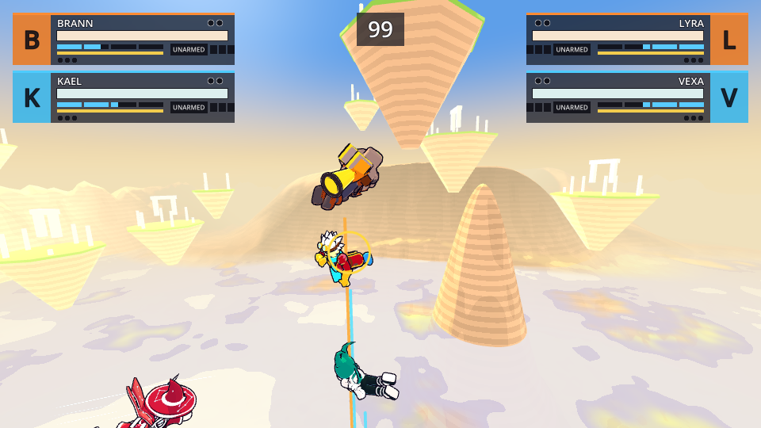 [2 s clip](2026-11-19-e3b95c9-quick/captures/108_skyhold_ruins_2v2_brann-lyra-kael-vexa_5343_t206/clip.mp4)

## Scenario library

38 tests: 36 passing, 2 failing, 0 pending (strict mode: known issues fail).

- FAIL `test_brann_lands_lights_launcher_air_light_and_spike_as_one_combo`: [5] expected to be >= than [6]:  one unbroken combo, launcher to spike
- FAIL `test_a_knockout_on_a_raised_island_rests_on_the_island_top`: [1.00000000000000000000] expected to equal [7.0] +/- [0.05]:  lies on the island, not inside it

## Golden replays

9 tests, 0 failing.

## Visual goldens

SSIM floor 0.90, tile 32px changes above 12/255, fail above 5% of tiles.

| Shot | Result | SSIM | Changed tiles |
|---|---|---|---|
| heartbloom_brann_idle.png | PASS | 0.975 | 4.2% |
| heartbloom_brann_light.png | PASS | 0.969 | 4.0% |
| heartbloom_kael_idle.png | PASS | 0.991 | 1.9% |
| heartbloom_kael_light.png | PASS | 0.980 | 2.3% |
| heartbloom_lyra_idle.png | PASS | 0.994 | 0.6% |
| heartbloom_lyra_light.png | PASS | 0.971 | 3.1% |
| heartbloom_vexa_idle.png | PASS | 0.981 | 2.1% |
| heartbloom_vexa_light.png | PASS | 0.976 | 2.7% |
| zone_ember_rift.png | FAIL | 0.883 | 34.6% |

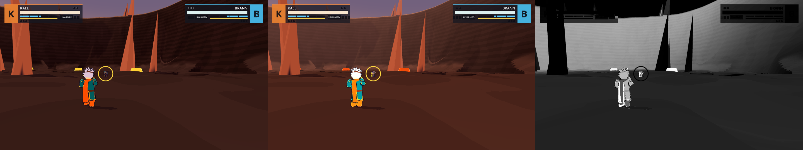

| zone_frozen_peaks.png | FAIL | 0.941 | 80.6% |

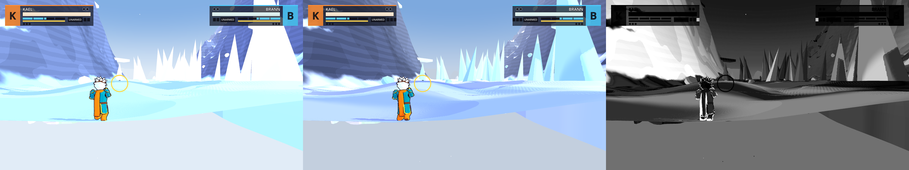

| zone_shattered_mesa.png | FAIL | 0.976 | 19.4% |

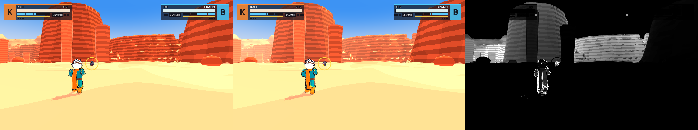

| zone_skyhold_ruins.png | FAIL | 0.841 | 44.2% |

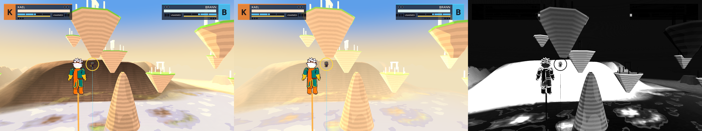

| zone_stormfall_city.png | FAIL | 0.979 | 6.5% |

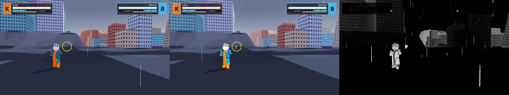

| zone_verdant_falls.png | FAIL | 0.949 | 20.2% |

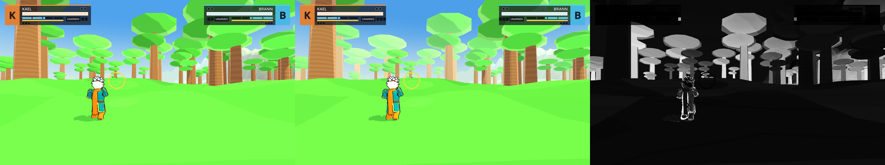

## Feel metrics

Compared with reports/qa/2026-11-19-fafc61e-quick/metrics.json; regression = worse by more than 15%.

| Metric | Now | Before | Change |
|---|---|---|---|
| hitstop_consistency | 0.669 | 0.6955 | -4% |
| pops_per_fighter_minute | 0 | 0 | - |
| finger_pops_per_fighter_minute | 0 | 0 | - |
| foot_slide_cm_per_frame | 0.007151 | 0.0078 | -8% |
| foot_error_p95_cm | 2.635 | 4.627 | -43% |
| camera_jerk_p95 | 0.01173 | 0.01233 | -5% |
| locked_on_screen_share | 0.9936 | 0.9943 | -0% |
| sim_ms_per_tick | 0.9269 | 1.464 | -37% |
| view_ms_per_frame | 0.6849 | 1.1 | -38% |

Press to first active frame (ticks at 60 Hz):

| Legend | grab@air | grab@ground | heavy@air | heavy@ground | light@air | light@ground |
|---|---|---|---|---|---|---|
| brann | 10 | 10 | 19 | 19 | 9 | 9 |
| kael | 8 | 8 | 15 | 15 | 7 | 7 |
| lyra | 9 | 9 | 16 | 16 | 7 | 7 |
| vexa | 7 | 7 | 12 | 12 | 5 | 5 |

