# Gameplay QA report: fafc61e (quick)

Matches: 21, ticks: 50400, total wall 504 s. Thresholds are documented in `AGENTS.md` (QA).

| Section | Result |
|---|---|
| Invariant soak (sim) | **FAIL** |
| Invariant soak (view) | **FAIL** |
| Scenario library | **FAIL** |
| Golden replays | **PASS** |
| Visual goldens | **FAIL** |
| Feel metrics trend | **PASS** |

## Invariant soak: sim

| Check | Matches hit | Frames | Note |
|---|---|---|---|
| fighter_overlap | 6 / 21 | 359 |  |
| arena_bounds | 2 / 21 | 2 |  |

## Invariant soak: view

| Check | Matches hit | Frames | Note |
|---|---|---|---|
| foot_ground | 18 / 21 | 545 |  |
| bow_string_head | 2 / 21 | 20 |  |
| camera_cover | 1 / 21 | 2 |  |

## Top 10 violations

1. **foot_ground**, fighter 2, legend lyra, weapon unarmed, zone ember_rift, 2v2, seed 105, worst at tick 2195 (first 475, 56 frames): lowest sole -86.9 cm off the visible ground (MOVING, clip run)  
   `tools/qa/run_qa.sh --repro '105:ember_rift:2v2:vexa,brann,lyra,kael:3224' --tick 2195 --fighter 2`

   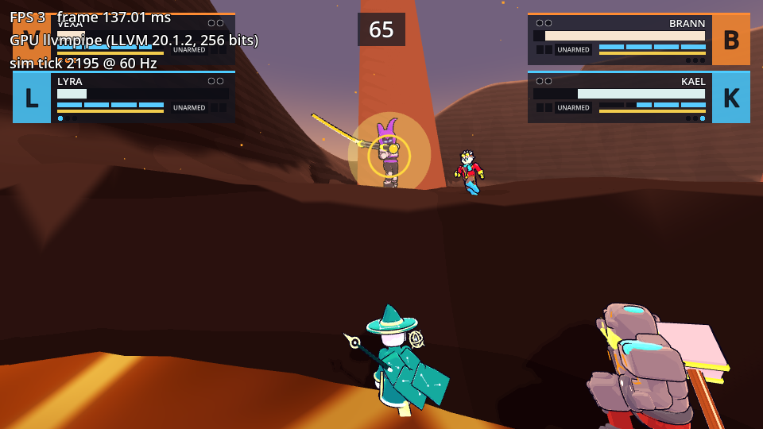 [2 s clip](2026-11-19-fafc61e-quick/captures/105_ember_rift_2v2_vexa-brann-lyra-kael_3224_t2195/clip.mp4)

2. **fighter_overlap**, fighter 0, legend kael, weapon unarmed, zone skyhold_ruins, ffa4, seed 101, worst at tick 564 (first 412, 170 frames): fighters 0 and 2 overlap 0.15 m (FLYING vs BLOCKING)  
   `tools/qa/run_qa.sh --repro '101:skyhold_ruins:ffa4:kael,vexa,brann,lyra:4235' --tick 564 --fighter 0`

   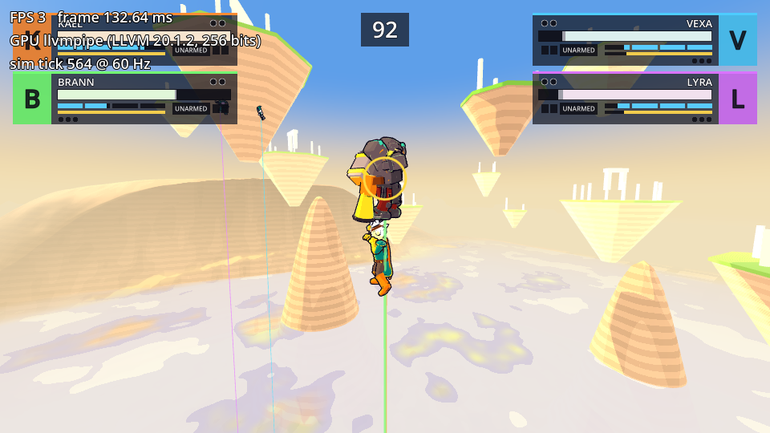 [2 s clip](2026-11-19-fafc61e-quick/captures/101_skyhold_ruins_ffa4_kael-vexa-brann-lyra_4235_t564/clip.mp4)

3. **bow_string_head**, fighter 1, legend brann, weapon bow, zone stormfall_city, ffa4, seed 116, worst at tick 674 (first 518, 17 frames): bow string 5.4 cm from the head centre (draw 1, ATTACKING)  
   `tools/qa/run_qa.sh --repro '116:stormfall_city:ffa4:vexa,brann,lyra,kael:5333' --tick 674 --fighter 1`

   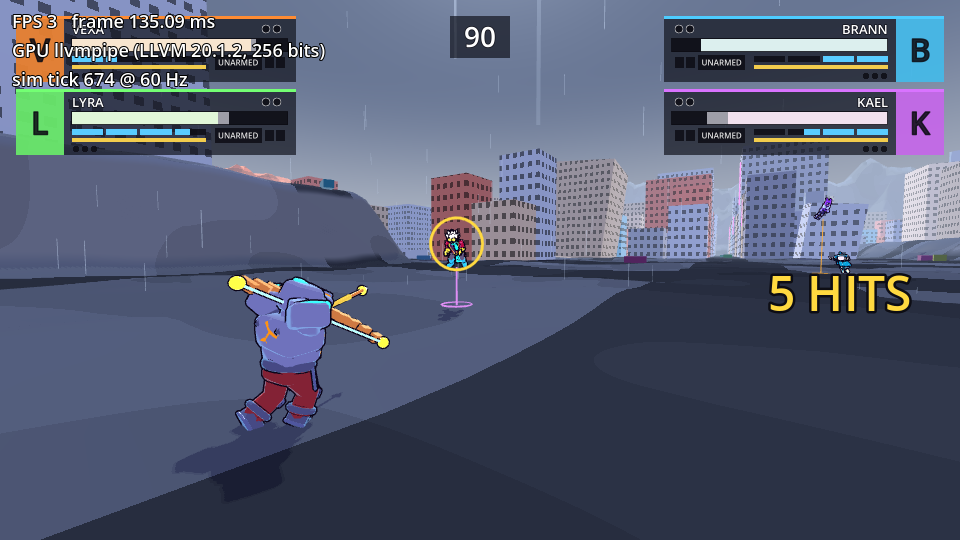 [2 s clip](2026-11-19-fafc61e-quick/captures/116_stormfall_city_ffa4_vexa-brann-lyra-kael_5333_t674/clip.mp4)

4. **camera_cover**, fighter 3, legend kael, weapon bow, zone verdant_falls, ffa4, seed 104, worst at tick 1681 (first 1681, 2 frames): fighter 3 covers 89% of the screen  
   `tools/qa/run_qa.sh --repro '104:verdant_falls:ffa4:vexa,brann,lyra,kael:2243' --tick 1681 --fighter 3`

   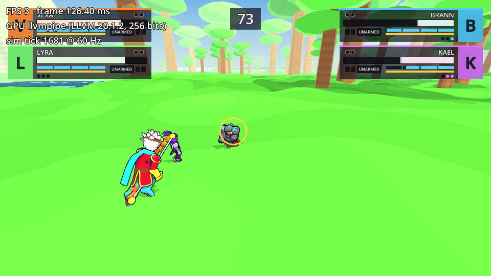 [2 s clip](2026-11-19-fafc61e-quick/captures/104_verdant_falls_ffa4_vexa-brann-lyra-kael_2243_t1681/clip.mp4)

5. **arena_bounds**, fighter 2, legend kael, weapon chakram, zone ember_rift, ffa4, seed 119, worst at tick 1472 (first 1472, 1 frames): outside the arena at (612.63, 36.77, -419.2) (stand 36.84, GRABBED)  
   `tools/qa/run_qa.sh --repro '119:ember_rift:ffa4:brann,lyra,kael,vexa:4433' --tick 1472 --fighter 2`

   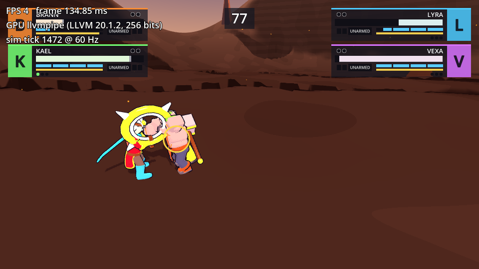 [2 s clip](2026-11-19-fafc61e-quick/captures/119_ember_rift_ffa4_brann-lyra-kael-vexa_4433_t1472/clip.mp4)

6. **foot_ground**, fighter 0, legend kael, weapon repeater, zone shattered_mesa, 1v1, seed 100, worst at tick 2135 (first 489, 44 frames): lowest sole -58.4 cm off the visible ground (IDLE, clip fight_idle)  
   `tools/qa/run_qa.sh --repro '100:shattered_mesa:1v1:kael,vexa:54' --tick 2135 --fighter 0`

   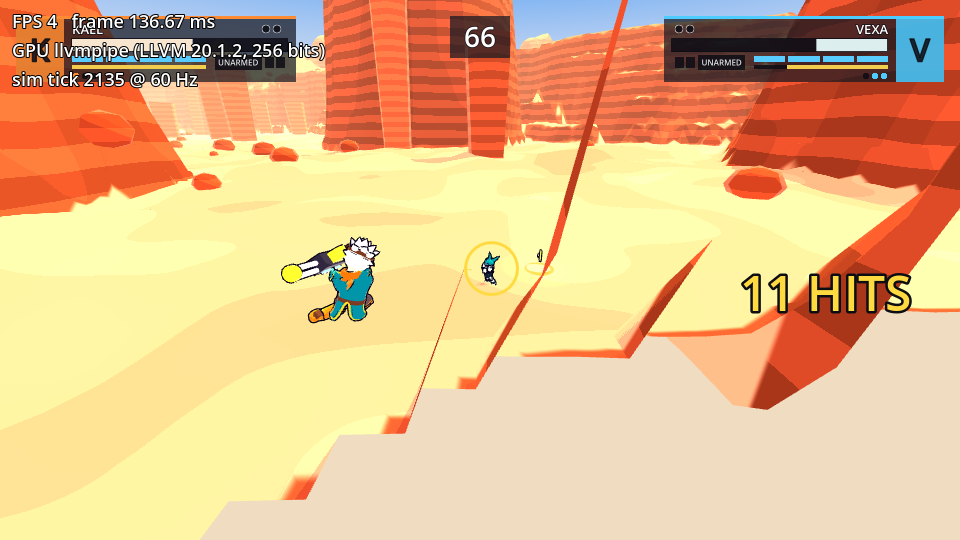 [2 s clip](2026-11-19-fafc61e-quick/captures/100_shattered_mesa_1v1_kael-vexa_54_t2135/clip.mp4)

7. **fighter_overlap**, fighter 0, legend brann, weapon unarmed, zone skyhold_ruins, 2v2, seed 108, worst at tick 202 (first 169, 82 frames): fighters 0 and 2 overlap 0.15 m (BLOCKING vs ATTACKING)  
   `tools/qa/run_qa.sh --repro '108:skyhold_ruins:2v2:brann,lyra,kael,vexa:5343' --tick 202 --fighter 0`

   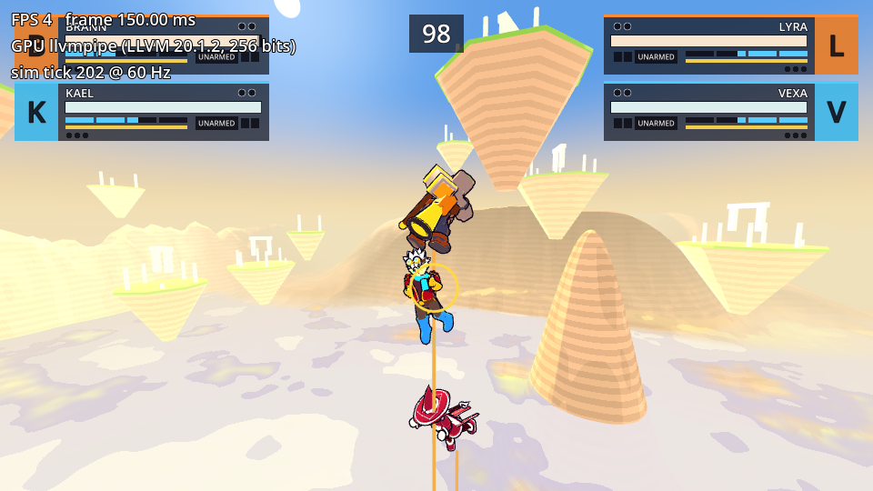 [2 s clip](2026-11-19-fafc61e-quick/captures/108_skyhold_ruins_2v2_brann-lyra-kael-vexa_5343_t202/clip.mp4)

8. **bow_string_head**, fighter 3, legend kael, weapon bow, zone verdant_falls, ffa4, seed 104, worst at tick 1691 (first 1689, 3 frames): bow string 8.4 cm from the head centre (draw 0, MOVING)  
   `tools/qa/run_qa.sh --repro '104:verdant_falls:ffa4:vexa,brann,lyra,kael:2243' --tick 1691 --fighter 3`

   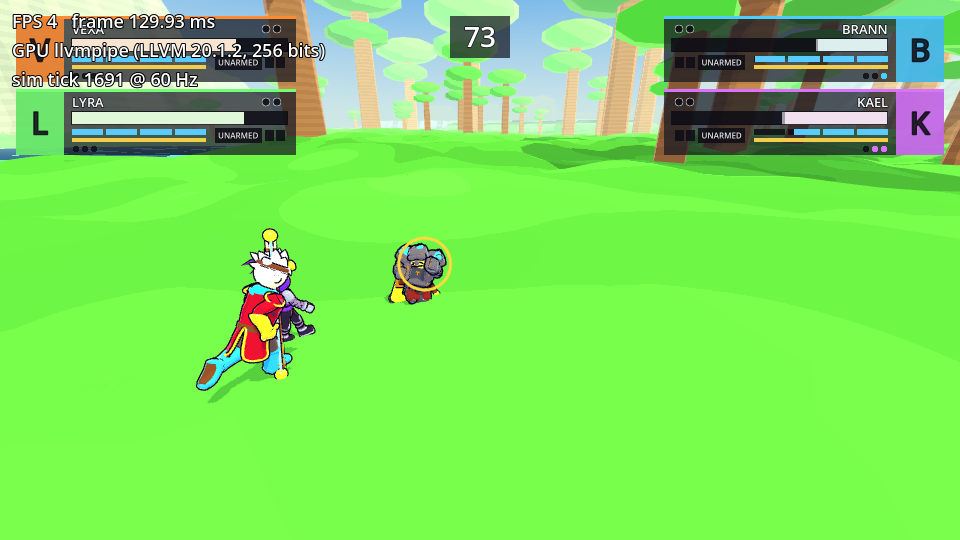 [2 s clip](2026-11-19-fafc61e-quick/captures/104_verdant_falls_ffa4_vexa-brann-lyra-kael_2243_t1691/clip.mp4)

9. **arena_bounds**, fighter 3, legend vexa, weapon unarmed, zone heartbloom_gardens, 2v2, seed 120, worst at tick 976 (first 976, 1 frames): outside the arena at (154.08, 275.41, -90.32) (stand 275.93, VANISHING)  
   `tools/qa/run_qa.sh --repro '120:heartbloom_gardens:2v2:brann,lyra,kael,vexa:5245' --tick 976 --fighter 3`

   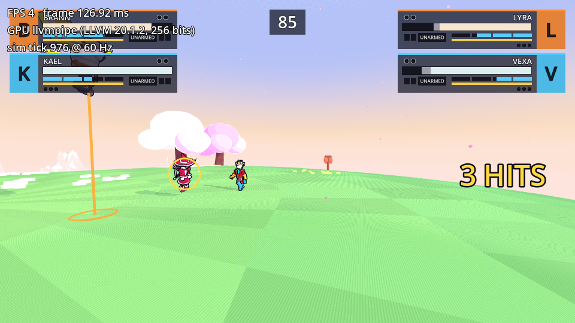 [2 s clip](2026-11-19-fafc61e-quick/captures/120_heartbloom_gardens_2v2_brann-lyra-kael-vexa_5245_t976/clip.mp4)

10. **foot_ground**, fighter 2, legend lyra, weapon unarmed, zone verdant_falls, ffa4, seed 104, worst at tick 2039 (first 212, 17 frames): lowest sole +90.4 cm off the visible ground (IDLE, clip heavy_land)  
   `tools/qa/run_qa.sh --repro '104:verdant_falls:ffa4:vexa,brann,lyra,kael:2243' --tick 2039 --fighter 2`

   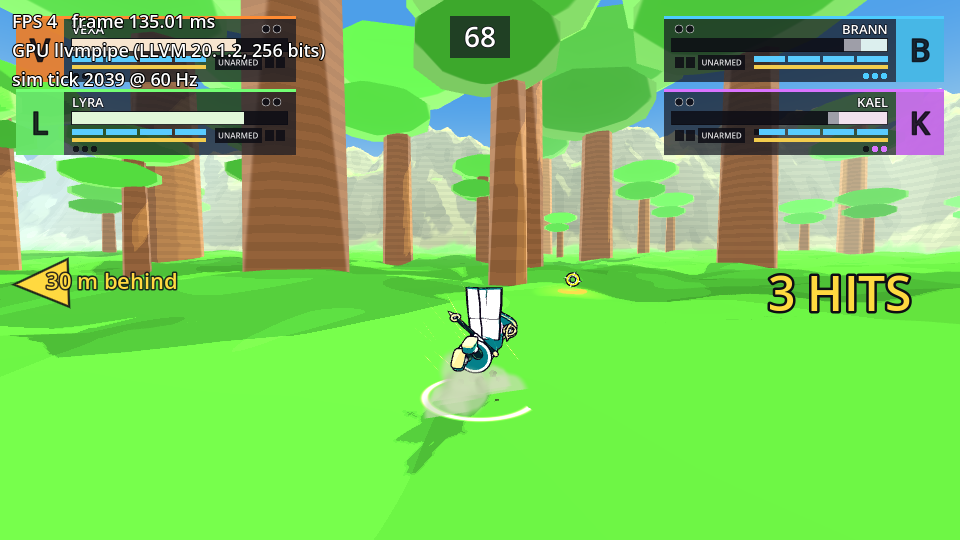 [2 s clip](2026-11-19-fafc61e-quick/captures/104_verdant_falls_ffa4_vexa-brann-lyra-kael_2243_t2039/clip.mp4)

## Scenario library

38 tests: 36 passing, 2 failing, 0 pending (strict mode: known issues fail).

- FAIL `test_brann_lands_lights_launcher_air_light_and_spike_as_one_combo`: [5] expected to be >= than [6]:  one unbroken combo, launcher to spike
- FAIL `test_a_knockout_on_a_raised_island_rests_on_the_island_top`: [1.00000000000000000000] expected to equal [7.0] +/- [0.05]:  lies on the island, not inside it

## Golden replays

9 tests, 0 failing.

## Visual goldens

SSIM floor 0.90, tile 32px changes above 12/255, fail above 5% of tiles.

| Shot | Result | SSIM | Changed tiles |
|---|---|---|---|
| heartbloom_brann_idle.png | PASS | 0.976 | 4.2% |
| heartbloom_brann_light.png | PASS | 0.969 | 4.0% |
| heartbloom_kael_idle.png | PASS | 0.992 | 1.9% |
| heartbloom_kael_light.png | PASS | 0.980 | 2.3% |
| heartbloom_lyra_idle.png | PASS | 0.995 | 0.6% |
| heartbloom_lyra_light.png | PASS | 0.972 | 3.1% |
| heartbloom_vexa_idle.png | PASS | 0.981 | 2.1% |
| heartbloom_vexa_light.png | PASS | 0.976 | 2.7% |
| zone_ember_rift.png | FAIL | 0.884 | 34.6% |

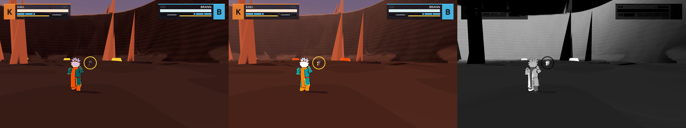

| zone_frozen_peaks.png | FAIL | 0.941 | 80.6% |

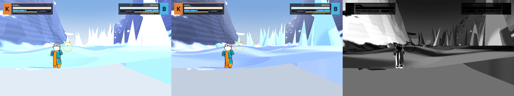

| zone_shattered_mesa.png | FAIL | 0.977 | 19.4% |

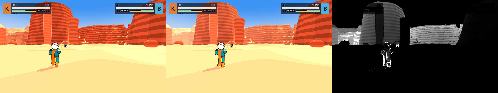

| zone_skyhold_ruins.png | FAIL | 0.849 | 43.1% |

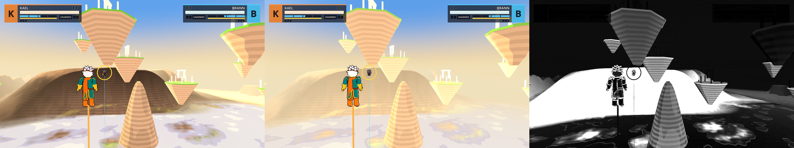

| zone_stormfall_city.png | FAIL | 0.982 | 6.5% |

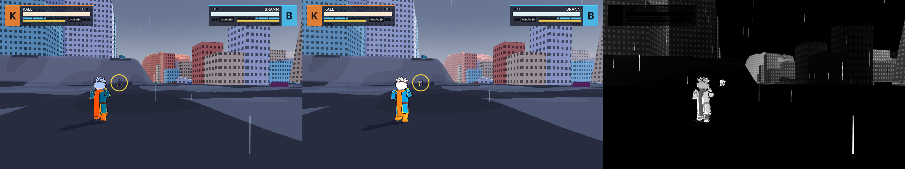

| zone_verdant_falls.png | FAIL | 0.950 | 20.2% |

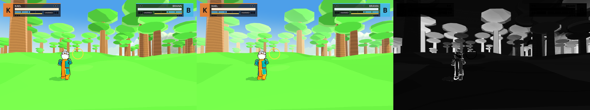

## Feel metrics

Compared with reports/qa/2026-11-19-bc9aa29-quick/metrics.json; regression = worse by more than 15%.

| Metric | Now | Before | Change |
|---|---|---|---|
| hitstop_consistency | 0.6955 | 0.6261 | +11% |
| pops_per_fighter_minute | 0 | 29.26 | -100% |
| finger_pops_per_fighter_minute | 0 | 28.96 | -100% |
| foot_slide_cm_per_frame | 0.0078 | 0.6964 | -99% |
| foot_error_p95_cm | 4.627 | 9.464 | -51% |
| camera_jerk_p95 | 0.01233 | 0.01345 | -8% |
| locked_on_screen_share | 0.9943 | 0.9799 | +1% |
| sim_ms_per_tick | 1.464 | 1.776 | -18% |
| view_ms_per_frame | 1.1 | 1.597 | -31% |

Press to first active frame (ticks at 60 Hz):

| Legend | grab@air | grab@ground | heavy@air | heavy@ground | light@air | light@ground |
|---|---|---|---|---|---|---|
| brann | 10 | 10 | 19 | 19 | 9 | 9 |
| kael | 8 | 8 | 15 | 15 | 7 | 7 |
| lyra | 9 | 9 | 16 | 16 | 7 | 7 |
| vexa | 7 | 7 | 12 | 12 | 5 | 5 |

