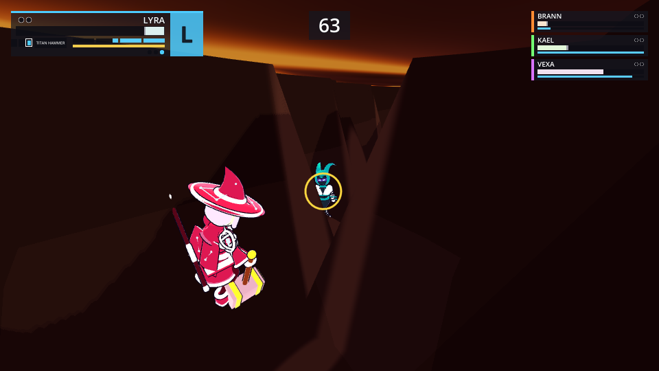
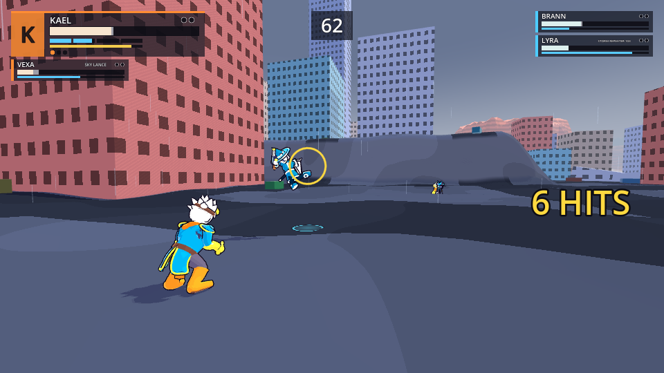
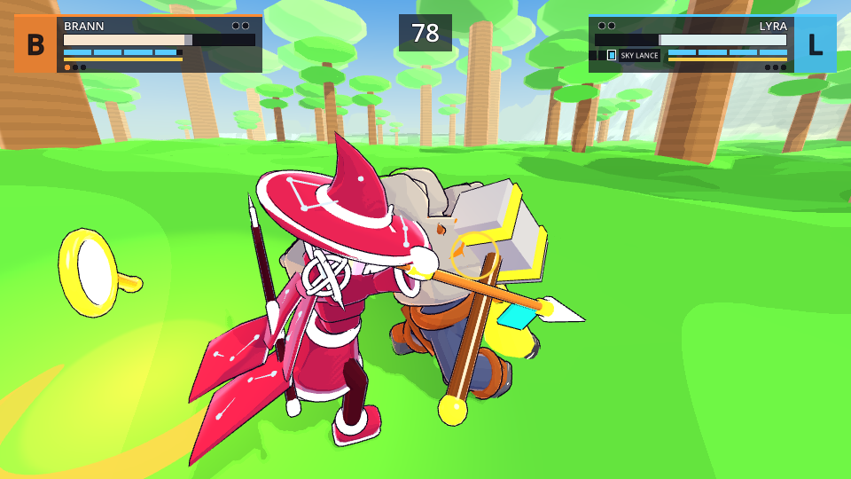
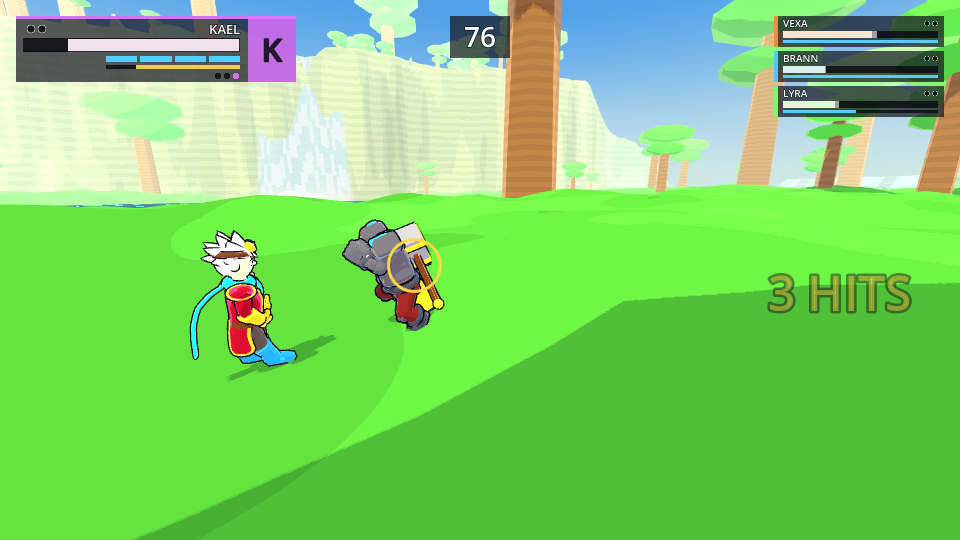
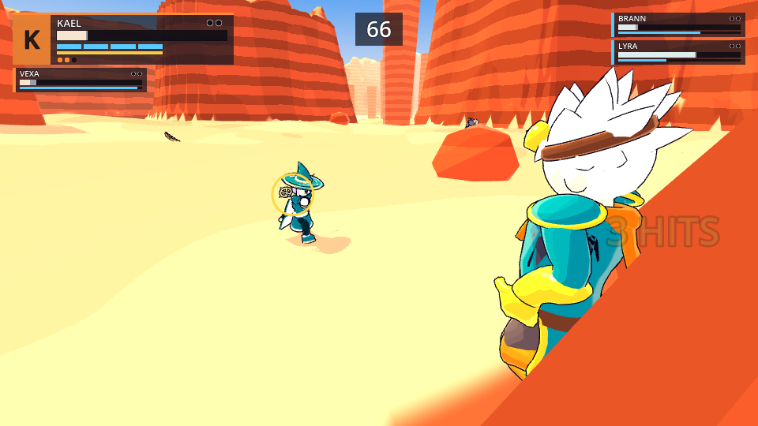
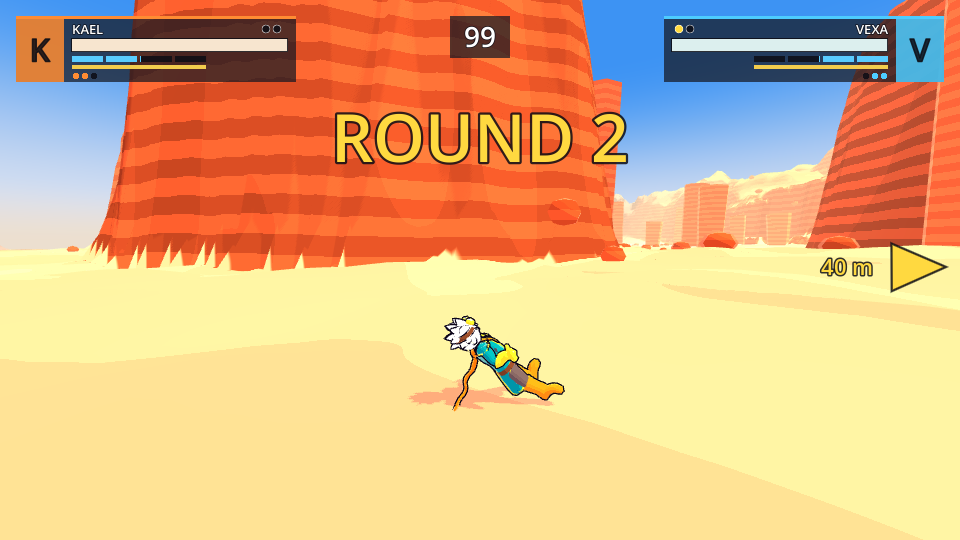
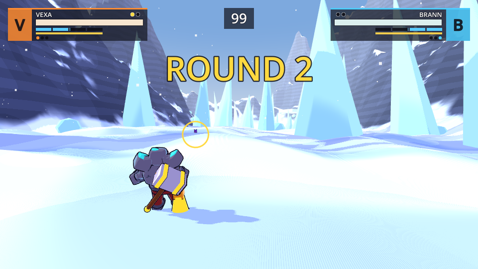
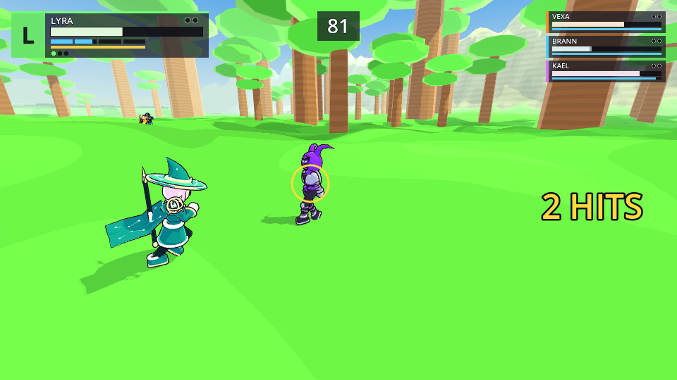

# Gameplay QA report: 20d1f08 (quick)

Matches: 21, ticks: 50400, total wall 449 s. Thresholds are documented in `AGENTS.md` (QA).

| Section | Result |
|---|---|
| Invariant soak (sim) | **PASS** |
| Invariant soak (view) | **FAIL** |
| Scenario library | **PASS** |
| Golden replays | **PASS** |
| Visual goldens | **NOT RUN** |
| Feel metrics trend | **FAIL** |

## Invariant soak: sim

No violations.

## Invariant soak: view

| Check | Matches hit | Frames | Note |
|---|---|---|---|
| foot_ground | 5 / 21 | 28 |  |
| camera_on_screen | 1 / 21 | 1 |  |
| pop | 1 / 21 | 1 |  |

## Top 10 violations

1. **foot_ground**, fighter 1, legend lyra, weapon hammer, zone ember_rift, ffa4, seed 119, worst at tick 2323 (first 2309, 22 frames): lowest sole -27.8 cm off the visible ground (MOVING, clip fight_idle)  
   `tools/qa/run_qa.sh --repro '119:ember_rift:ffa4:brann,lyra,kael,vexa:4433' --tick 2323 --fighter 1`

    [2 s clip](2026-11-20-20d1f08-quick/captures/119_ember_rift_ffa4_brann-lyra-kael-vexa_4433_t2323/clip.mp4)

2. **camera_on_screen**, fighter 0, legend kael, weapon unarmed, zone stormfall_city, 2v2, seed 102, worst at tick 2400 (first 2400, 1 frames): both locked fighters on screen in 94.3% of 2294 locked frames  
   `tools/qa/run_qa.sh --repro '102:stormfall_city:2v2:kael,vexa,brann,lyra:4455' --tick 2400 --fighter 0`

    [2 s clip](2026-11-20-20d1f08-quick/captures/102_stormfall_city_2v2_kael-vexa-brann-lyra_4455_t2400/clip.mp4)

3. **pop**, fighter 1, legend lyra, weapon lance, zone verdant_falls, 1v1, seed 118, worst at tick 1413 (first 1413, 1 frames): RightUpperArm turned 1.21 rad in one frame (HITSTUN, move , clip hit_light)  
   `tools/qa/run_qa.sh --repro '118:verdant_falls:1v1:brann,lyra:24' --tick 1413 --fighter 1`

    [2 s clip](2026-11-20-20d1f08-quick/captures/118_verdant_falls_1v1_brann-lyra_24_t1413/clip.mp4)

4. **foot_ground**, fighter 3, legend kael, weapon unarmed, zone verdant_falls, ffa4, seed 104, worst at tick 1570 (first 1567, 2 frames): lowest sole +5.3 cm off the visible ground (BLOCKING, clip guard)  
   `tools/qa/run_qa.sh --repro '104:verdant_falls:ffa4:vexa,brann,lyra,kael:2243' --tick 1570 --fighter 3`

    [2 s clip](2026-11-20-20d1f08-quick/captures/104_verdant_falls_ffa4_vexa-brann-lyra-kael_2243_t1570/clip.mp4)

5. **foot_ground**, fighter 0, legend kael, weapon unarmed, zone shattered_mesa, 2v2, seed 114, worst at tick 2185 (first 2185, 1 frames): lowest sole +9.2 cm off the visible ground (IDLE, clip fight_idle)  
   `tools/qa/run_qa.sh --repro '114:shattered_mesa:2v2:kael,vexa,brann,lyra:3355' --tick 2185 --fighter 0`

    [2 s clip](2026-11-20-20d1f08-quick/captures/114_shattered_mesa_2v2_kael-vexa-brann-lyra_3355_t2185/clip.mp4)

6. **foot_ground**, fighter 0, legend kael, weapon unarmed, zone shattered_mesa, 1v1, seed 100, worst at tick 2221 (first 2221, 1 frames): lowest sole +7.5 cm off the visible ground (IDLE, clip turn_step)  
   `tools/qa/run_qa.sh --repro '100:shattered_mesa:1v1:kael,vexa:54' --tick 2221 --fighter 0`

    [2 s clip](2026-11-20-20d1f08-quick/captures/100_shattered_mesa_1v1_kael-vexa_54_t2221/clip.mp4)

7. **foot_ground**, fighter 1, legend brann, weapon unarmed, zone frozen_peaks, 1v1, seed 103, worst at tick 2152 (first 2152, 1 frames): lowest sole +5.4 cm off the visible ground (IDLE, clip turn_step)  
   `tools/qa/run_qa.sh --repro '103:frozen_peaks:1v1:vexa,brann:44' --tick 2152 --fighter 1`

    [2 s clip](2026-11-20-20d1f08-quick/captures/103_frozen_peaks_1v1_vexa-brann_44_t2152/clip.mp4)

8. **foot_ground**, fighter 2, legend lyra, weapon unarmed, zone verdant_falls, ffa4, seed 104, worst at tick 1276 (first 1276, 1 frames): lowest sole +5.3 cm off the visible ground (BLOCKING, clip guard)  
   `tools/qa/run_qa.sh --repro '104:verdant_falls:ffa4:vexa,brann,lyra,kael:2243' --tick 1276 --fighter 2`

    [2 s clip](2026-11-20-20d1f08-quick/captures/104_verdant_falls_ffa4_vexa-brann-lyra-kael_2243_t1276/clip.mp4)

## Scenario library

38 tests: 38 passing, 0 failing, 0 pending (strict mode: known issues fail).

## Golden replays

11 tests, 0 failing.

## Visual goldens

Not run: numpy/Pillow missing.

## Feel metrics

Compared with reports/qa/2026-11-20-7c5f465-quick/metrics.json; regression = worse by more than 15%.

| Metric | Now | Before | Change |
|---|---|---|---|
| hitstop_consistency | 0.5949 | 0.62 | -4% |
| pops_per_fighter_minute | 0.03573 | 0 | - |
| finger_pops_per_fighter_minute | 0 | 0 | - |
| foot_slide_cm_per_frame | 0.02761 | 0.03259 | -15% |
| foot_error_p95_cm | 0.8856 | 0.855 | +4% |
| camera_jerk_p95 | 0.01002 | 0.01045 | -4% |
| locked_on_screen_share | 0.9876 | 0.9879 | -0% |
| sim_ms_per_tick | 1.312 | 1.071 | +23% **REGRESSION** |
| view_ms_per_frame | 1.141 | 0.9177 | +24% **REGRESSION** |

Press to first active frame (ticks at 60 Hz):

| Legend | grab@air | grab@ground | heavy@air | heavy@ground | light@air | light@ground |
|---|---|---|---|---|---|---|
| brann | 10 | 10 | 19 | 19 | 9 | 9 |
| kael | 8 | 8 | 15 | 15 | 7 | 7 |
| lyra | 9 | 9 | 16 | 16 | 7 | 7 |
| vexa | 7 | 7 | 12 | 12 | 5 | 5 |

