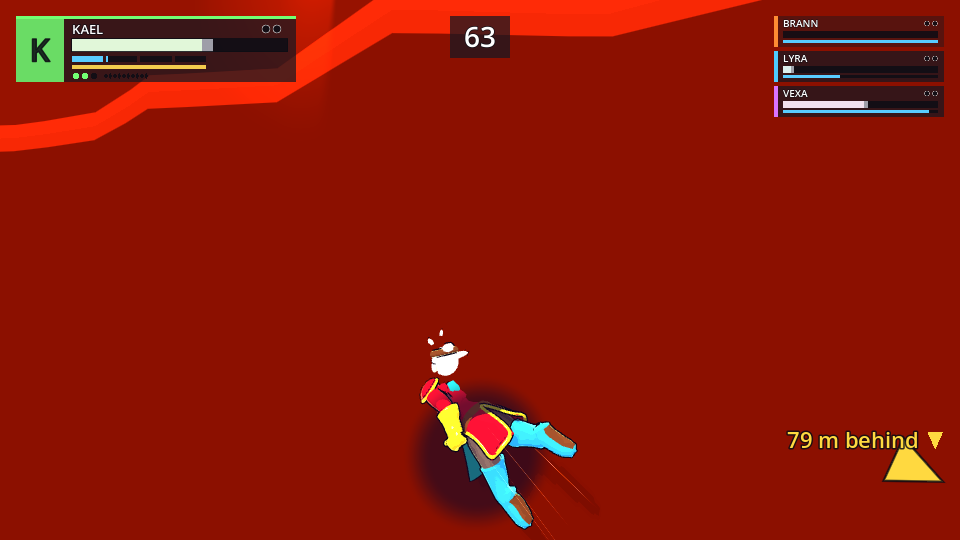
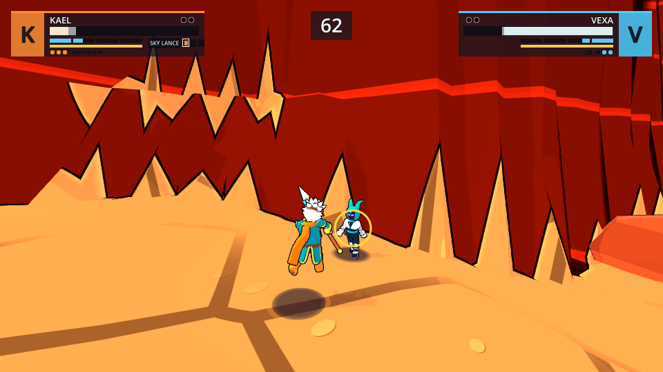
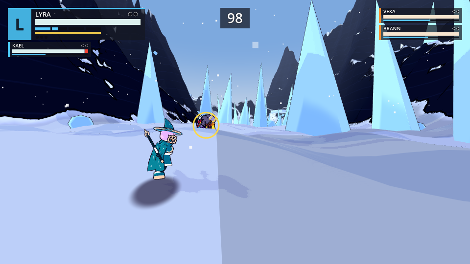
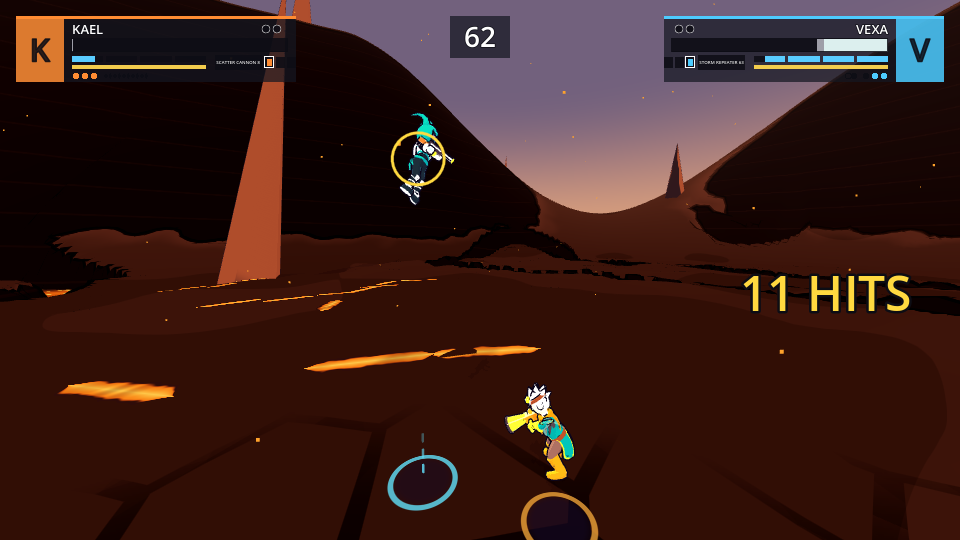
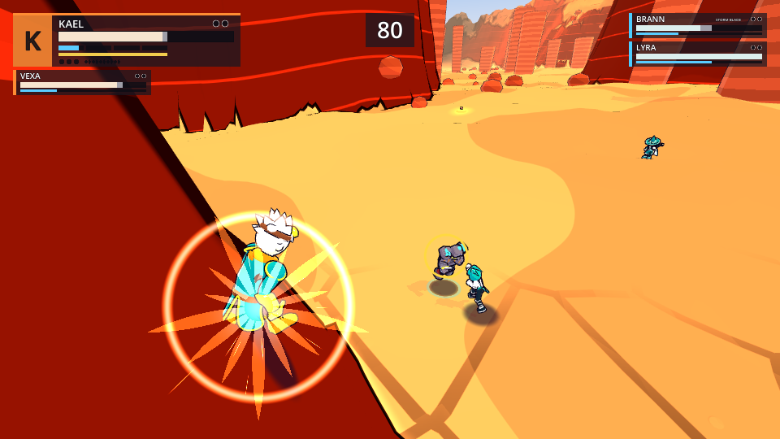
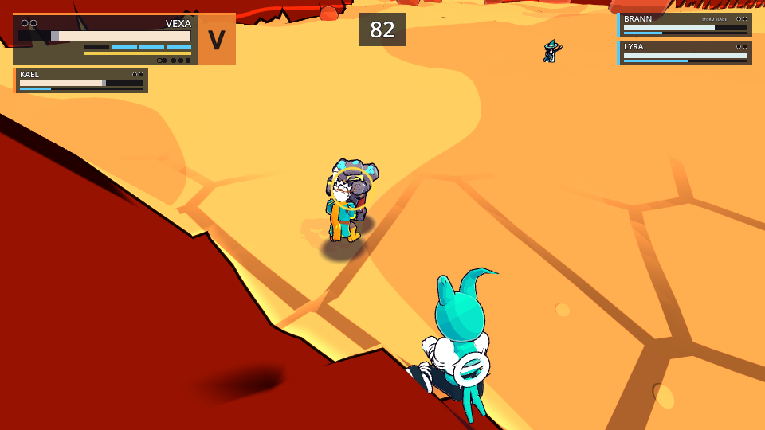
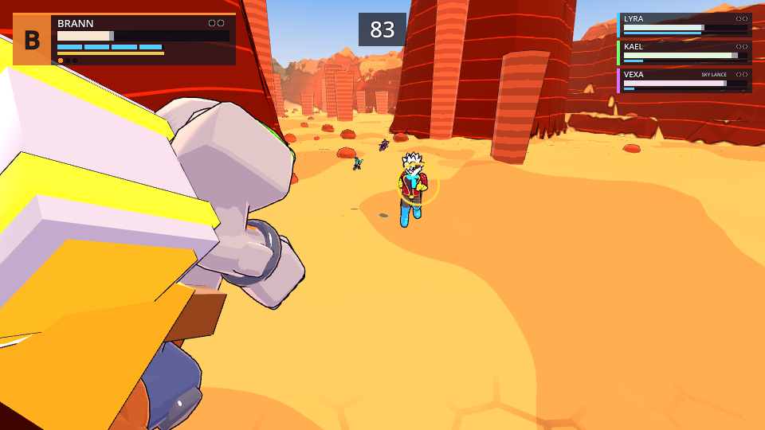
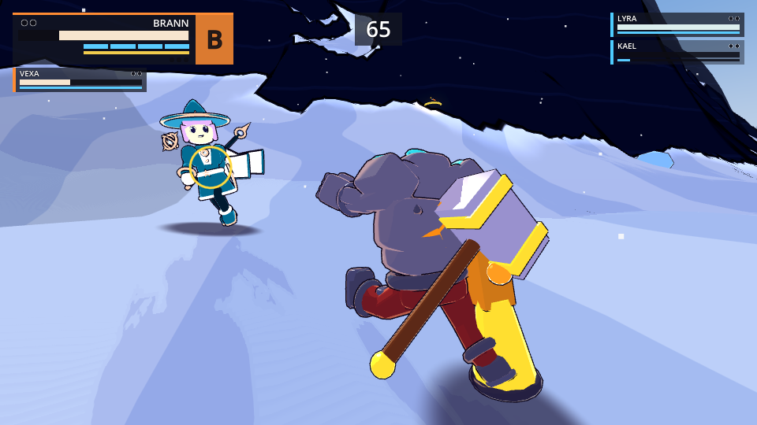

# Gameplay QA report: 6bf311b (quick)

Matches: 21, ticks: 50400, total wall 458 s. Thresholds are documented in `AGENTS.md` (QA).

| Section | Result |
|---|---|
| Invariant soak (sim) | **PASS** |
| Invariant soak (view) | **FAIL** |
| Scenario library | **PASS** |
| Golden replays | **PASS** |
| Visual goldens | **NOT RUN** |
| Feel metrics trend | **FAIL** |

## Invariant soak: sim

No violations.

## Invariant soak: view

| Check | Matches hit | Frames | Note |
|---|---|---|---|
| foot_ground | 3 / 21 | 15 |  |
| camera_on_screen | 2 / 21 | 2 |  |

## Top 10 violations

1. **foot_ground**, fighter 2, legend kael, weapon unarmed, zone shattered_mesa, ffa4, seed 107, worst at tick 2328 (first 2328, 2 frames): lowest sole +167.7 cm off the visible ground (IDLE, clip land)  
   `tools/qa/run_qa.sh --repro '107:shattered_mesa:ffa4:brann,lyra,kael,vexa:2445' --tick 2328 --fighter 2`

    [2 s clip](2026-11-20-6bf311b-quick/captures/107_shattered_mesa_ffa4_brann-lyra-kael-vexa_2445_t2328/clip.mp4)

2. **camera_on_screen**, fighter 0, legend kael, weapon lance, zone shattered_mesa, 1v1, seed 100, worst at tick 2400 (first 2400, 1 frames): both locked fighters on screen in 92.8% of 2255 locked frames  
   `tools/qa/run_qa.sh --repro '100:shattered_mesa:1v1:kael,vexa:54' --tick 2400 --fighter 0`

    [2 s clip](2026-11-20-6bf311b-quick/captures/100_shattered_mesa_1v1_kael-vexa_54_t2400/clip.mp4)

3. **foot_ground**, fighter 2, legend lyra, weapon unarmed, zone frozen_peaks, 2v2, seed 117, worst at tick 268 (first 268, 9 frames): lowest sole +30.7 cm off the visible ground (IDLE, clip fight_idle)  
   `tools/qa/run_qa.sh --repro '117:frozen_peaks:2v2:vexa,brann,lyra,kael:2343' --tick 268 --fighter 2`

    [2 s clip](2026-11-20-6bf311b-quick/captures/117_frozen_peaks_2v2_vexa-brann-lyra-kael_2343_t268/clip.mp4)

4. **camera_on_screen**, fighter 0, legend kael, weapon scatter, zone ember_rift, 1v1, seed 112, worst at tick 2400 (first 2400, 1 frames): both locked fighters on screen in 94.4% of 2287 locked frames  
   `tools/qa/run_qa.sh --repro '112:ember_rift:1v1:kael,vexa:45' --tick 2400 --fighter 0`

    [2 s clip](2026-11-20-6bf311b-quick/captures/112_ember_rift_1v1_kael-vexa_45_t2400/clip.mp4)

5. **foot_ground**, fighter 0, legend kael, weapon unarmed, zone shattered_mesa, 2v2, seed 114, worst at tick 1292 (first 1292, 1 frames): lowest sole -98.5 cm off the visible ground (IDLE, clip fight_idle)  
   `tools/qa/run_qa.sh --repro '114:shattered_mesa:2v2:kael,vexa,brann,lyra:3355' --tick 1292 --fighter 0`

    [2 s clip](2026-11-20-6bf311b-quick/captures/114_shattered_mesa_2v2_kael-vexa-brann-lyra_3355_t1292/clip.mp4)

6. **foot_ground**, fighter 1, legend vexa, weapon unarmed, zone shattered_mesa, 2v2, seed 114, worst at tick 1170 (first 1170, 1 frames): lowest sole +34.7 cm off the visible ground (IDLE, clip turn_step)  
   `tools/qa/run_qa.sh --repro '114:shattered_mesa:2v2:kael,vexa,brann,lyra:3355' --tick 1170 --fighter 1`

    [2 s clip](2026-11-20-6bf311b-quick/captures/114_shattered_mesa_2v2_kael-vexa-brann-lyra_3355_t1170/clip.mp4)

7. **foot_ground**, fighter 0, legend brann, weapon unarmed, zone shattered_mesa, ffa4, seed 107, worst at tick 1126 (first 1126, 1 frames): lowest sole -18.5 cm off the visible ground (IDLE, clip fight_idle)  
   `tools/qa/run_qa.sh --repro '107:shattered_mesa:ffa4:brann,lyra,kael,vexa:2445' --tick 1126 --fighter 0`

    [2 s clip](2026-11-20-6bf311b-quick/captures/107_shattered_mesa_ffa4_brann-lyra-kael-vexa_2445_t1126/clip.mp4)

8. **foot_ground**, fighter 1, legend brann, weapon unarmed, zone frozen_peaks, 2v2, seed 117, worst at tick 2215 (first 2215, 1 frames): lowest sole +12.5 cm off the visible ground (IDLE, clip fight_idle)  
   `tools/qa/run_qa.sh --repro '117:frozen_peaks:2v2:vexa,brann,lyra,kael:2343' --tick 2215 --fighter 1`

    [2 s clip](2026-11-20-6bf311b-quick/captures/117_frozen_peaks_2v2_vexa-brann-lyra-kael_2343_t2215/clip.mp4)

## Ki usage by the AI (T-KI1)

| blasts | charged | beams | ultimates | clashes | reflects | soaks | beam_whiffs | ki_hits |
|---|---|---|---|---|---|---|---|---|
| 78 | 30 | 5 | 0 | 0 | 2 | 1 | 1 | 76 |

Per fighter-minute (46.7 fighter-minutes): blasts 1.67, charged 0.64, beams 0.11, clashes 0.00.

## Scenario library

38 tests: 38 passing, 0 failing, 0 pending (strict mode: known issues fail).

## Golden replays

9 tests, 0 failing.

## Visual goldens

Not run: numpy/Pillow missing.

## Feel metrics

Compared with reports/qa/2026-11-20-b9fbf04-quick/metrics.json; regression = worse by more than 15%.

| Metric | Now | Before | Change |
|---|---|---|---|
| hitstop_consistency | 0.7028 | 0.6422 | +9% |
| pops_per_fighter_minute | 0 | 0 | - |
| finger_pops_per_fighter_minute | 0.01786 | 0 | - |
| foot_slide_cm_per_frame | 0.02786 | 0.03814 | -27% |
| foot_error_p95_cm | 0.9078 | 0.9055 | +0% |
| camera_jerk_p95 | 0.01052 | 0.01074 | -2% |
| locked_on_screen_share | 0.9784 | 0.9895 | -1% |
| sim_ms_per_tick | 1.605 | 0.8401 | +91% **REGRESSION** |
| view_ms_per_frame | 1.325 | 0.6898 | +92% **REGRESSION** |

Press to first active frame (ticks at 60 Hz):

| Legend | grab@air | grab@ground | heavy@air | heavy@ground | light@air | light@ground |
|---|---|---|---|---|---|---|
| brann | 10 | 10 | 19 | 19 | 9 | 9 |
| kael | 8 | 8 | 15 | 15 | 7 | 7 |
| lyra | 9 | 9 | 16 | 16 | 7 | 7 |
| vexa | 7 | 7 | 12 | 12 | 5 | 5 |

