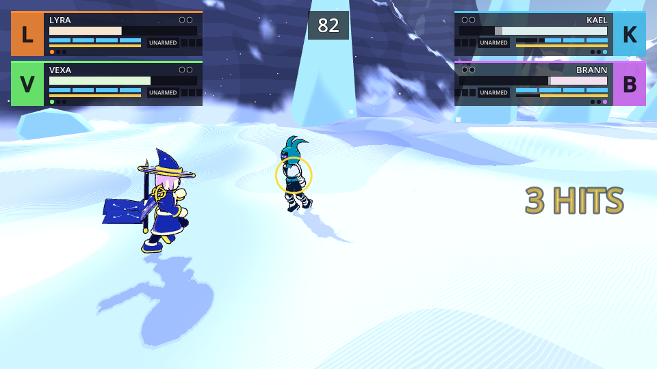
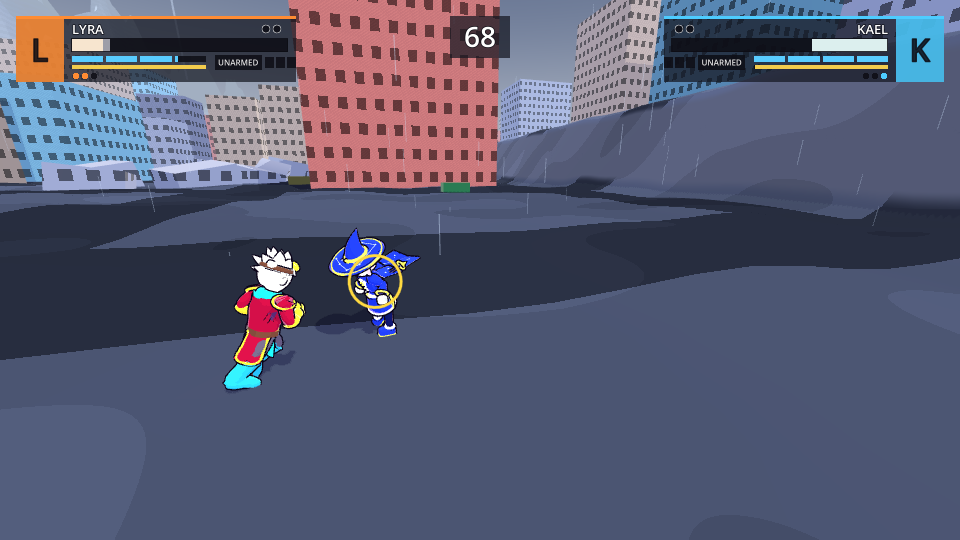

# Gameplay QA report: 830ca2c (quick)

Matches: 21, ticks: 50400, total wall 453 s. Thresholds are documented in `AGENTS.md` (QA).

| Section | Result |
|---|---|
| Invariant soak (sim) | **PASS** |
| Invariant soak (view) | **FAIL** |
| Scenario library | **PASS** |
| Golden replays | **PASS** |
| Visual goldens | **NOT RUN** |
| Feel metrics trend | **PASS** |

## Invariant soak: sim

No violations.

## Invariant soak: view

| Check | Matches hit | Frames | Note |
|---|---|---|---|
| foot_ground | 2 / 21 | 3 |  |

## Top 10 violations

1. **foot_ground**, fighter 0, legend lyra, weapon unarmed, zone frozen_peaks, ffa4, seed 110, worst at tick 1181 (first 1178, 2 frames): lowest sole +6.6 cm off the visible ground (BLOCKING, clip guard)  
   `tools/qa/run_qa.sh --repro '110:frozen_peaks:ffa4:lyra,kael,vexa,brann:3523' --tick 1181 --fighter 0`

    [2 s clip](2026-11-20-830ca2c-quick/captures/110_frozen_peaks_ffa4_lyra-kael-vexa-brann_3523_t1181/clip.mp4)

2. **foot_ground**, fighter 1, legend kael, weapon unarmed, zone stormfall_city, 1v1, seed 109, worst at tick 2035 (first 2035, 1 frames): lowest sole +5.2 cm off the visible ground (BLOCKING, clip guard)  
   `tools/qa/run_qa.sh --repro '109:stormfall_city:1v1:lyra,kael:43' --tick 2035 --fighter 1`

    [2 s clip](2026-11-20-830ca2c-quick/captures/109_stormfall_city_1v1_lyra-kael_43_t2035/clip.mp4)

## Scenario library

38 tests: 38 passing, 0 failing, 0 pending (strict mode: known issues fail).

## Golden replays

9 tests, 0 failing.

## Visual goldens

Not run: numpy/Pillow missing.

## Feel metrics

Compared with reports/qa/2026-11-19-fafc61e-quick/metrics.json; regression = worse by more than 15%.

| Metric | Now | Before | Change |
|---|---|---|---|
| hitstop_consistency | 0.606 | 0.6955 | -13% |
| pops_per_fighter_minute | 0 | 0 | - |
| finger_pops_per_fighter_minute | 0 | 0 | - |
| foot_slide_cm_per_frame | 0.06609 | 0.0078 | re-baselined (v2) |
| foot_error_p95_cm | 0.8857 | 4.627 | -81% |
| camera_jerk_p95 | 0.01054 | 0.01233 | -14% |
| locked_on_screen_share | 0.9879 | 0.9943 | -1% |
| sim_ms_per_tick | 1.395 | 1.464 | -5% |
| view_ms_per_frame | 1.173 | 1.1 | +7% |

Press to first active frame (ticks at 60 Hz):

| Legend | grab@air | grab@ground | heavy@air | heavy@ground | light@air | light@ground |
|---|---|---|---|---|---|---|
| brann | 10 | 10 | 19 | 19 | 9 | 9 |
| kael | 8 | 8 | 15 | 15 | 7 | 7 |
| lyra | 9 | 9 | 16 | 16 | 7 | 7 |
| vexa | 7 | 7 | 12 | 12 | 5 | 5 |

