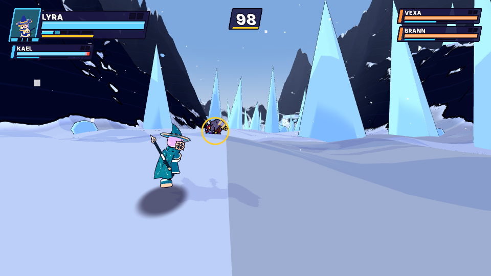
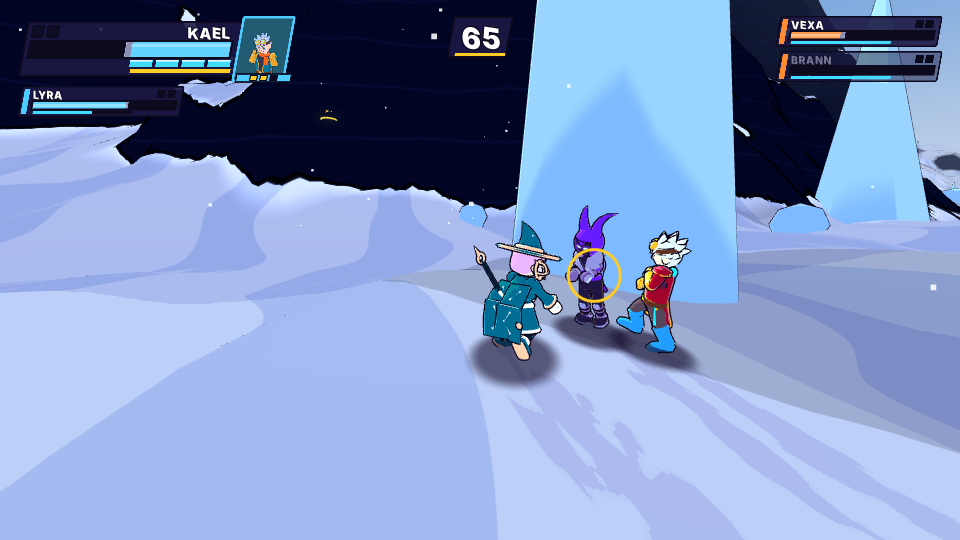
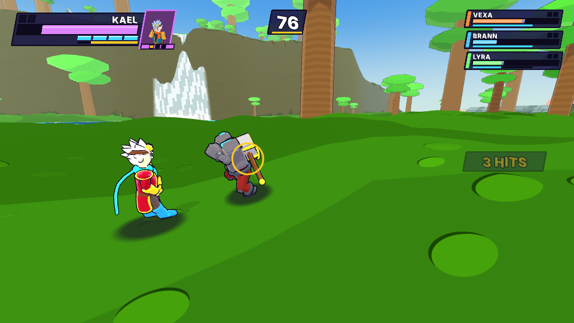
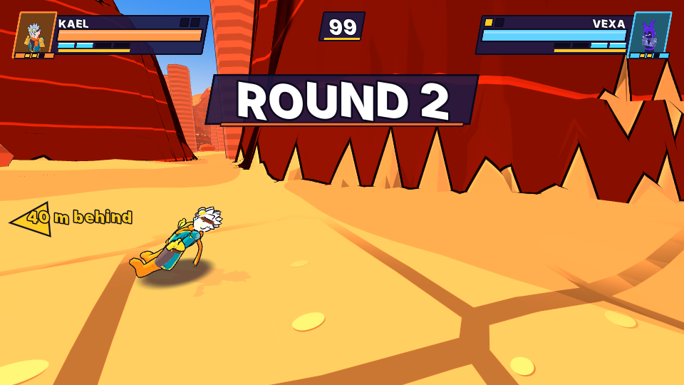
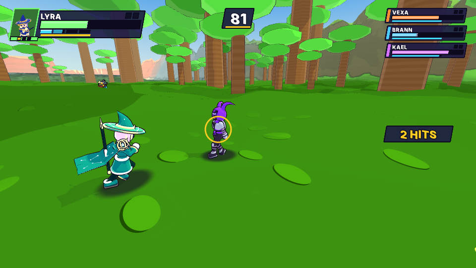
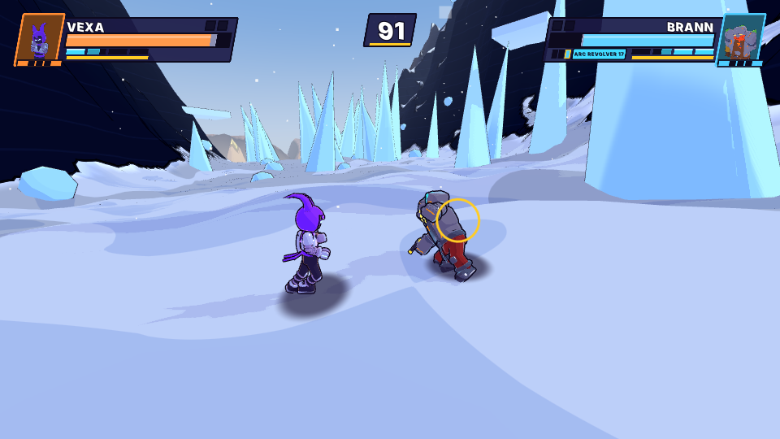

# Gameplay QA report: 842c22b (quick)

Matches: 21, ticks: 50400, total wall 485 s. Thresholds are documented in `AGENTS.md` (QA).

| Section | Result |
|---|---|
| Invariant soak (sim) | **PASS** |
| Invariant soak (view) | **FAIL** |
| Scenario library | **PASS** |
| Golden replays | **PASS** |
| Visual goldens | **NOT RUN** |
| Feel metrics trend | **PASS** |

## Invariant soak: sim

No violations.

## Invariant soak: view

| Check | Matches hit | Frames | Note |
|---|---|---|---|
| foot_ground | 4 / 21 | 14 |  |

## Top 10 violations

1. **foot_ground**, fighter 2, legend lyra, weapon unarmed, zone frozen_peaks, 2v2, seed 117, worst at tick 268 (first 268, 7 frames): lowest sole +30.7 cm off the visible ground (IDLE, clip fight_idle)  
   `tools/qa/run_qa.sh --repro '117:frozen_peaks:2v2:vexa,brann,lyra,kael:2343' --tick 268 --fighter 2`

    [2 s clip](2026-11-20-842c22b-quick/captures/117_frozen_peaks_2v2_vexa-brann-lyra-kael_2343_t268/clip.mp4)

2. **foot_ground**, fighter 3, legend kael, weapon unarmed, zone frozen_peaks, 2v2, seed 117, worst at tick 2206 (first 2201, 2 frames): lowest sole +5.4 cm off the visible ground (BLOCKING, clip guard)  
   `tools/qa/run_qa.sh --repro '117:frozen_peaks:2v2:vexa,brann,lyra,kael:2343' --tick 2206 --fighter 3`

    [2 s clip](2026-11-20-842c22b-quick/captures/117_frozen_peaks_2v2_vexa-brann-lyra-kael_2343_t2206/clip.mp4)

3. **foot_ground**, fighter 3, legend kael, weapon unarmed, zone verdant_falls, ffa4, seed 104, worst at tick 1570 (first 1567, 2 frames): lowest sole +5.3 cm off the visible ground (BLOCKING, clip guard)  
   `tools/qa/run_qa.sh --repro '104:verdant_falls:ffa4:vexa,brann,lyra,kael:2243' --tick 1570 --fighter 3`

    [2 s clip](2026-11-20-842c22b-quick/captures/104_verdant_falls_ffa4_vexa-brann-lyra-kael_2243_t1570/clip.mp4)

4. **foot_ground**, fighter 0, legend kael, weapon unarmed, zone shattered_mesa, 1v1, seed 100, worst at tick 2226 (first 2226, 1 frames): lowest sole +7.5 cm off the visible ground (IDLE, clip turn_step)  
   `tools/qa/run_qa.sh --repro '100:shattered_mesa:1v1:kael,vexa:54' --tick 2226 --fighter 0`

    [2 s clip](2026-11-20-842c22b-quick/captures/100_shattered_mesa_1v1_kael-vexa_54_t2226/clip.mp4)

5. **foot_ground**, fighter 2, legend lyra, weapon unarmed, zone verdant_falls, ffa4, seed 104, worst at tick 1276 (first 1276, 1 frames): lowest sole +5.3 cm off the visible ground (BLOCKING, clip guard)  
   `tools/qa/run_qa.sh --repro '104:verdant_falls:ffa4:vexa,brann,lyra,kael:2243' --tick 1276 --fighter 2`

    [2 s clip](2026-11-20-842c22b-quick/captures/104_verdant_falls_ffa4_vexa-brann-lyra-kael_2243_t1276/clip.mp4)

6. **foot_ground**, fighter 0, legend vexa, weapon unarmed, zone frozen_peaks, 1v1, seed 103, worst at tick 639 (first 639, 1 frames): lowest sole +5.1 cm off the visible ground (BLOCKING, clip guard)  
   `tools/qa/run_qa.sh --repro '103:frozen_peaks:1v1:vexa,brann:44' --tick 639 --fighter 0`

    [2 s clip](2026-11-20-842c22b-quick/captures/103_frozen_peaks_1v1_vexa-brann_44_t639/clip.mp4)

## Ki usage by the AI (T-KI1)

| blasts | charged | beams | ultimates | clashes | reflects | soaks | beam_whiffs | ki_hits |
|---|---|---|---|---|---|---|---|---|
| 82 | 23 | 7 | 0 | 0 | 2 | 1 | 2 | 64 |

Per fighter-minute (46.7 fighter-minutes): blasts 1.76, charged 0.49, beams 0.15, clashes 0.00.

## Scenario library

38 tests: 38 passing, 0 failing, 0 pending (strict mode: known issues fail).

## Golden replays

11 tests, 0 failing.

## Visual goldens

Not run: numpy/Pillow missing.

## Feel metrics

Compared with reports/qa/2026-11-20-59963fd-quick/metrics.json; regression = worse by more than 15%.

| Metric | Now | Before | Change |
|---|---|---|---|
| hitstop_consistency | 0.6198 | 0.6198 | +0% |
| pops_per_fighter_minute | 0 | 0 | - |
| finger_pops_per_fighter_minute | 0.01786 | 0.01786 | +0% |
| foot_slide_cm_per_frame | 0.02877 | 0.02877 | +0% |
| foot_error_p95_cm | 0.9107 | 0.9107 | +0% |
| camera_jerk_p95 | 0.009425 | 0.009425 | +0% |
| locked_on_screen_share | 0.9849 | 0.9849 | +0% |
| sim_ms_per_tick | 1.651 | 2.028 | -19% |
| view_ms_per_frame | 1.417 | 1.742 | -19% |

Press to first active frame (ticks at 60 Hz):

| Legend | grab@air | grab@ground | heavy@air | heavy@ground | light@air | light@ground |
|---|---|---|---|---|---|---|
| brann | 10 | 10 | 19 | 19 | 9 | 9 |
| kael | 8 | 8 | 15 | 15 | 7 | 7 |
| lyra | 9 | 9 | 16 | 16 | 7 | 7 |
| vexa | 7 | 7 | 12 | 12 | 5 | 5 |

