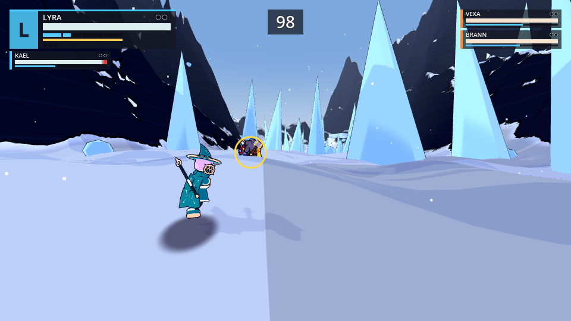
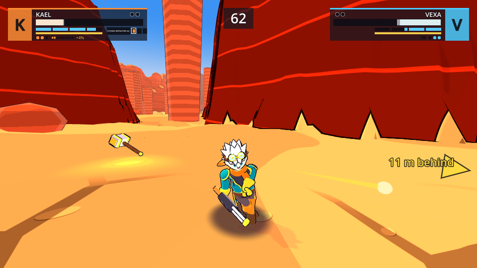
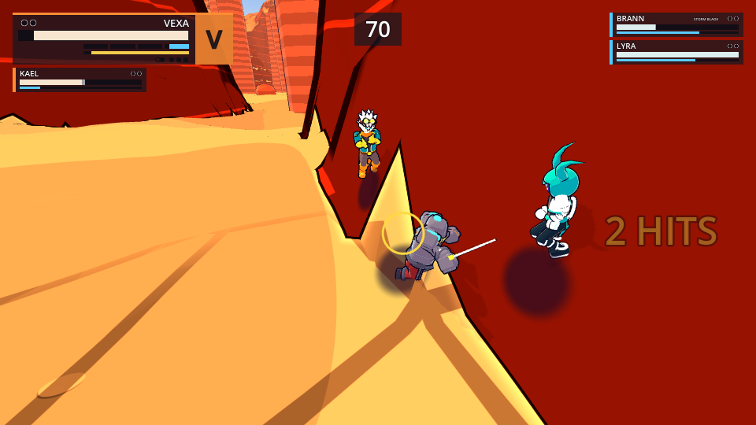
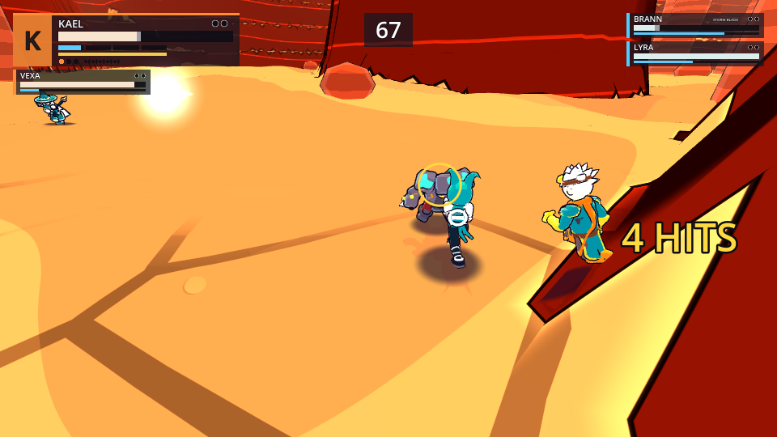
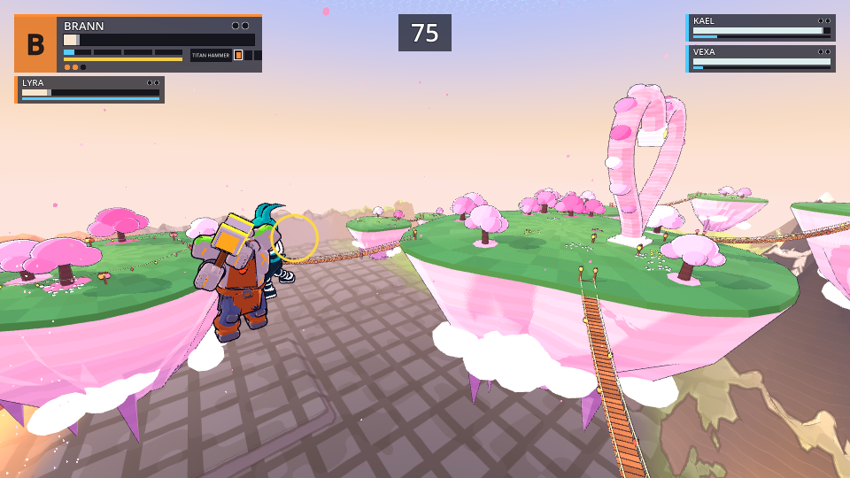
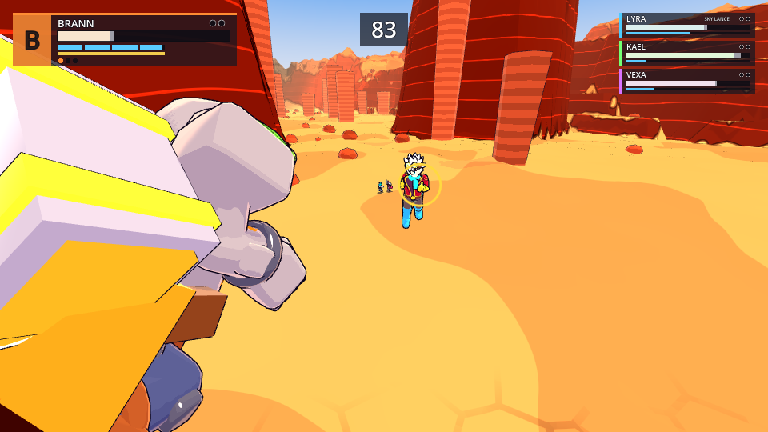
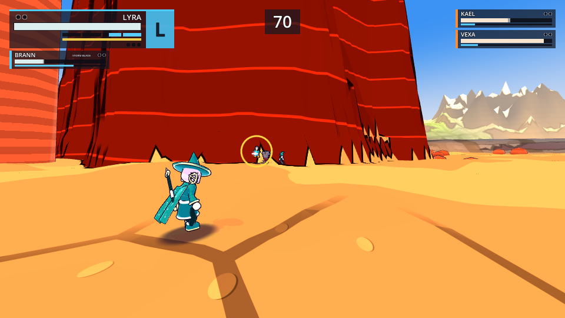
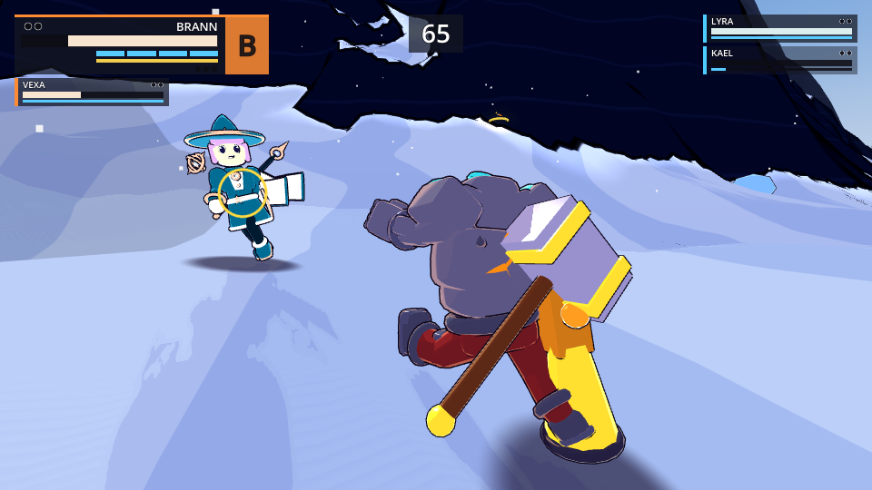
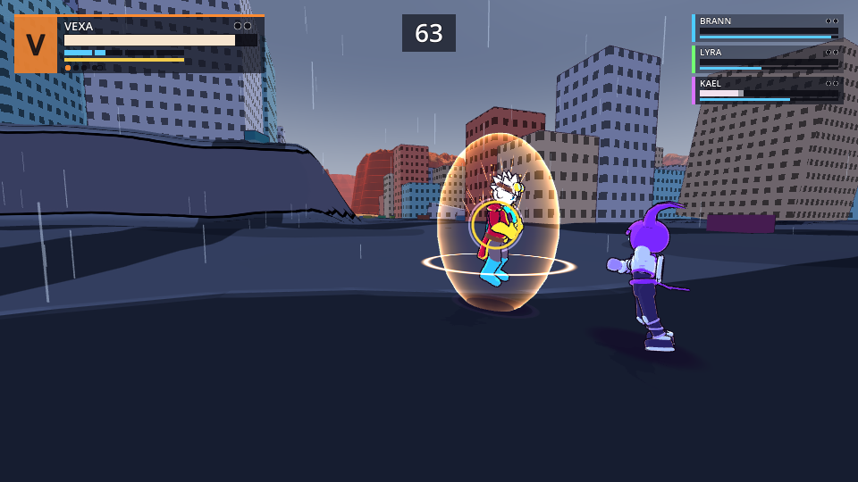
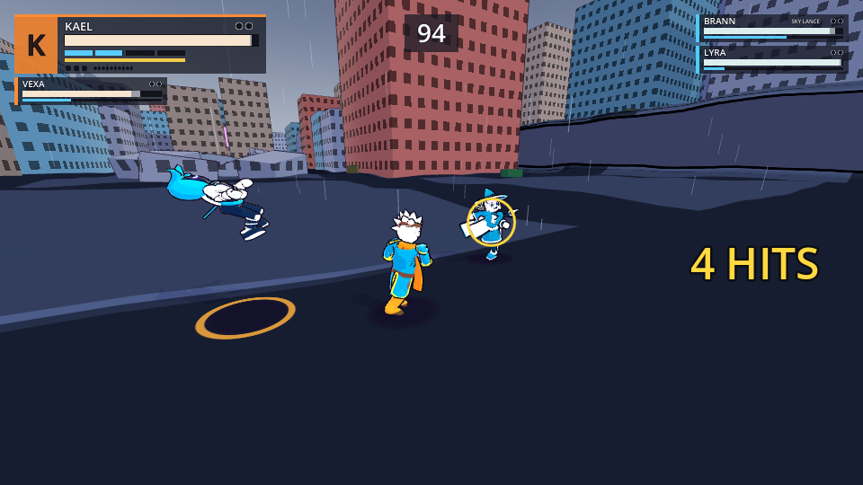

# Gameplay QA report: a90acdb (quick)

Matches: 21, ticks: 50400, total wall 372 s. Thresholds are documented in `AGENTS.md` (QA).

| Section | Result |
|---|---|
| Invariant soak (sim) | **PASS** |
| Invariant soak (view) | **FAIL** |
| Scenario library | **PASS** |
| Golden replays | **PASS** |
| Visual goldens | **PASS** |
| Feel metrics trend | **PASS** |

## Invariant soak: sim

No violations.

## Invariant soak: view

| Check | Matches hit | Frames | Note |
|---|---|---|---|
| foot_ground | 6 / 21 | 27 |  |
| camera_on_screen | 1 / 21 | 1 |  |

## Top 10 violations

1. **foot_ground**, fighter 2, legend lyra, weapon unarmed, zone frozen_peaks, 2v2, seed 117, worst at tick 268 (first 268, 9 frames): lowest sole +30.7 cm off the visible ground (IDLE, clip fight_idle)  
   `tools/qa/run_qa.sh --repro '117:frozen_peaks:2v2:vexa,brann,lyra,kael:2343' --tick 268 --fighter 2`

    [2 s clip](2026-11-20-a90acdb-quick/captures/117_frozen_peaks_2v2_vexa-brann-lyra-kael_2343_t268/clip.mp4)

2. **camera_on_screen**, fighter 0, legend kael, weapon repeater, zone shattered_mesa, 1v1, seed 100, worst at tick 2400 (first 2400, 1 frames): both locked fighters on screen in 93.4% of 2210 locked frames  
   `tools/qa/run_qa.sh --repro '100:shattered_mesa:1v1:kael,vexa:54' --tick 2400 --fighter 0`

    [2 s clip](2026-11-20-a90acdb-quick/captures/100_shattered_mesa_1v1_kael-vexa_54_t2400/clip.mp4)

3. **foot_ground**, fighter 1, legend vexa, weapon unarmed, zone shattered_mesa, 2v2, seed 114, worst at tick 1937 (first 1936, 6 frames): lowest sole -20.0 cm off the visible ground (BLOCKING, clip guard)  
   `tools/qa/run_qa.sh --repro '114:shattered_mesa:2v2:kael,vexa,brann,lyra:3355' --tick 1937 --fighter 1`

    [2 s clip](2026-11-20-a90acdb-quick/captures/114_shattered_mesa_2v2_kael-vexa-brann-lyra_3355_t1937/clip.mp4)

4. **foot_ground**, fighter 0, legend kael, weapon unarmed, zone shattered_mesa, 2v2, seed 114, worst at tick 2109 (first 1984, 5 frames): lowest sole -7.5 cm off the visible ground (MOVING, clip run)  
   `tools/qa/run_qa.sh --repro '114:shattered_mesa:2v2:kael,vexa,brann,lyra:3355' --tick 2109 --fighter 0`

    [2 s clip](2026-11-20-a90acdb-quick/captures/114_shattered_mesa_2v2_kael-vexa-brann-lyra_3355_t2109/clip.mp4)

5. **foot_ground**, fighter 0, legend brann, weapon unarmed, zone heartbloom_gardens, 2v2, seed 120, worst at tick 1591 (first 1591, 1 frames): lowest sole -21.1 cm off the visible ground (MOVING, clip run)  
   `tools/qa/run_qa.sh --repro '120:heartbloom_gardens:2v2:brann,lyra,kael,vexa:5245' --tick 1591 --fighter 0`

    [2 s clip](2026-11-20-a90acdb-quick/captures/120_heartbloom_gardens_2v2_brann-lyra-kael-vexa_5245_t1591/clip.mp4)

6. **foot_ground**, fighter 0, legend brann, weapon unarmed, zone shattered_mesa, ffa4, seed 107, worst at tick 1126 (first 1126, 1 frames): lowest sole -18.5 cm off the visible ground (IDLE, clip fight_idle)  
   `tools/qa/run_qa.sh --repro '107:shattered_mesa:ffa4:brann,lyra,kael,vexa:2445' --tick 1126 --fighter 0`

    [2 s clip](2026-11-20-a90acdb-quick/captures/107_shattered_mesa_ffa4_brann-lyra-kael-vexa_2445_t1126/clip.mp4)

7. **foot_ground**, fighter 3, legend lyra, weapon unarmed, zone shattered_mesa, 2v2, seed 114, worst at tick 1890 (first 1890, 2 frames): lowest sole +7.4 cm off the visible ground (CHARGING, clip charge)  
   `tools/qa/run_qa.sh --repro '114:shattered_mesa:2v2:kael,vexa,brann,lyra:3355' --tick 1890 --fighter 3`

    [2 s clip](2026-11-20-a90acdb-quick/captures/114_shattered_mesa_2v2_kael-vexa-brann-lyra_3355_t1890/clip.mp4)

8. **foot_ground**, fighter 1, legend brann, weapon unarmed, zone frozen_peaks, 2v2, seed 117, worst at tick 2215 (first 2215, 1 frames): lowest sole +12.5 cm off the visible ground (IDLE, clip fight_idle)  
   `tools/qa/run_qa.sh --repro '117:frozen_peaks:2v2:vexa,brann,lyra,kael:2343' --tick 2215 --fighter 1`

    [2 s clip](2026-11-20-a90acdb-quick/captures/117_frozen_peaks_2v2_vexa-brann-lyra-kael_2343_t2215/clip.mp4)

9. **foot_ground**, fighter 0, legend vexa, weapon unarmed, zone stormfall_city, ffa4, seed 116, worst at tick 2355 (first 2355, 1 frames): lowest sole +6.2 cm off the visible ground (BLOCKING, clip guard)  
   `tools/qa/run_qa.sh --repro '116:stormfall_city:ffa4:vexa,brann,lyra,kael:5333' --tick 2355 --fighter 0`

    [2 s clip](2026-11-20-a90acdb-quick/captures/116_stormfall_city_ffa4_vexa-brann-lyra-kael_5333_t2355/clip.mp4)

10. **foot_ground**, fighter 0, legend kael, weapon unarmed, zone stormfall_city, 2v2, seed 102, worst at tick 490 (first 490, 1 frames): lowest sole +5.7 cm off the visible ground (BLOCKING, clip guard)  
   `tools/qa/run_qa.sh --repro '102:stormfall_city:2v2:kael,vexa,brann,lyra:4455' --tick 490 --fighter 0`

    [2 s clip](2026-11-20-a90acdb-quick/captures/102_stormfall_city_2v2_kael-vexa-brann-lyra_4455_t490/clip.mp4)

## Ki usage by the AI (T-KI1)

| blasts | charged | beams | ultimates | clashes | reflects | soaks | beam_whiffs | ki_hits |
|---|---|---|---|---|---|---|---|---|
| 63 | 31 | 3 | 0 | 0 | 2 | 1 | 1 | 66 |

Per fighter-minute (46.7 fighter-minutes): blasts 1.35, charged 0.66, beams 0.06, clashes 0.00.

## Scenario library

38 tests: 38 passing, 0 failing, 0 pending (strict mode: known issues fail).

## Golden replays

9 tests, 0 failing.

## Visual goldens

SSIM floor 0.90, tile 32px changes above 12/255, fail above 5% of tiles.

| Shot | Result | SSIM | Changed tiles |
|---|---|---|---|
| heartbloom_brann_idle.png | PASS | 0.994 | 0.4% |
| heartbloom_brann_light.png | PASS | 0.994 | 0.4% |
| heartbloom_kael_idle.png | PASS | 0.994 | 0.4% |
| heartbloom_kael_light.png | PASS | 0.994 | 0.4% |
| heartbloom_lyra_idle.png | PASS | 0.995 | 0.4% |
| heartbloom_lyra_light.png | PASS | 0.995 | 0.4% |
| heartbloom_vexa_idle.png | PASS | 0.994 | 0.4% |
| heartbloom_vexa_light.png | PASS | 0.995 | 0.4% |
| zone_ember_rift.png | PASS | 0.994 | 0.4% |
| zone_frozen_peaks.png | PASS | 1.000 | 0.0% |
| zone_shattered_mesa.png | PASS | 1.000 | 0.0% |
| zone_skyhold_ruins.png | PASS | 0.943 | 3.3% |
| zone_stormfall_city.png | PASS | 0.995 | 0.0% |
| zone_verdant_falls.png | PASS | 1.000 | 0.0% |

## Feel metrics

Compared with reports/qa/2026-11-20-6bf311b-quick/metrics.json; regression = worse by more than 15%.

| Metric | Now | Before | Change |
|---|---|---|---|
| hitstop_consistency | 0.7072 | 0.7028 | +1% |
| pops_per_fighter_minute | 0 | 0 | - |
| finger_pops_per_fighter_minute | 0 | 0.01786 | -100% |
| foot_slide_cm_per_frame | 0.02977 | 0.02786 | +7% |
| foot_error_p95_cm | 0.9374 | 0.9078 | +3% |
| camera_jerk_p95 | 0.01049 | 0.01052 | -0% |
| locked_on_screen_share | 0.9791 | 0.9784 | +0% |
| sim_ms_per_tick | 0.9979 | 1.605 | -38% |
| view_ms_per_frame | 0.829 | 1.325 | -37% |

Press to first active frame (ticks at 60 Hz):

| Legend | grab@air | grab@ground | heavy@air | heavy@ground | light@air | light@ground |
|---|---|---|---|---|---|---|
| brann | 10 | 10 | 19 | 19 | 9 | 9 |
| kael | 8 | 8 | 15 | 15 | 7 | 7 |
| lyra | 9 | 9 | 16 | 16 | 7 | 7 |
| vexa | 7 | 7 | 12 | 12 | 5 | 5 |

