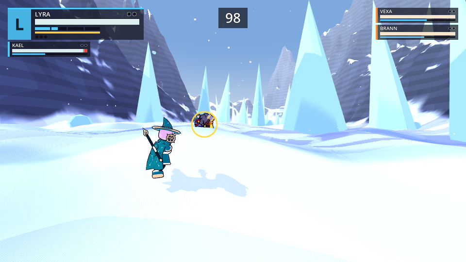
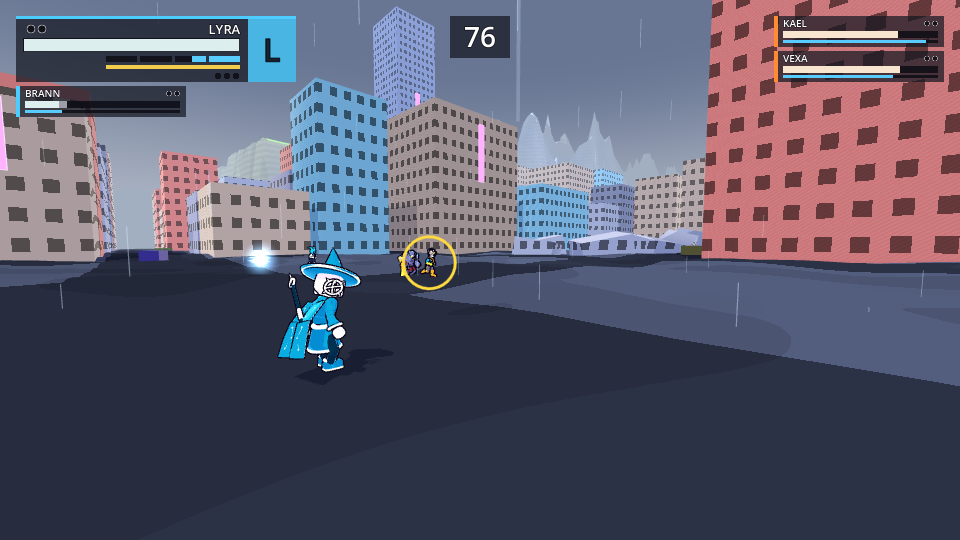
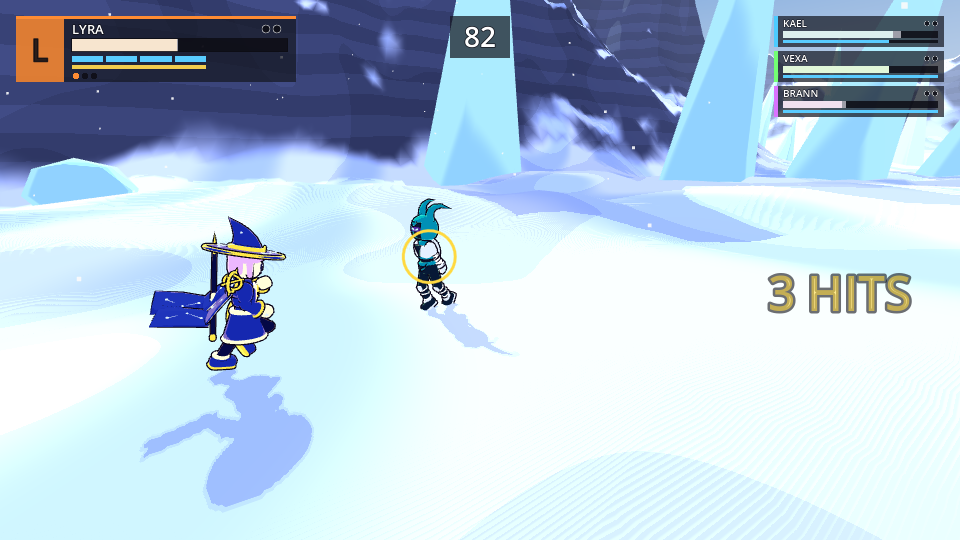
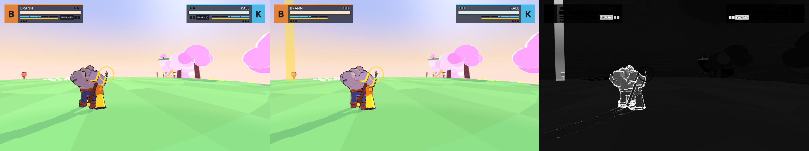
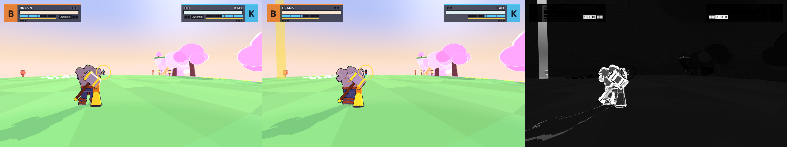
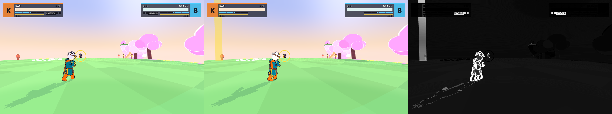
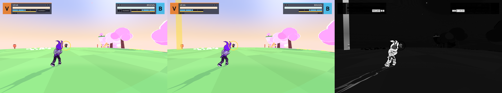

# Gameplay QA report: b9fbf04 (quick)

Matches: 21, ticks: 50400, total wall 366 s. Thresholds are documented in `AGENTS.md` (QA).

| Section | Result |
|---|---|
| Invariant soak (sim) | **PASS** |
| Invariant soak (view) | **FAIL** |
| Scenario library | **PASS** |
| Golden replays | **PASS** |
| Visual goldens | **FAIL** |
| Feel metrics trend | **FAIL** |

## Invariant soak: sim

No violations.

## Invariant soak: view

| Check | Matches hit | Frames | Note |
|---|---|---|---|
| foot_ground | 3 / 21 | 12 |  |

## Top 10 violations

1. **foot_ground**, fighter 2, legend lyra, weapon unarmed, zone frozen_peaks, 2v2, seed 117, worst at tick 268 (first 268, 7 frames): lowest sole +30.7 cm off the visible ground (IDLE, clip fight_idle)  
   `tools/qa/run_qa.sh --repro '117:frozen_peaks:2v2:vexa,brann,lyra,kael:2343' --tick 268 --fighter 2`

    [2 s clip](2026-11-20-b9fbf04-quick/captures/117_frozen_peaks_2v2_vexa-brann-lyra-kael_2343_t268/clip.mp4)

2. **foot_ground**, fighter 3, legend lyra, weapon unarmed, zone stormfall_city, 2v2, seed 102, worst at tick 1568 (first 1565, 3 frames): lowest sole +6.9 cm off the visible ground (CHARGING, clip charge)  
   `tools/qa/run_qa.sh --repro '102:stormfall_city:2v2:kael,vexa,brann,lyra:4455' --tick 1568 --fighter 3`

    [2 s clip](2026-11-20-b9fbf04-quick/captures/102_stormfall_city_2v2_kael-vexa-brann-lyra_4455_t1568/clip.mp4)

3. **foot_ground**, fighter 0, legend lyra, weapon unarmed, zone frozen_peaks, ffa4, seed 110, worst at tick 1181 (first 1178, 2 frames): lowest sole +6.6 cm off the visible ground (BLOCKING, clip guard)  
   `tools/qa/run_qa.sh --repro '110:frozen_peaks:ffa4:lyra,kael,vexa,brann:3523' --tick 1181 --fighter 0`

    [2 s clip](2026-11-20-b9fbf04-quick/captures/110_frozen_peaks_ffa4_lyra-kael-vexa-brann_3523_t1181/clip.mp4)

## Ki usage by the AI (T-KI1)

| blasts | charged | beams | ultimates | clashes | reflects | soaks | beam_whiffs | ki_hits |
|---|---|---|---|---|---|---|---|---|
| 44 | 23 | 4 | 0 | 0 | 3 | 2 | 0 | 41 |

Per fighter-minute (46.7 fighter-minutes): blasts 0.94, charged 0.49, beams 0.09, clashes 0.00.

## Scenario library

38 tests: 38 passing, 0 failing, 0 pending (strict mode: known issues fail).

## Golden replays

9 tests, 0 failing.

## Visual goldens

SSIM floor 0.90, tile 32px changes above 12/255, fail above 5% of tiles.

| Shot | Result | SSIM | Changed tiles |
|---|---|---|---|
| heartbloom_brann_idle.png | FAIL | 0.973 | 6.5% |

| heartbloom_brann_light.png | FAIL | 0.962 | 7.5% |

| heartbloom_kael_idle.png | PASS | 0.982 | 4.2% |
| heartbloom_kael_light.png | FAIL | 0.971 | 5.4% |

| heartbloom_lyra_idle.png | PASS | 0.986 | 3.8% |
| heartbloom_lyra_light.png | FAIL | 0.963 | 5.8% |

| heartbloom_vexa_idle.png | PASS | 0.981 | 4.2% |
| heartbloom_vexa_light.png | FAIL | 0.967 | 6.0% |

| zone_ember_rift.png | PASS | 0.995 | 0.0% |
| zone_frozen_peaks.png | PASS | 0.992 | 2.5% |
| zone_shattered_mesa.png | PASS | 0.997 | 2.9% |
| zone_skyhold_ruins.png | PASS | 0.990 | 0.0% |
| zone_stormfall_city.png | PASS | 0.987 | 3.8% |
| zone_verdant_falls.png | PASS | 0.994 | 1.7% |

## Feel metrics

Compared with reports/qa/2026-11-20-7c5f465-quick/metrics.json; regression = worse by more than 15%.

| Metric | Now | Before | Change |
|---|---|---|---|
| hitstop_consistency | 0.6422 | 0.62 | +4% |
| pops_per_fighter_minute | 0 | 0 | - |
| finger_pops_per_fighter_minute | 0 | 0 | - |
| foot_slide_cm_per_frame | 0.03814 | 0.03259 | +17% **REGRESSION** |
| foot_error_p95_cm | 0.9055 | 0.855 | +6% |
| camera_jerk_p95 | 0.01074 | 0.01045 | +3% |
| locked_on_screen_share | 0.9895 | 0.9879 | +0% |
| sim_ms_per_tick | 0.8401 | 1.071 | -22% |
| view_ms_per_frame | 0.6898 | 0.9177 | -25% |

Press to first active frame (ticks at 60 Hz):

| Legend | grab@air | grab@ground | heavy@air | heavy@ground | light@air | light@ground |
|---|---|---|---|---|---|---|
| brann | 10 | 10 | 19 | 19 | 9 | 9 |
| kael | 8 | 8 | 15 | 15 | 7 | 7 |
| lyra | 9 | 9 | 16 | 16 | 7 | 7 |
| vexa | 7 | 7 | 12 | 12 | 5 | 5 |

