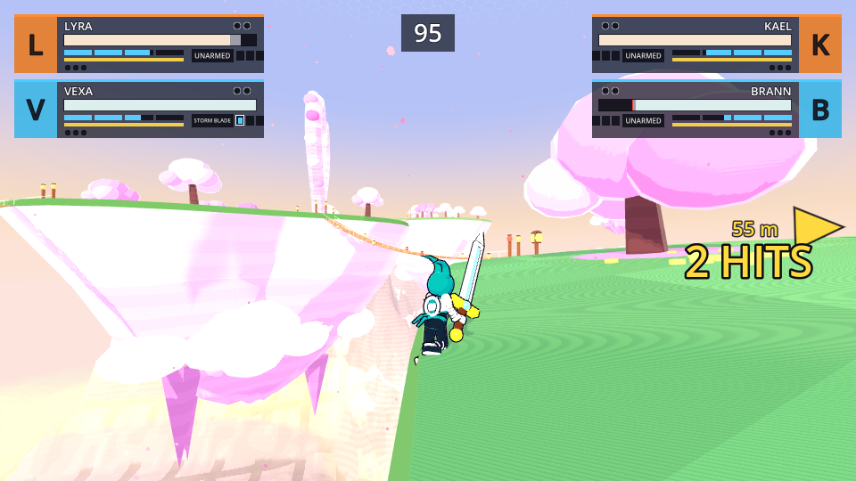
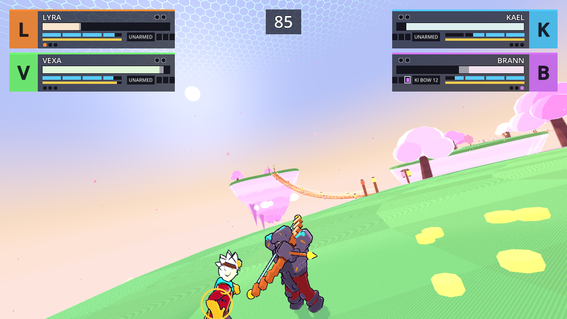
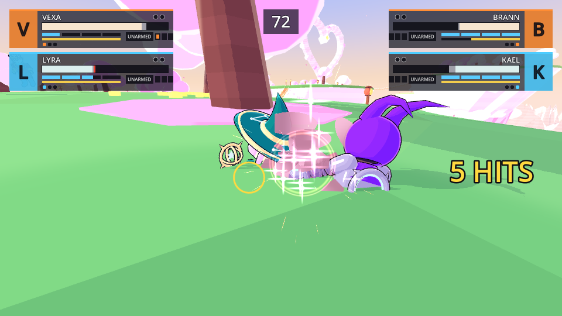
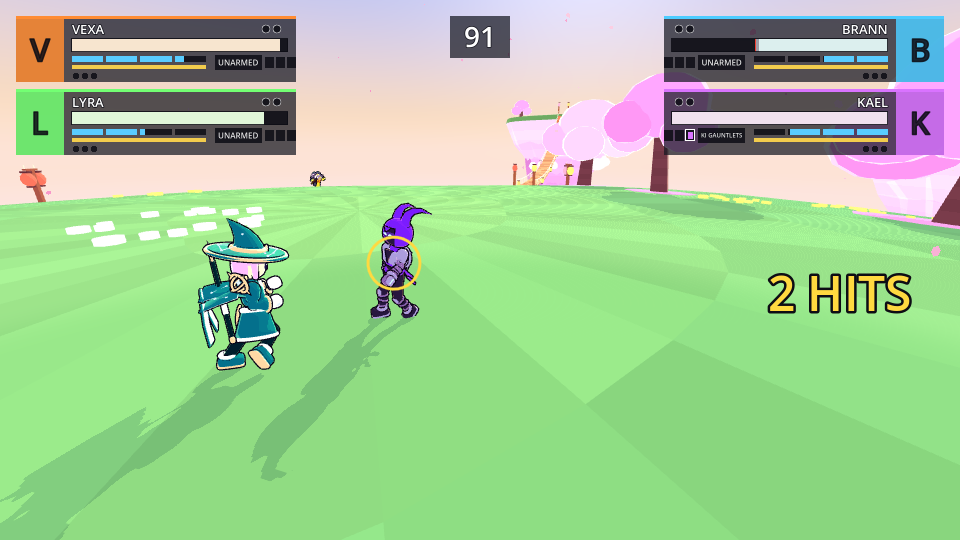
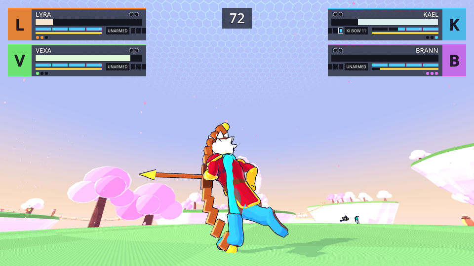
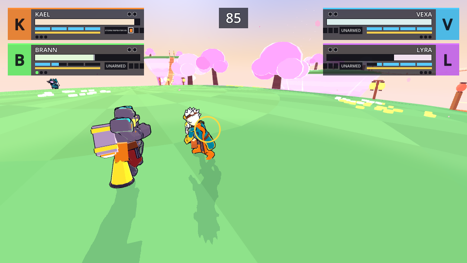
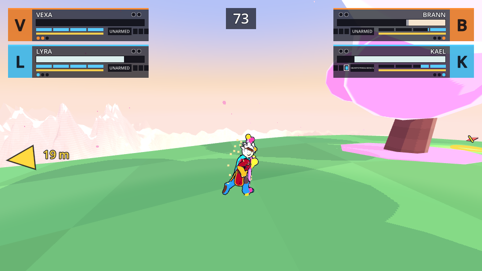

# Gameplay QA report: ed09a87 (full)

Matches: 36, ticks: 64800, total wall 503 s. Thresholds are documented in `AGENTS.md` (QA).

| Section | Result |
|---|---|
| Invariant soak (sim) | **PASS** |
| Invariant soak (view) | **FAIL** |
| Scenario library | **PASS** |
| Golden replays | **PASS** |
| Visual goldens | **NOT RUN** |
| Feel metrics trend | **PASS** |

## Invariant soak: sim

No violations.

## Invariant soak: view

| Check | Matches hit | Frames | Note |
|---|---|---|---|
| foot_ground | 3 / 36 | 3 |  |
| bow_string_head | 2 / 36 | 11 |  |
| camera_on_screen | 1 / 36 | 1 |  |

## Top 10 violations

1. **foot_ground**, fighter 2, legend vexa, weapon blade, zone heartbloom_gardens, 2v2, seed 1623, worst at tick 423 (first 423, 1 frames): lowest sole -34.0 cm off the visible ground (IDLE, clip fight_idle)  
   `tools/qa/run_qa.sh --repro '1623:heartbloom_gardens:2v2:lyra,kael,vexa,brann:3235' --tick 423 --fighter 2`

    [2 s clip](2026-11-20-ed09a87-full-heartbloom_gardens/captures/1623_heartbloom_gardens_2v2_lyra-kael-vexa-brann_3235_t423/clip.mp4)

2. **bow_string_head**, fighter 3, legend brann, weapon bow, zone heartbloom_gardens, ffa4, seed 3613, worst at tick 997 (first 997, 5 frames): bow string 4.9 cm from the head centre (draw 0, ATTACKING)  
   `tools/qa/run_qa.sh --repro '3613:heartbloom_gardens:ffa4:lyra,kael,vexa,brann:2533' --tick 997 --fighter 3`

    [2 s clip](2026-11-20-ed09a87-full-heartbloom_gardens/captures/3613_heartbloom_gardens_ffa4_lyra-kael-vexa-brann_2533_t997/clip.mp4)

3. **camera_on_screen**, fighter 0, legend vexa, weapon unarmed, zone heartbloom_gardens, 2v2, seed 2621, worst at tick 1800 (first 1800, 1 frames): both locked fighters on screen in 83.1% of 1580 locked frames  
   `tools/qa/run_qa.sh --repro '2621:heartbloom_gardens:2v2:vexa,brann,lyra,kael:5533' --tick 1800 --fighter 0`

    [2 s clip](2026-11-20-ed09a87-full-heartbloom_gardens/captures/2621_heartbloom_gardens_2v2_vexa-brann-lyra-kael_5533_t1800/clip.mp4)

4. **foot_ground**, fighter 2, legend lyra, weapon unarmed, zone heartbloom_gardens, ffa4, seed 3611, worst at tick 638 (first 638, 1 frames): lowest sole +5.3 cm off the visible ground (BLOCKING, clip guard)  
   `tools/qa/run_qa.sh --repro '3611:heartbloom_gardens:ffa4:vexa,brann,lyra,kael:2555' --tick 638 --fighter 2`

    [2 s clip](2026-11-20-ed09a87-full-heartbloom_gardens/captures/3611_heartbloom_gardens_ffa4_vexa-brann-lyra-kael_2555_t638/clip.mp4)

5. **bow_string_head**, fighter 1, legend kael, weapon bow, zone heartbloom_gardens, ffa4, seed 3613, worst at tick 1793 (first 1772, 3 frames): bow string 8.8 cm from the head centre (draw 0, MOVING)  
   `tools/qa/run_qa.sh --repro '3613:heartbloom_gardens:ffa4:lyra,kael,vexa,brann:2533' --tick 1793 --fighter 1`

    [2 s clip](2026-11-20-ed09a87-full-heartbloom_gardens/captures/3613_heartbloom_gardens_ffa4_lyra-kael-vexa-brann_2533_t1793/clip.mp4)

6. **foot_ground**, fighter 2, legend brann, weapon unarmed, zone heartbloom_gardens, ffa4, seed 2610, worst at tick 1034 (first 1034, 1 frames): lowest sole +5.1 cm off the visible ground (BLOCKING, clip guard)  
   `tools/qa/run_qa.sh --repro '2610:heartbloom_gardens:ffa4:kael,vexa,brann,lyra:4342' --tick 1034 --fighter 2`

    [2 s clip](2026-11-20-ed09a87-full-heartbloom_gardens/captures/2610_heartbloom_gardens_ffa4_kael-vexa-brann-lyra_4342_t1034/clip.mp4)

7. **bow_string_head**, fighter 3, legend kael, weapon heartstring, zone heartbloom_gardens, 2v2, seed 1621, worst at tick 1765 (first 1765, 3 frames): bow string 9.0 cm from the head centre (draw 0, MOVING)  
   `tools/qa/run_qa.sh --repro '1621:heartbloom_gardens:2v2:vexa,brann,lyra,kael:2345' --tick 1765 --fighter 3`

    [2 s clip](2026-11-20-ed09a87-full-heartbloom_gardens/captures/1621_heartbloom_gardens_2v2_vexa-brann-lyra-kael_2345_t1765/clip.mp4)

## Scenario library

38 tests: 38 passing, 0 failing, 0 pending (strict mode: known issues fail).

## Golden replays

9 tests, 0 failing.

## Visual goldens

Not run: numpy/Pillow missing.

## Feel metrics

Compared with reports/qa/2026-11-19-bc9aa29-full/metrics.json; regression = worse by more than 15%.

| Metric | Now | Before | Change |
|---|---|---|---|
| hitstop_consistency | 0.5696 | 0.5341 | +7% |
| pops_per_fighter_minute | 0 | 24.26 | -100% |
| finger_pops_per_fighter_minute | 0 | 27.79 | -100% |
| foot_slide_cm_per_frame | 0.007552 | 0.8564 | re-baselined (v2) |
| foot_error_p95_cm | 1.168 | 10.76 | -89% |
| camera_jerk_p95 | 0.01022 | 0.01378 | -26% |
| locked_on_screen_share | 0.9873 | 0.9793 | +1% |
| sim_ms_per_tick | 0.7667 | 3.528 | -78% |
| view_ms_per_frame | 0.6763 | 3.246 | -79% |

Press to first active frame (ticks at 60 Hz):

| Legend | grab@air | grab@ground | heavy@air | heavy@ground | light@air | light@ground |
|---|---|---|---|---|---|---|
| brann | 10 | 10 | 19 | 19 | 9 | 9 |
| kael | 8 | 8 | 15 | 15 | 7 | 7 |
| lyra | 9 | 9 | 16 | 16 | 7 | 7 |
| vexa | 7 | 7 | 12 | 12 | 5 | 5 |

