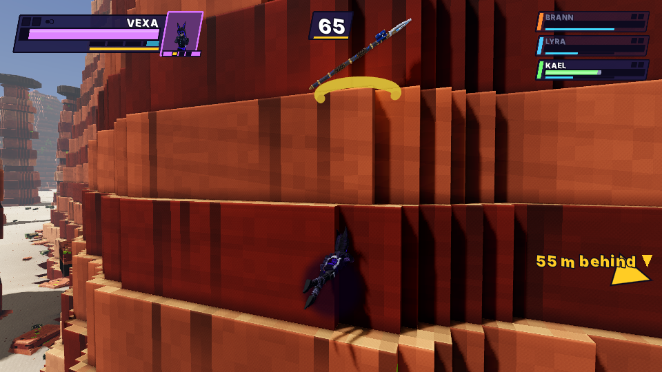
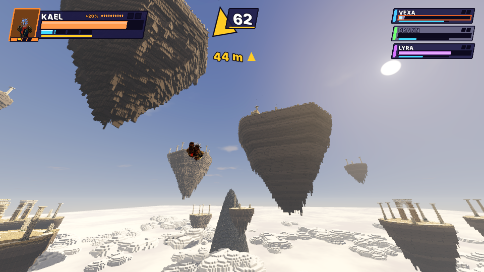
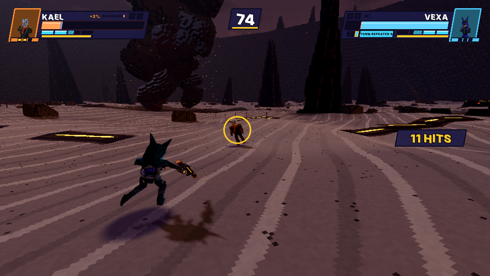
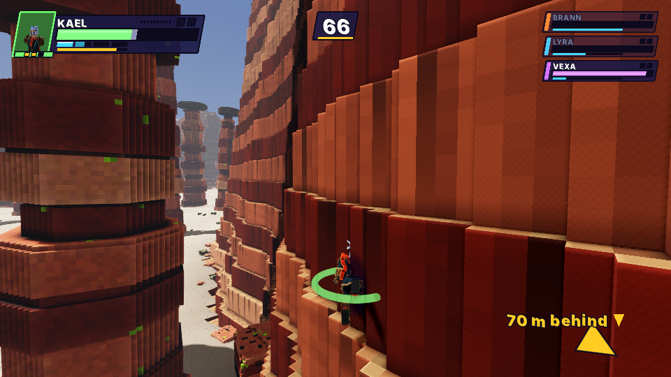
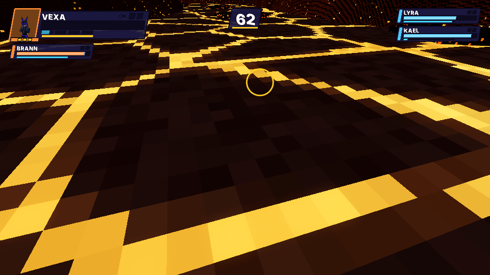
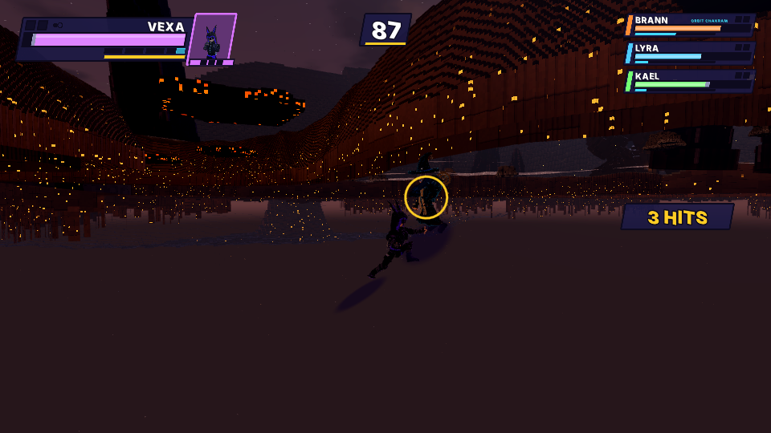
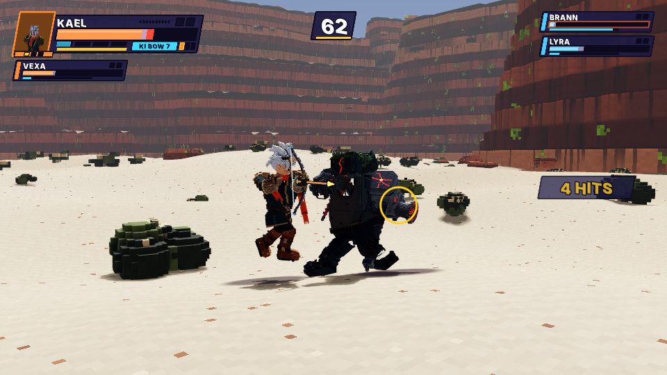
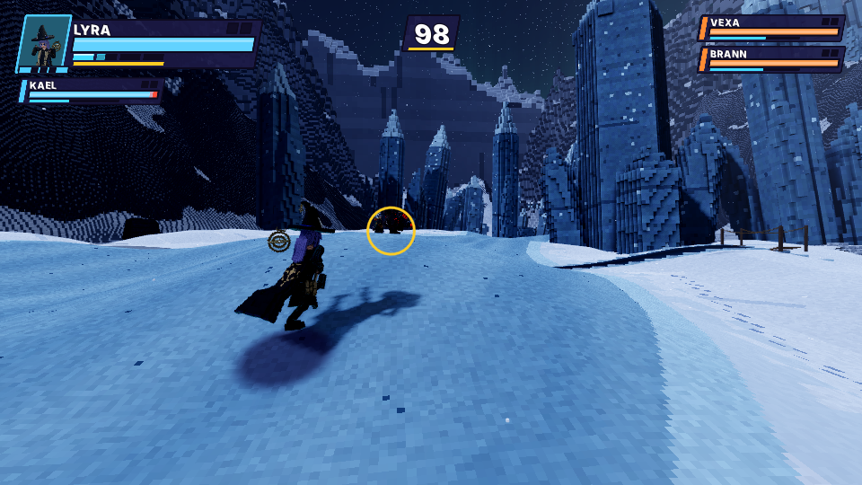
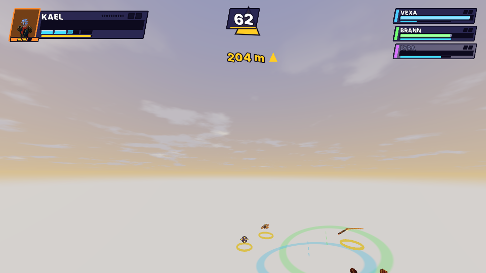
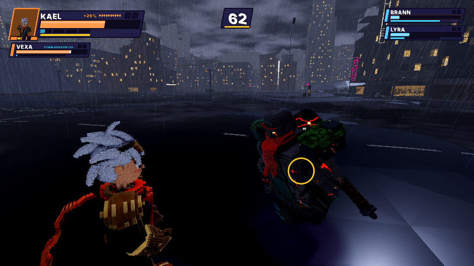

# Gameplay QA report: b1f01aca (quick)

Matches: 21, ticks: 50400, total wall 1396 s. Thresholds are documented in `AGENTS.md` (QA).

| Section | Result |
|---|---|
| Invariant soak (sim) | **PASS** |
| Invariant soak (view) | **FAIL** |
| Scenario library | **PASS** |
| Golden replays | **PASS** |
| Visual goldens | **NOT RUN** |
| Feel metrics trend | **PASS** |

## Invariant soak: sim

No violations.

## Invariant soak: view

| Check | Matches hit | Frames | Note |
|---|---|---|---|
| camera_on_screen | 5 / 21 | 5 |  |
| foot_ground | 5 / 21 | 19 |  |
| pop | 1 / 21 | 1 |  |

## Top 10 violations

1. **foot_ground**, fighter 3, legend vexa, weapon unarmed, zone shattered_mesa, ffa4, seed 107, worst at tick 2196 (first 2196, 4 frames): lowest sole +193.9 cm off the visible ground (IDLE, clip land)  
   `tools/qa/run_qa.sh --repro '107:shattered_mesa:ffa4:brann,lyra,kael,vexa:2445' --tick 2196 --fighter 3`

    [2 s clip](2026-11-22-b1f01aca-quick/captures/107_shattered_mesa_ffa4_brann-lyra-kael-vexa_2445_t2196/clip.mp4)

2. **camera_on_screen**, fighter 0, legend kael, weapon unarmed, zone skyhold_ruins, ffa4, seed 101, worst at tick 2400 (first 2400, 1 frames): both locked fighters on screen in 92.3% of 2378 locked frames  
   `tools/qa/run_qa.sh --repro '101:skyhold_ruins:ffa4:kael,vexa,brann,lyra:4235' --tick 2400 --fighter 0`

    [2 s clip](2026-11-22-b1f01aca-quick/captures/101_skyhold_ruins_ffa4_kael-vexa-brann-lyra_4235_t2400/clip.mp4)

3. **pop**, fighter 1, legend vexa, weapon repeater, zone ember_rift, 1v1, seed 112, worst at tick 1690 (first 1690, 1 frames): RightHand turned 1.21 rad in one frame (HITSTUN, move , clip hit_light)  
   `tools/qa/run_qa.sh --repro '112:ember_rift:1v1:kael,vexa:45' --tick 1690 --fighter 1`

    [2 s clip](2026-11-22-b1f01aca-quick/captures/112_ember_rift_1v1_kael-vexa_45_t1690/clip.mp4)

4. **foot_ground**, fighter 2, legend kael, weapon unarmed, zone shattered_mesa, ffa4, seed 107, worst at tick 2171 (first 2171, 2 frames): lowest sole +187.6 cm off the visible ground (IDLE, clip land)  
   `tools/qa/run_qa.sh --repro '107:shattered_mesa:ffa4:brann,lyra,kael,vexa:2445' --tick 2171 --fighter 2`

    [2 s clip](2026-11-22-b1f01aca-quick/captures/107_shattered_mesa_ffa4_brann-lyra-kael-vexa_2445_t2171/clip.mp4)

5. **camera_on_screen**, fighter 0, legend vexa, weapon unarmed, zone ember_rift, 2v2, seed 105, worst at tick 2400 (first 2400, 1 frames): both locked fighters on screen in 92.4% of 1989 locked frames  
   `tools/qa/run_qa.sh --repro '105:ember_rift:2v2:vexa,brann,lyra,kael:3224' --tick 2400 --fighter 0`

    [2 s clip](2026-11-22-b1f01aca-quick/captures/105_ember_rift_2v2_vexa-brann-lyra-kael_3224_t2400/clip.mp4)

6. **foot_ground**, fighter 3, legend vexa, weapon unarmed, zone ember_rift, ffa4, seed 119, worst at tick 923 (first 920, 9 frames): lowest sole -17.9 cm off the visible ground (MOVING, clip walk_back)  
   `tools/qa/run_qa.sh --repro '119:ember_rift:ffa4:brann,lyra,kael,vexa:4433' --tick 923 --fighter 3`

    [2 s clip](2026-11-22-b1f01aca-quick/captures/119_ember_rift_ffa4_brann-lyra-kael-vexa_4433_t923/clip.mp4)

7. **camera_on_screen**, fighter 0, legend kael, weapon bow, zone shattered_mesa, 2v2, seed 114, worst at tick 2400 (first 2400, 1 frames): both locked fighters on screen in 94.5% of 2202 locked frames  
   `tools/qa/run_qa.sh --repro '114:shattered_mesa:2v2:kael,vexa,brann,lyra:3355' --tick 2400 --fighter 0`

    [2 s clip](2026-11-22-b1f01aca-quick/captures/114_shattered_mesa_2v2_kael-vexa-brann-lyra_3355_t2400/clip.mp4)

8. **foot_ground**, fighter 2, legend lyra, weapon unarmed, zone frozen_peaks, 2v2, seed 117, worst at tick 268 (first 268, 2 frames): lowest sole +22.0 cm off the visible ground (IDLE, clip fight_idle)  
   `tools/qa/run_qa.sh --repro '117:frozen_peaks:2v2:vexa,brann,lyra,kael:2343' --tick 268 --fighter 2`

    [2 s clip](2026-11-22-b1f01aca-quick/captures/117_frozen_peaks_2v2_vexa-brann-lyra-kael_2343_t268/clip.mp4)

9. **camera_on_screen**, fighter 0, legend kael, weapon unarmed, zone heartbloom_gardens, ffa4, seed 113, worst at tick 2400 (first 2400, 1 frames): both locked fighters on screen in 94.6% of 1605 locked frames  
   `tools/qa/run_qa.sh --repro '113:heartbloom_gardens:ffa4:kael,vexa,brann,lyra:2553' --tick 2400 --fighter 0`

    [2 s clip](2026-11-22-b1f01aca-quick/captures/113_heartbloom_gardens_ffa4_kael-vexa-brann-lyra_2553_t2400/clip.mp4)

10. **foot_ground**, fighter 0, legend kael, weapon unarmed, zone stormfall_city, 2v2, seed 102, worst at tick 2383 (first 2383, 1 frames): lowest sole +5.5 cm off the visible ground (BLOCKING, clip guard)  
   `tools/qa/run_qa.sh --repro '102:stormfall_city:2v2:kael,vexa,brann,lyra:4455' --tick 2383 --fighter 0`

    [2 s clip](2026-11-22-b1f01aca-quick/captures/102_stormfall_city_2v2_kael-vexa-brann-lyra_4455_t2383/clip.mp4)

## Ki usage by the AI (T-KI1)

| blasts | charged | beams | ultimates | clashes | reflects | soaks | beam_whiffs | ki_hits |
|---|---|---|---|---|---|---|---|---|
| 29 | 11 | 5 | 0 | 0 | 0 | 0 | 3 | 22 |

Per fighter-minute (46.7 fighter-minutes): blasts 0.62, charged 0.24, beams 0.11, clashes 0.00.

## Scenario library

38 tests: 38 passing, 0 failing, 0 pending (strict mode: known issues fail).

## Golden replays

11 tests, 0 failing.

## Visual goldens

Not run: numpy/Pillow missing.

## Feel metrics

Compared with reports/qa/2026-11-22-1fc992f-quick/metrics.json; regression = worse by more than 15%.

| Metric | Now | Before | Change |
|---|---|---|---|
| hitstop_consistency | 0.7138 | 0.7216 | -1% |
| pops_per_fighter_minute | 0.03573 | 0.03573 | +0% |
| finger_pops_per_fighter_minute | 0.03573 | 0.03573 | +0% |
| foot_slide_cm_per_frame | 0.03118 | 0.03168 | -2% |
| foot_error_p95_cm | 0.916 | 0.9284 | -1% |
| camera_jerk_p95 | 0.008953 | 0.008731 | +3% |
| locked_on_screen_share | 0.9763 | 0.9816 | -1% |
| sim_ms_per_tick | 1.201 | 1.133 | +6% |
| view_ms_per_frame | 1.231 | 1.168 | +5% |

Press to first active frame (ticks at 60 Hz):

| Legend | grab@air | grab@ground | heavy@air | heavy@ground | light@air | light@ground |
|---|---|---|---|---|---|---|
| brann | 10 | 10 | 19 | 19 | 9 | 9 |
| kael | 8 | 8 | 15 | 15 | 7 | 7 |
| lyra | 9 | 9 | 16 | 16 | 7 | 7 |
| vexa | 7 | 7 | 12 | 12 | 5 | 5 |

