# Gameplay QA report: e6bf7d31 (quick)

Matches: 21, ticks: 50400, total wall 427 s. Thresholds are documented in `AGENTS.md` (QA).

| Section | Result |
|---|---|
| Invariant soak (sim) | **PASS** |
| Invariant soak (view) | **FAIL** |
| Scenario library | **PASS** |
| Golden replays | **PASS** |
| Visual goldens | **FAIL** |
| Feel metrics trend | **PASS** |

## Invariant soak: sim

No violations.

## Invariant soak: view

| Check | Matches hit | Frames | Note |
|---|---|---|---|
| foot_ground | 3 / 21 | 4 |  |
| camera_on_screen | 2 / 21 | 2 |  |
| pop | 1 / 21 | 1 |  |

## Top 10 violations

1. **foot_ground**, fighter 2, legend lyra, weapon unarmed, zone frozen_peaks, 2v2, seed 117, worst at tick 268 (first 268, 2 frames): lowest sole +22.0 cm off the visible ground (IDLE, clip fight_idle)  
   `tools/qa/run_qa.sh --repro '117:frozen_peaks:2v2:vexa,brann,lyra,kael:2343' --tick 268 --fighter 2`

   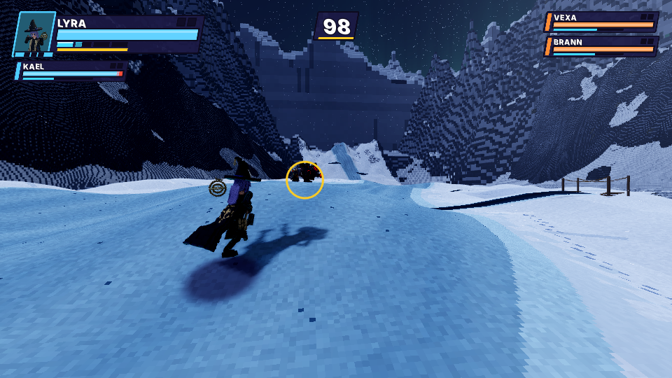 [2 s clip](2026-11-22-e6bf7d31-quick/captures/117_frozen_peaks_2v2_vexa-brann-lyra-kael_2343_t268/clip.mp4)

2. **camera_on_screen**, fighter 0, legend brann, weapon unarmed, zone heartbloom_gardens, 2v2, seed 120, worst at tick 2400 (first 2400, 1 frames): both locked fighters on screen in 94.2% of 1804 locked frames  
   `tools/qa/run_qa.sh --repro '120:heartbloom_gardens:2v2:brann,lyra,kael,vexa:5245' --tick 2400 --fighter 0`

   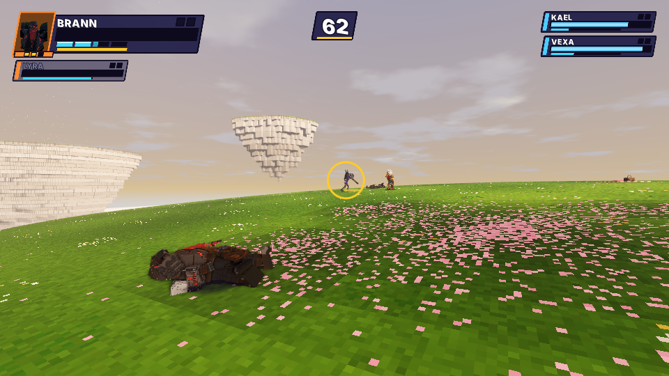 [2 s clip](2026-11-22-e6bf7d31-quick/captures/120_heartbloom_gardens_2v2_brann-lyra-kael-vexa_5245_t2400/clip.mp4)

3. **pop**, fighter 1, legend vexa, weapon repeater, zone ember_rift, 1v1, seed 112, worst at tick 1690 (first 1690, 1 frames): RightHand turned 1.21 rad in one frame (HITSTUN, move , clip hit_light)  
   `tools/qa/run_qa.sh --repro '112:ember_rift:1v1:kael,vexa:45' --tick 1690 --fighter 1`

   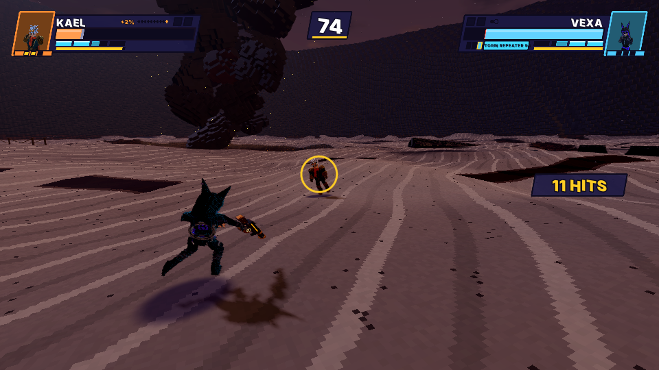 [2 s clip](2026-11-22-e6bf7d31-quick/captures/112_ember_rift_1v1_kael-vexa_45_t1690/clip.mp4)

4. **foot_ground**, fighter 0, legend lyra, weapon unarmed, zone frozen_peaks, ffa4, seed 110, worst at tick 1594 (first 1594, 1 frames): lowest sole +5.2 cm off the visible ground (BLOCKING, clip guard)  
   `tools/qa/run_qa.sh --repro '110:frozen_peaks:ffa4:lyra,kael,vexa,brann:3523' --tick 1594 --fighter 0`

   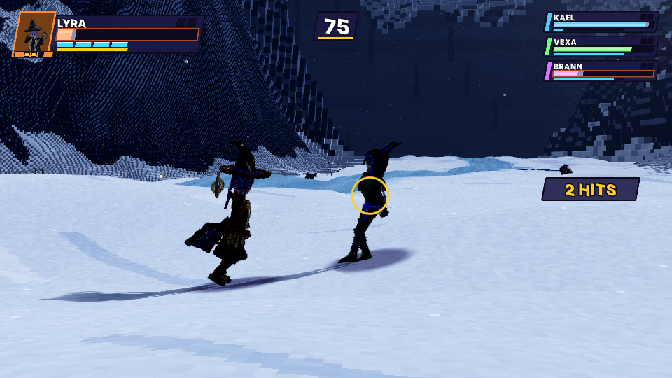 [2 s clip](2026-11-22-e6bf7d31-quick/captures/110_frozen_peaks_ffa4_lyra-kael-vexa-brann_3523_t1594/clip.mp4)

5. **camera_on_screen**, fighter 0, legend kael, weapon unarmed, zone skyhold_ruins, ffa4, seed 101, worst at tick 2400 (first 2400, 1 frames): both locked fighters on screen in 94.8% of 2377 locked frames  
   `tools/qa/run_qa.sh --repro '101:skyhold_ruins:ffa4:kael,vexa,brann,lyra:4235' --tick 2400 --fighter 0`

   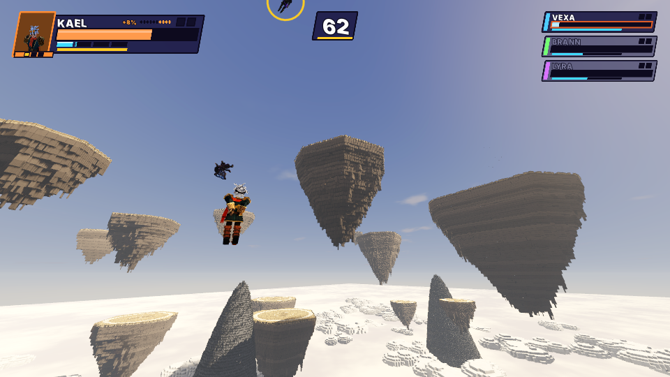 [2 s clip](2026-11-22-e6bf7d31-quick/captures/101_skyhold_ruins_ffa4_kael-vexa-brann-lyra_4235_t2400/clip.mp4)

6. **foot_ground**, fighter 2, legend brann, weapon unarmed, zone shattered_mesa, 2v2, seed 114, worst at tick 442 (first 442, 1 frames): lowest sole +5.1 cm off the visible ground (BLOCKING, clip guard)  
   `tools/qa/run_qa.sh --repro '114:shattered_mesa:2v2:kael,vexa,brann,lyra:3355' --tick 442 --fighter 2`

   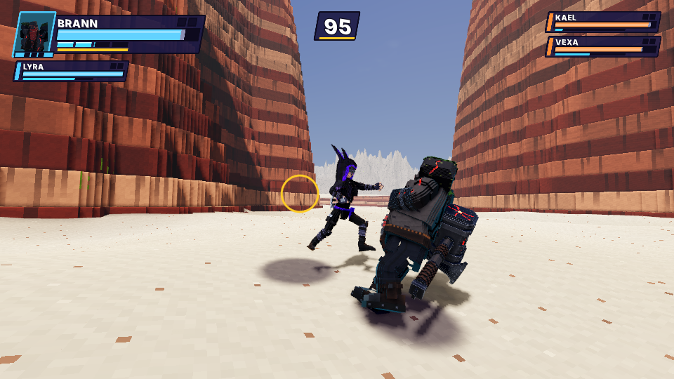 [2 s clip](2026-11-22-e6bf7d31-quick/captures/114_shattered_mesa_2v2_kael-vexa-brann-lyra_3355_t442/clip.mp4)

## Ki usage by the AI (T-KI1)

| blasts | charged | beams | ultimates | clashes | reflects | soaks | beam_whiffs | ki_hits |
|---|---|---|---|---|---|---|---|---|
| 29 | 14 | 4 | 0 | 0 | 2 | 1 | 2 | 22 |

Per fighter-minute (46.7 fighter-minutes): blasts 0.62, charged 0.30, beams 0.09, clashes 0.00.

## Scenario library

38 tests: 38 passing, 0 failing, 0 pending (strict mode: known issues fail).

## Golden replays

11 tests, 0 failing.

## Visual goldens

SSIM floor 0.90, tile 32px changes above 12/255, fail above 5% of tiles.

| Shot | Result | SSIM | Changed tiles |
|---|---|---|---|
| heartbloom_brann_idle.png | FAIL | 0.880 | 16.0% |

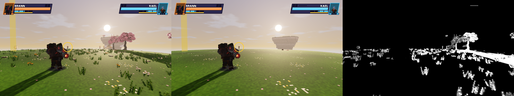

| heartbloom_brann_light.png | FAIL | 0.882 | 15.0% |

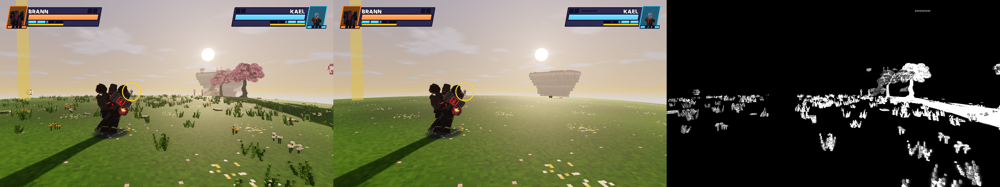

| heartbloom_kael_idle.png | FAIL | 0.876 | 16.2% |

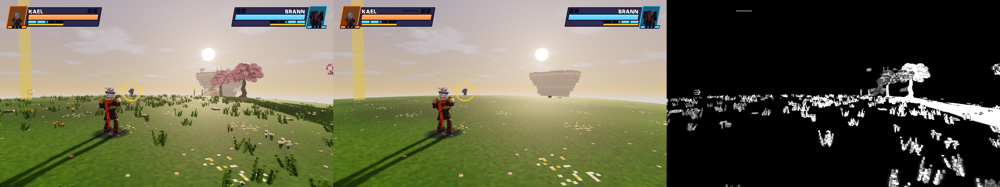

| heartbloom_kael_light.png | FAIL | 0.880 | 15.0% |

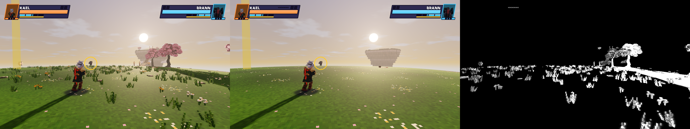

| heartbloom_lyra_idle.png | FAIL | 0.873 | 16.5% |

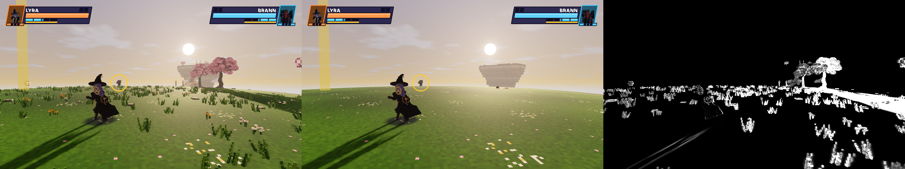

| heartbloom_lyra_light.png | FAIL | 0.881 | 15.6% |

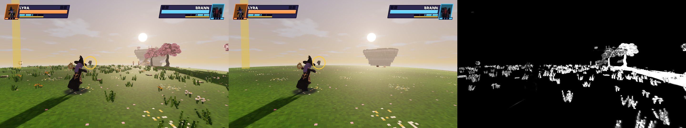

| heartbloom_vexa_idle.png | FAIL | 0.876 | 16.5% |

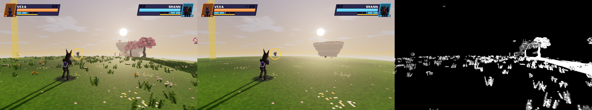

| heartbloom_vexa_light.png | FAIL | 0.880 | 15.6% |

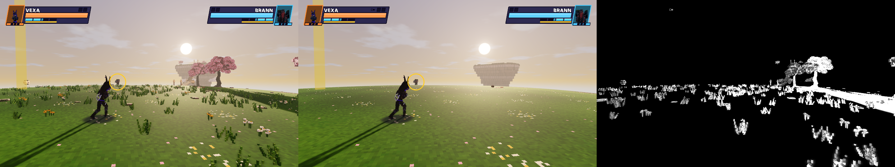

| zone_ember_rift.png | FAIL | 0.884 | 15.6% |

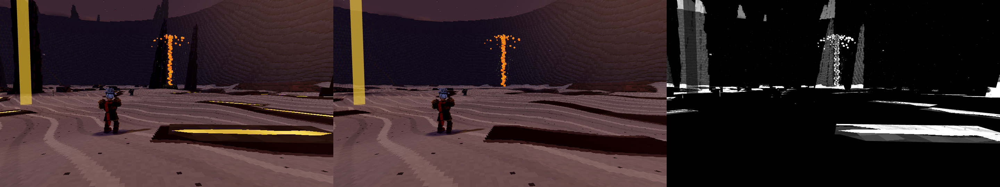

| zone_frozen_peaks.png | FAIL | 0.436 | 55.0% |

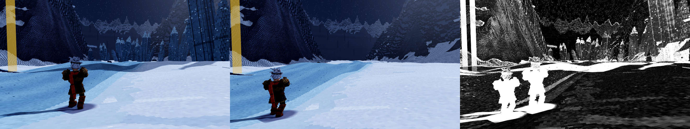

| zone_shattered_mesa.png | FAIL | 0.929 | 10.6% |

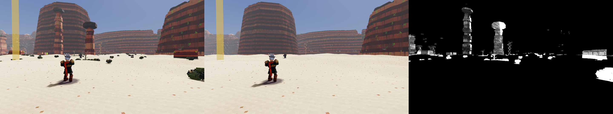

| zone_skyhold_ruins.png | PASS | 0.954 | 4.0% |
| zone_stormfall_city.png | PASS | 0.955 | 0.2% |
| zone_verdant_falls.png | FAIL | 0.698 | 46.9% |

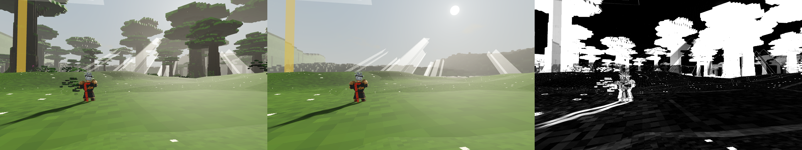

## Feel metrics

Compared with reports/qa/2026-11-22-6ea2e918-quick/metrics.json; regression = worse by more than 15%.

| Metric | Now | Before | Change |
|---|---|---|---|
| hitstop_consistency | 0.7216 | 0.7216 | +0% |
| pops_per_fighter_minute | 0.03573 | 0.03573 | +0% |
| finger_pops_per_fighter_minute | 0.03573 | 0.03573 | +0% |
| foot_slide_cm_per_frame | 0.03168 | 0.03168 | +0% |
| foot_error_p95_cm | 0.9284 | 0.9284 | +0% |
| camera_jerk_p95 | 0.008731 | 0.01052 | -17% |
| locked_on_screen_share | 0.9816 | 0.9784 | +0% |
| sim_ms_per_tick | 1.085 | 1.137 | -5% |
| view_ms_per_frame | 1.193 | 1.072 | +11% |

Press to first active frame (ticks at 60 Hz):

| Legend | grab@air | grab@ground | heavy@air | heavy@ground | light@air | light@ground |
|---|---|---|---|---|---|---|
| brann | 10 | 10 | 19 | 19 | 9 | 9 |
| kael | 8 | 8 | 15 | 15 | 7 | 7 |
| lyra | 9 | 9 | 16 | 16 | 7 | 7 |
| vexa | 7 | 7 | 12 | 12 | 5 | 5 |

