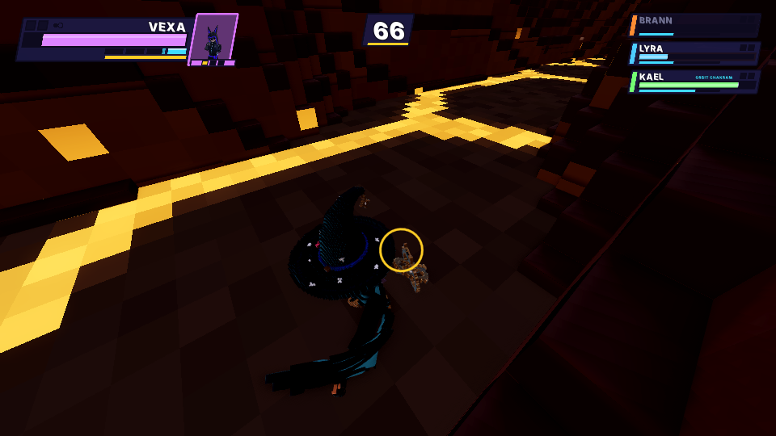
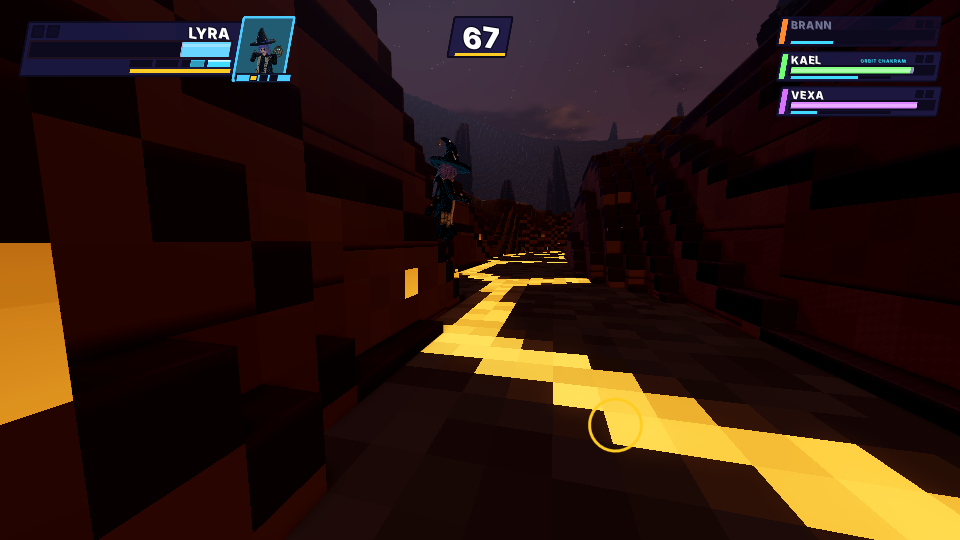
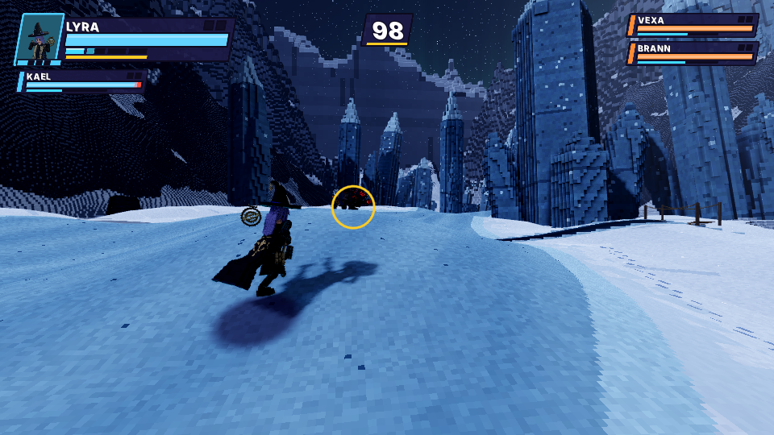
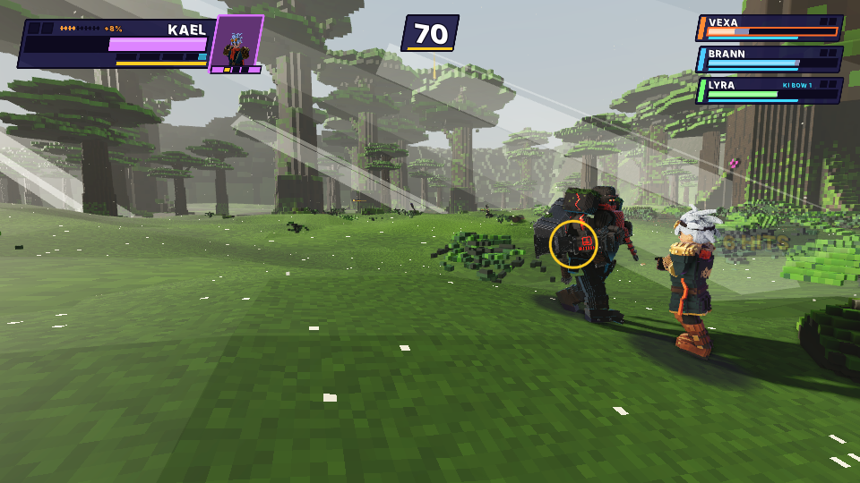
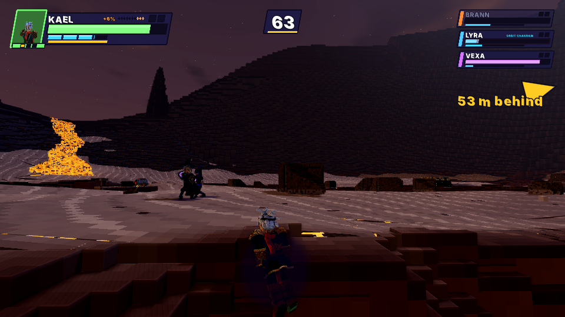
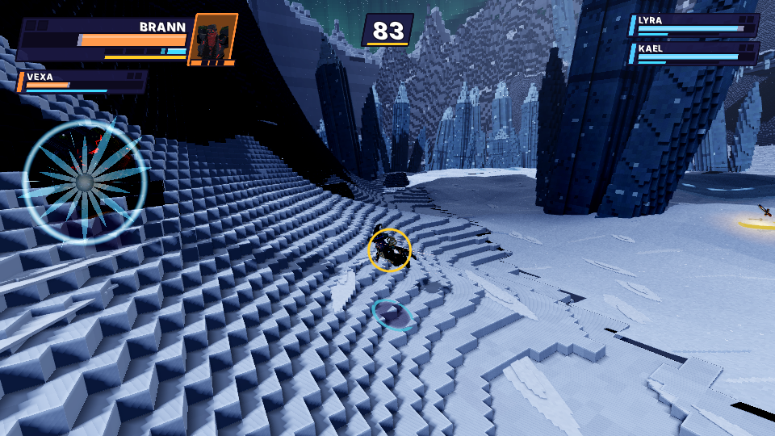
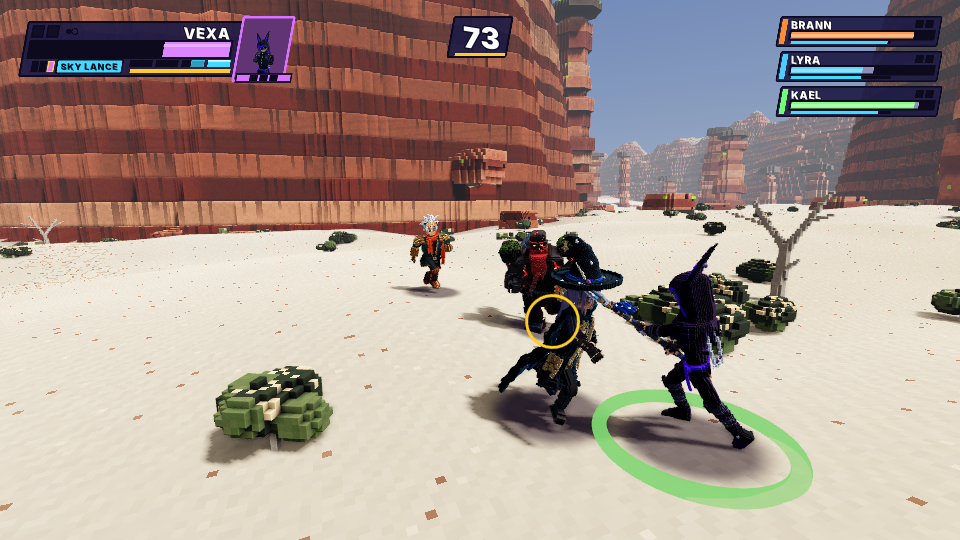
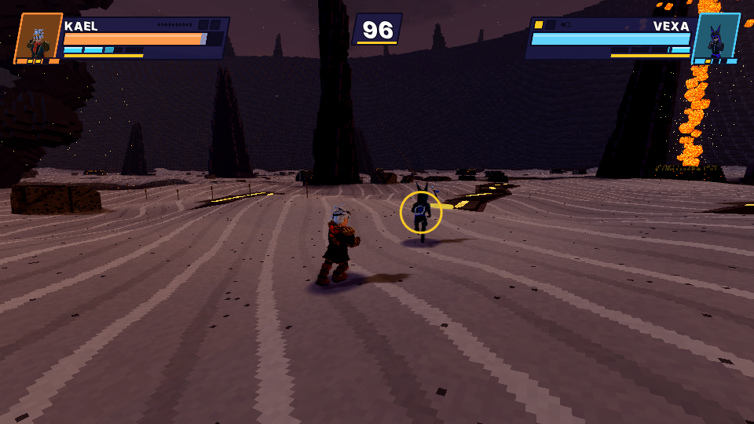
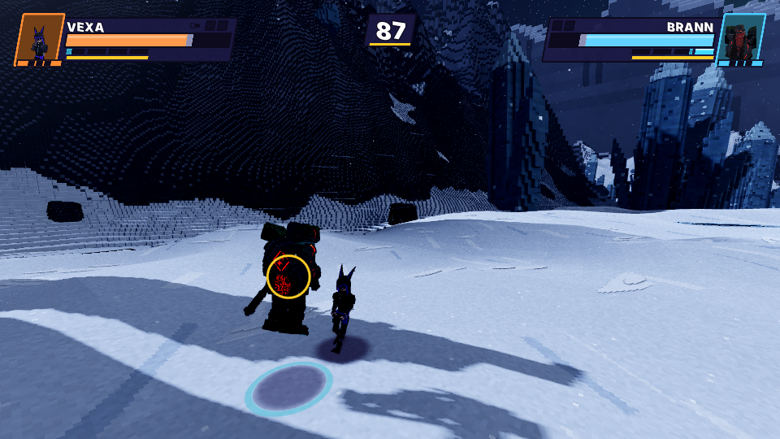
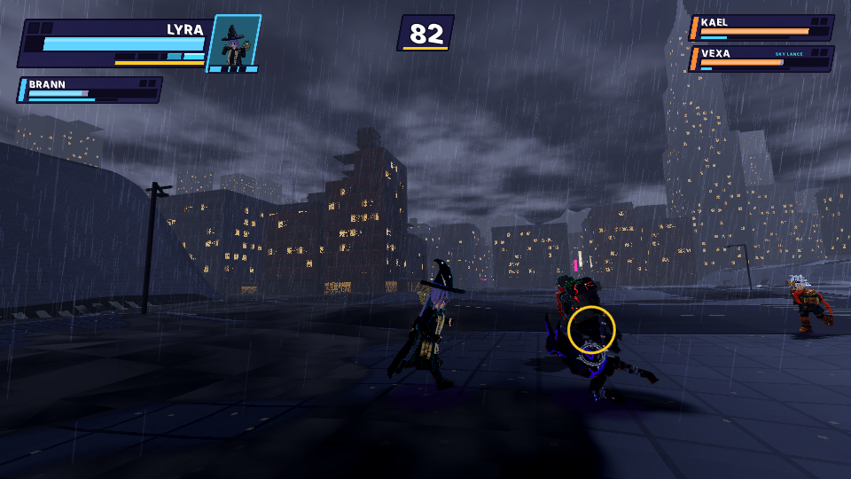

# Gameplay QA report: afcfe0dd (quick)

Matches: 21, ticks: 50400, total wall 450 s. Thresholds are documented in `AGENTS.md` (QA).

| Section | Result |
|---|---|
| Invariant soak (sim) | **PASS** |
| Invariant soak (view) | **FAIL** |
| Scenario library | **PASS** |
| Golden replays | **PASS** |
| Visual goldens | **NOT RUN** |
| Feel metrics trend | **FAIL** |

## Invariant soak: sim

No violations.

## Invariant soak: view

| Check | Matches hit | Frames | Note |
|---|---|---|---|
| foot_ground | 8 / 21 | 16 |  |

## Top 10 violations

1. **foot_ground**, fighter 3, legend vexa, weapon unarmed, zone ember_rift, ffa4, seed 119, worst at tick 2148 (first 2146, 2 frames): lowest sole -112.4 cm off the visible ground (MOVING, clip strafe_left)  
   `tools/qa/run_qa.sh --repro '119:ember_rift:ffa4:brann,lyra,kael,vexa:4433' --tick 2148 --fighter 3`

    [2 s clip](2026-11-23-afcfe0dd-quick/captures/119_ember_rift_ffa4_brann-lyra-kael-vexa_4433_t2148/clip.mp4)

2. **foot_ground**, fighter 1, legend lyra, weapon unarmed, zone ember_rift, ffa4, seed 119, worst at tick 2082 (first 1018, 2 frames): lowest sole -39.2 cm off the visible ground (IDLE, clip land)  
   `tools/qa/run_qa.sh --repro '119:ember_rift:ffa4:brann,lyra,kael,vexa:4433' --tick 2082 --fighter 1`

    [2 s clip](2026-11-23-afcfe0dd-quick/captures/119_ember_rift_ffa4_brann-lyra-kael-vexa_4433_t2082/clip.mp4)

3. **foot_ground**, fighter 2, legend lyra, weapon unarmed, zone frozen_peaks, 2v2, seed 117, worst at tick 268 (first 268, 2 frames): lowest sole +22.0 cm off the visible ground (IDLE, clip fight_idle)  
   `tools/qa/run_qa.sh --repro '117:frozen_peaks:2v2:vexa,brann,lyra,kael:2343' --tick 268 --fighter 2`

    [2 s clip](2026-11-23-afcfe0dd-quick/captures/117_frozen_peaks_2v2_vexa-brann-lyra-kael_2343_t268/clip.mp4)

4. **foot_ground**, fighter 3, legend kael, weapon unarmed, zone verdant_falls, ffa4, seed 104, worst at tick 1949 (first 1943, 3 frames): lowest sole +6.6 cm off the visible ground (BLOCKING, clip guard)  
   `tools/qa/run_qa.sh --repro '104:verdant_falls:ffa4:vexa,brann,lyra,kael:2243' --tick 1949 --fighter 3`

    [2 s clip](2026-11-23-afcfe0dd-quick/captures/104_verdant_falls_ffa4_vexa-brann-lyra-kael_2243_t1949/clip.mp4)

5. **foot_ground**, fighter 2, legend kael, weapon unarmed, zone ember_rift, ffa4, seed 119, worst at tick 2335 (first 2335, 1 frames): lowest sole +11.8 cm off the visible ground (IDLE, clip land)  
   `tools/qa/run_qa.sh --repro '119:ember_rift:ffa4:brann,lyra,kael,vexa:4433' --tick 2335 --fighter 2`

    [2 s clip](2026-11-23-afcfe0dd-quick/captures/119_ember_rift_ffa4_brann-lyra-kael-vexa_4433_t2335/clip.mp4)

6. **foot_ground**, fighter 1, legend brann, weapon unarmed, zone frozen_peaks, 2v2, seed 117, worst at tick 1151 (first 1151, 1 frames): lowest sole +10.8 cm off the visible ground (IDLE, clip fight_idle)  
   `tools/qa/run_qa.sh --repro '117:frozen_peaks:2v2:vexa,brann,lyra,kael:2343' --tick 1151 --fighter 1`

    [2 s clip](2026-11-23-afcfe0dd-quick/captures/117_frozen_peaks_2v2_vexa-brann-lyra-kael_2343_t1151/clip.mp4)

7. **foot_ground**, fighter 3, legend vexa, weapon lance, zone shattered_mesa, ffa4, seed 107, worst at tick 1717 (first 1717, 1 frames): lowest sole +6.1 cm off the visible ground (BLOCKING, clip guard)  
   `tools/qa/run_qa.sh --repro '107:shattered_mesa:ffa4:brann,lyra,kael,vexa:2445' --tick 1717 --fighter 3`

    [2 s clip](2026-11-23-afcfe0dd-quick/captures/107_shattered_mesa_ffa4_brann-lyra-kael-vexa_2445_t1717/clip.mp4)

8. **foot_ground**, fighter 0, legend kael, weapon unarmed, zone ember_rift, 1v1, seed 112, worst at tick 2052 (first 2052, 1 frames): lowest sole +6.1 cm off the visible ground (BLOCKING, clip guard)  
   `tools/qa/run_qa.sh --repro '112:ember_rift:1v1:kael,vexa:45' --tick 2052 --fighter 0`

    [2 s clip](2026-11-23-afcfe0dd-quick/captures/112_ember_rift_1v1_kael-vexa_45_t2052/clip.mp4)

9. **foot_ground**, fighter 0, legend vexa, weapon unarmed, zone frozen_peaks, 1v1, seed 103, worst at tick 896 (first 896, 1 frames): lowest sole +6.1 cm off the visible ground (BLOCKING, clip guard)  
   `tools/qa/run_qa.sh --repro '103:frozen_peaks:1v1:vexa,brann:44' --tick 896 --fighter 0`

    [2 s clip](2026-11-23-afcfe0dd-quick/captures/103_frozen_peaks_1v1_vexa-brann_44_t896/clip.mp4)

10. **foot_ground**, fighter 3, legend lyra, weapon unarmed, zone stormfall_city, 2v2, seed 102, worst at tick 1213 (first 1213, 1 frames): lowest sole +5.6 cm off the visible ground (BLOCKING, clip guard)  
   `tools/qa/run_qa.sh --repro '102:stormfall_city:2v2:kael,vexa,brann,lyra:4455' --tick 1213 --fighter 3`

    [2 s clip](2026-11-23-afcfe0dd-quick/captures/102_stormfall_city_2v2_kael-vexa-brann-lyra_4455_t1213/clip.mp4)

## Ki usage by the AI (T-KI1)

| blasts | charged | beams | ultimates | clashes | reflects | soaks | beam_whiffs | ki_hits |
|---|---|---|---|---|---|---|---|---|
| 39 | 16 | 4 | 0 | 0 | 2 | 0 | 2 | 33 |

Per fighter-minute (46.7 fighter-minutes): blasts 0.84, charged 0.34, beams 0.09, clashes 0.00.

## Scenario library

38 tests: 38 passing, 0 failing, 0 pending (strict mode: known issues fail).

## Golden replays

11 tests, 0 failing.

## Visual goldens

Not run: numpy/Pillow missing.

## Feel metrics

Compared with reports/qa/2026-11-23-68eb50d1-quick/metrics.json; regression = worse by more than 15%.

| Metric | Now | Before | Change |
|---|---|---|---|
| hitstop_consistency | 0.716 | 0.7535 | -5% |
| pops_per_fighter_minute | 0 | 0.03573 | -100% |
| finger_pops_per_fighter_minute | 0 | 0.03573 | -100% |
| foot_slide_cm_per_frame | 0.03585 | 0.02945 | +22% **REGRESSION** |
| foot_error_p95_cm | 0.898 | 0.8954 | +0% |
| camera_jerk_p95 | 0.009085 | 0.0094 | -3% |
| locked_on_screen_share | 0.9914 | 0.9875 | +0% |
| sim_ms_per_tick | 1.308 | 1.33 | -2% |
| view_ms_per_frame | 1.455 | 1.499 | -3% |

Press to first active frame (ticks at 60 Hz):

| Legend | grab@air | grab@ground | heavy@air | heavy@ground | light@air | light@ground |
|---|---|---|---|---|---|---|
| brann | 10 | 10 | 19 | 19 | 9 | 9 |
| kael | 8 | 8 | 15 | 15 | 7 | 7 |
| lyra | 9 | 9 | 16 | 16 | 7 | 7 |
| vexa | 7 | 7 | 12 | 12 | 5 | 5 |

